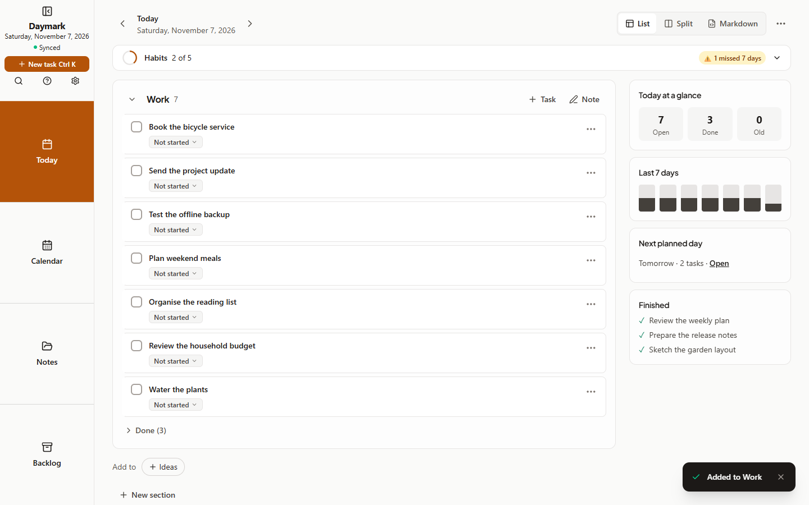

## Web
1. Open **Today**. This is your notebook for the day, grouped into sections.
2. Press **New task** (or Ctrl/⌘ K), type a title and save it.
3. Tick the checkbox when it is done. Unfinished tasks carry forward to tomorrow.
4. Open **Notes** in the side menu and choose **New note** for longer writing. Type `#project` anywhere to tag it.
5. Open **Settings → Backup & restore** and choose **Back up now**. Keep the file somewhere safe.

To use Daymark offline, install it from your browser's install menu. To use it on more devices, see Sync.
## Tablet
1. Open **Today** from the side menu.
2. Tap **New task**, type a title and save it.
3. Tick the checkbox when it is done. Unfinished tasks carry forward.
4. Open **Notes**, then **New note** to type, or **Note templates → Handwritten note** to write with a pen.
5. Open **Settings → Backup & restore** and choose **Back up now**.

## Phone
1. Open the **Today** tab.
2. Tap the plus button, type a title and save it.
3. Tick the checkbox when it is done. Unfinished tasks carry forward to tomorrow.
4. Tap **Notes** in the bottom bar and **New note**. Type `#project` to tag it.
5. Open **Settings → Backup & restore** and tap **Back up now**, then save the file outside the app.

