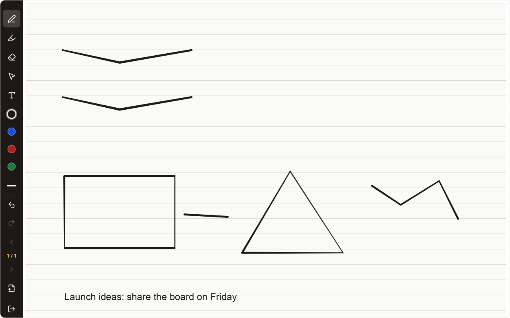

## Web
1. Open a note and choose **Full screen**, or press Ctrl/⌘ + . on the keyboard.
2. The title, folder row, Related, footer and navigation are hidden; the editor keeps its formatting bar.
3. Choose **Exit full screen** or press Escape to come back.

A handwritten note in full screen shows only the page and a side rail with every tool, colour, Undo, Redo, pages and Exit.
## Tablet
1. Open a note and tap **Full screen**.
2. On a handwritten note, the side rail holds every pen tool, colours, Undo, Redo and pages.
3. Choose **More writing options → Move rail to right** to put the rail on the other side. This device remembers it.
4. Tap **Exit** or use Android Back to leave.

## Phone
1. Open a note and tap **Full screen**.
2. Write without the title, Move to folder, Related or navigation in the way.
3. Tap **Exit full screen** or use Android Back to return.

Handwritten notes show the side rail with every tool in full screen too.
