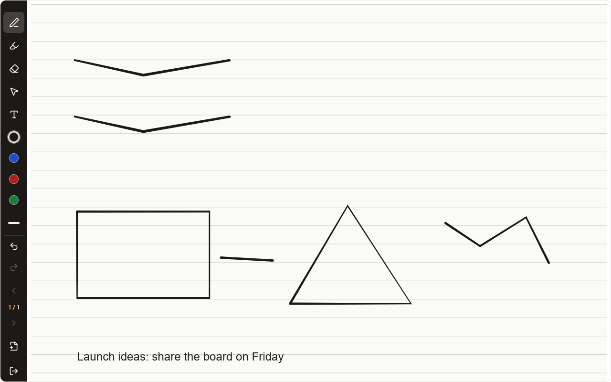

## Web
1. Open **Note templates** beside New note, choose **Handwritten note**, then lined, grid or blank paper.
2. Choose Pen, Highlighter or Eraser. Mouse drawing works on a device where no pen has been used; fingers scroll.
3. **Select:** draw a loop around ink or text boxes, drag inside to move, drag a corner to resize. The action bar recolours, copies, cuts, pastes, duplicates or deletes. Press S or click Select again to return to your pen.
4. **Text boxes work without a pen:** choose Text, click the page and type. The side grips set the width; the bar changes size and colour.
5. **Draw-and-hold:** draw a line, arrow or shape and keep still at the end to tidy it. Undo restores the freehand stroke.

With an S Pen, hold the S Pen button while writing to erase.
## Tablet
1. Choose **Note templates → Handwritten note**, then lined, grid or blank paper.
2. Write with the pen; pressure changes line width, and palms and fingers do not draw.
3. Hold the **S Pen button** while writing to erase; release it to get your pen back.
4. **Select:** draw a loop, drag to move, drag a corner to resize, and use the action bar. Tap Select again to return to your pen.
5. **Text boxes work without a pen:** choose Text and tap the page. **Draw-and-hold** tidies lines and shapes.

## Phone
1. Choose **Note templates → Handwritten note**, then lined, grid or blank paper.
2. Choose Pen, Highlighter or Eraser. Hold the S Pen button while writing to erase.
3. **Select:** draw a loop, drag to move, drag a corner to resize, then use the action bar.
4. **Text boxes work without a pen:** choose Text, tap the page and type.
5. **Draw-and-hold** a line or shape to tidy it.

Ink and text boxes sync and are in ZIP and JSON backups; Markdown export holds a placeholder.
