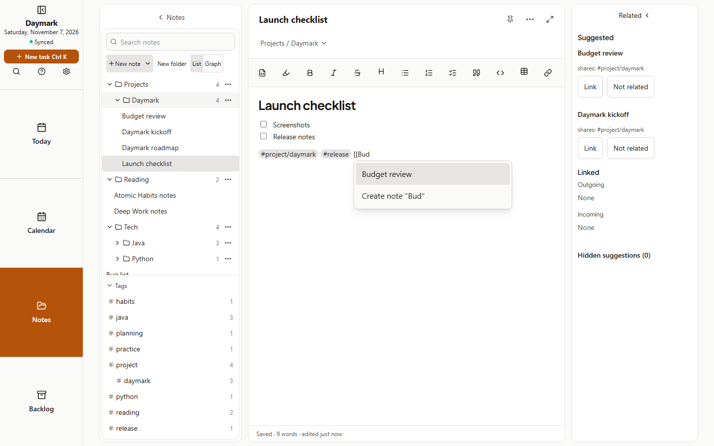

## Web
1. In a note, type `[[` and start typing another note's title.
2. Pick a note from the list, or choose to create a new note with that title.
3. Click the link to open the other note. Links also appear under **Linked** in the Related panel.

Links are saved as `[[Title]]` in the Markdown, so they survive export and sync. Renaming a note does not rewrite links to it. Graph draws links as solid lines.
## Phone
1. Type `[[` in a note and start typing a title.
2. Tap a suggestion, or create a new note with that title.
3. Tap the link to open the other note.

The Related button shows Linked notes, both outgoing and incoming. Handwritten notes cannot hold links, but typed notes can link to them.
