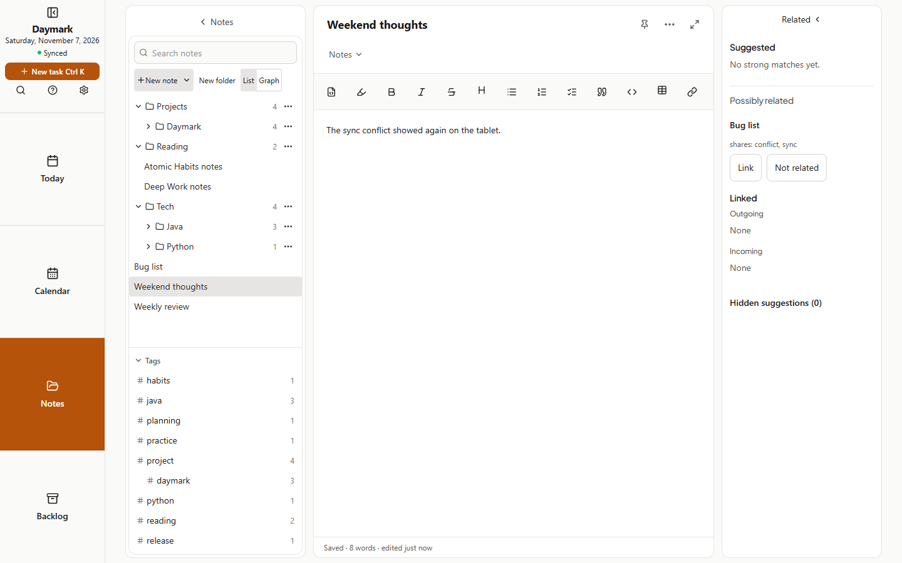
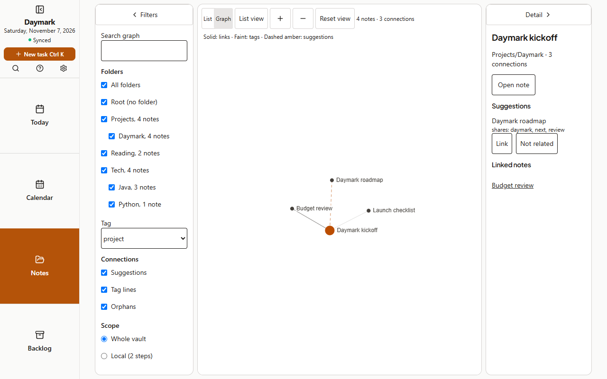

## Web
1. Open a note. The **Related panel** lists Suggested notes, each with what they share, such as `shares: sync, conflict, #daymark`.
2. Choose **Link** to add a link to the open note, or **Not related** to hide a suggestion.
3. Weaker matches appear below under **Possibly related**, only when there are few strong ones.
4. Bring a hidden suggestion back with **Restore** under **Hidden suggestions**.
5. Switch **List | Graph** to Graph to see every note: solid lines are links, faint lines are shared tags, dashed amber lines are suggestions.

Graph filters by folder and tag, and List view shows every connection as buttons.
## Tablet
1. Open a note and the **Related panel** beside it. Each suggestion shows what the notes share.
2. Tap **Link** or **Not related**. Possibly related lists weaker matches.
3. Switch to **Graph** to explore; pinch to zoom and tap a note to select it.

## Phone
1. Open a note and tap the **Related button**.
2. Each suggestion shows what the notes share. Tap **Link** or **Not related**.
3. **Possibly related** lists weaker matches; **Hidden suggestions** lets you restore one.

Graph needs a tablet or a wider screen. When a handwritten note is open, suggestions offer Open and Not related, but no Link.
