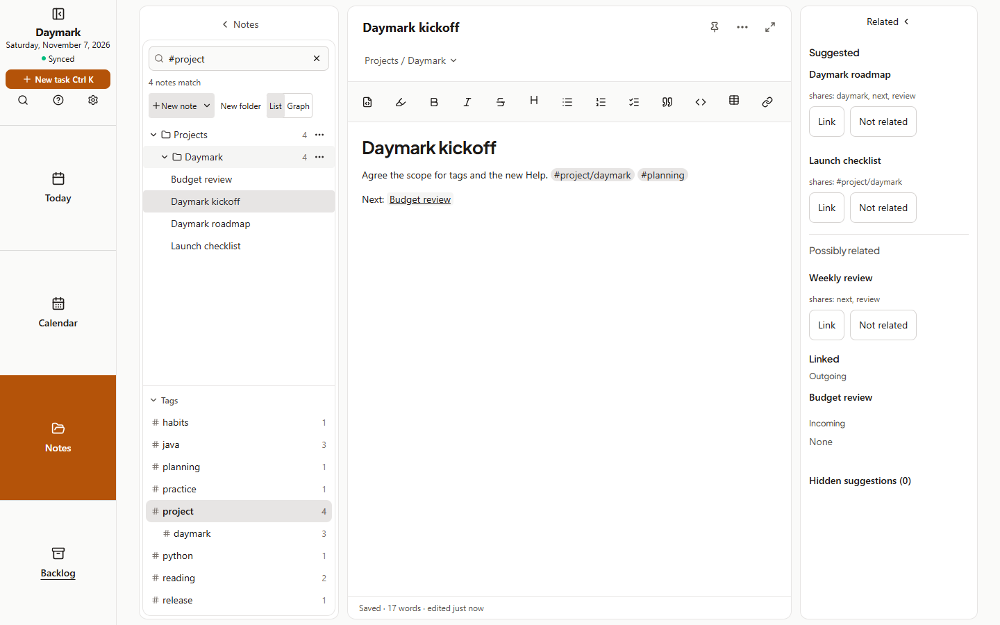

## Web
1. In any note, type `#` and a word, for example `#project`. Nested tags use a slash: `#project/daymark`.
2. The tag appears as a chip in the editor. Click it to show every note with that tag.
3. In Notes, open the **Tags section** under the folder tree. Each tag shows how many notes use it, and nested tags are indented.
4. Choose a tag to filter the list. Choose it again, or clear the search, to see everything.

Tags live in the note text, so they sync and export with it. `#` in code, links and headings is not a tag. Searching `#project` also finds `#project/daymark`. Notes sharing a tag show up in Related and as faint lines in Graph.
## Tablet
1. Type `#project` in a note, or write it in a **text box** on a handwritten note.
2. For tags without a text box, open a handwritten note's **More note actions → Tags…**.
3. Open the **Tags section** under the folder tree and tap a tag to filter. Nested tags such as `#project/daymark` are indented.

## Phone
1. Type `#` and a word in a note, such as `#project` or `#project/daymark`.
2. Tap the tag chip to show every note with that tag.
3. On the Notes list, scroll to the **Tags section** and tap a tag to filter. Tap it again to clear.

Tags sync with the note text. Notes sharing a tag also appear under Related.
