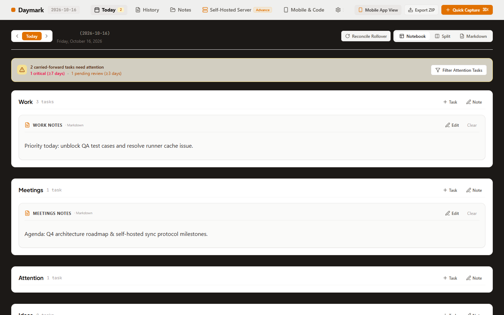
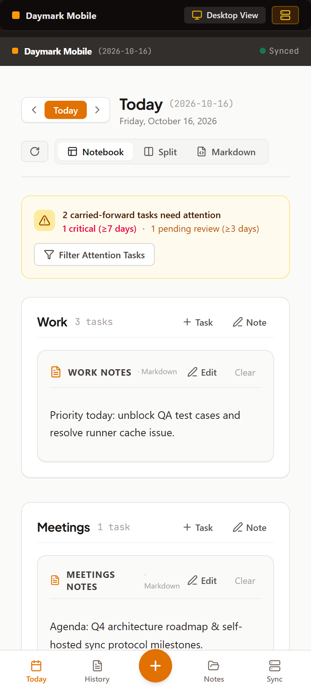

# Cycle 0: Repo structure and ai-configs validation

Date: 2026-10-20 · Branch: `cycle-0-repo-and-ai-configs`

## What shipped
- `npm install` / `npm ci` work without `--legacy-peer-deps` (removed conflicting `esbuild`, plus unused `@google/genai`, `autoprefixer`, and stub `@types/jszip`/`@types/marked`). Switched from `bun.lock` to a single `package-lock.json`.
- Package renamed to `daymark`; `.env.example` and `metadata.json` no longer reference AI Studio/Gemini.
- Vitest added (`npm test`) with first tests: rollover carry-forward and idempotency, date math, markdown metadata round-trip.
- GitHub Actions CI: install, lint, test, build, validate:ai.
- `validate:ai` extended from structure-only to fitness checks: referenced npm scripts exist, all three root adapters state the core invariants, links in `docs/` and `README.md` resolve, each release doc has a README and screenshots.
- That evaluation found real drift, now fixed: `AGENTS.md` and `GEMINI.md` lacked invariant file paths, and skills/workflows told agents to edit stub docs under `docs/`. Stubs deleted; references point at `.ai-configs/project/`.
- Release-doc convention: `scripts/capture-screenshots.mjs`, template `.ai-configs/templates/release-doc.md`, and a new section in the release-handoff workflow.

## Screenshots
Captured with `node scripts/capture-screenshots.mjs cycle-0` (no UI change this cycle; these are the baseline for later cycles).

| Screen | Image |
| :--- | :--- |
| Desktop 1440x900 |  |
| Android 412x915 |  |

Baseline observations for Cycle 1: both show the demo date `2026-10-16` instead of today's date, and the Android shot shows a duplicated "Daymark Mobile" header.

## How it was verified
See the completion report in the session; commands: `npm ci`, `npm run lint`, `npm test`, `npm run build`, `npm run validate:ai`.

## Known gaps
- `npm audit` was not reviewed.
- CI workflow has not run on GitHub yet (not pushed).
- Test coverage is a starter set; full engine coverage is Cycle 1.
- Workflow dry-runs were done through this cycle's own work, not as separate trial runs.

## Usage vs. estimate
| | Estimated | Actual |
| :--- | :--- | :--- |
| Claude sessions | 1 | 1 |
| Tokens (approx.) | 0.8-1.5M | not measured here; check `/usage` |
| Pro 5-hour windows | 0.3-0.5 | not measured here |

## Next cycle
[Cycle 1: Android-ready local app](../../ROADMAP.md#cycle-1-android-ready-local-app-pwa-single-device)
