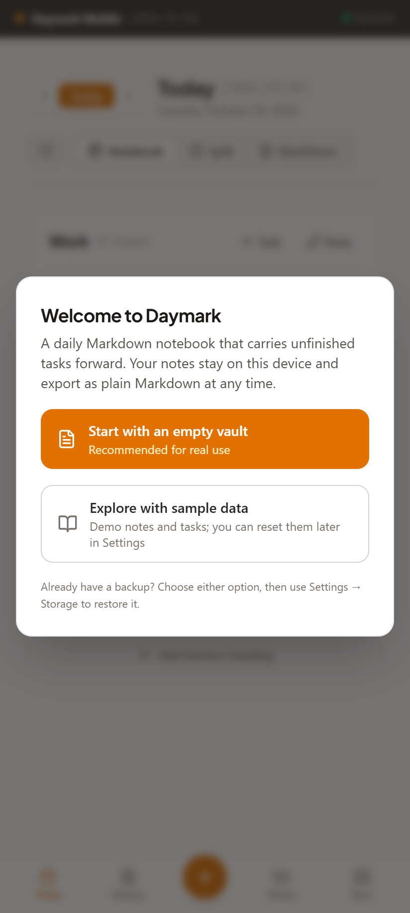
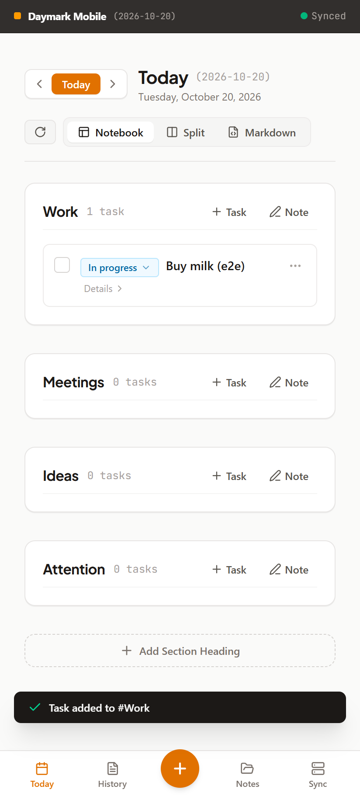
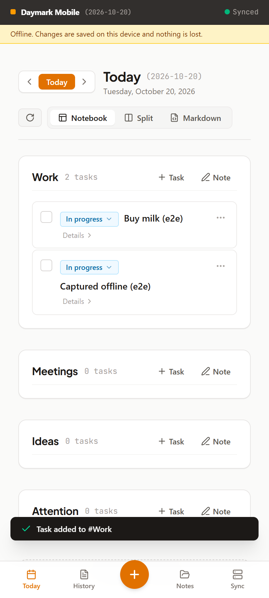
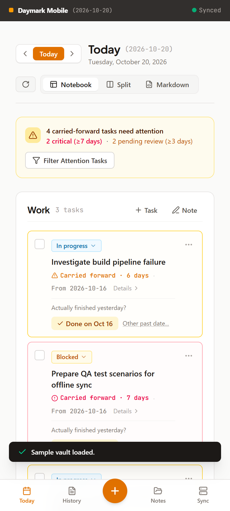
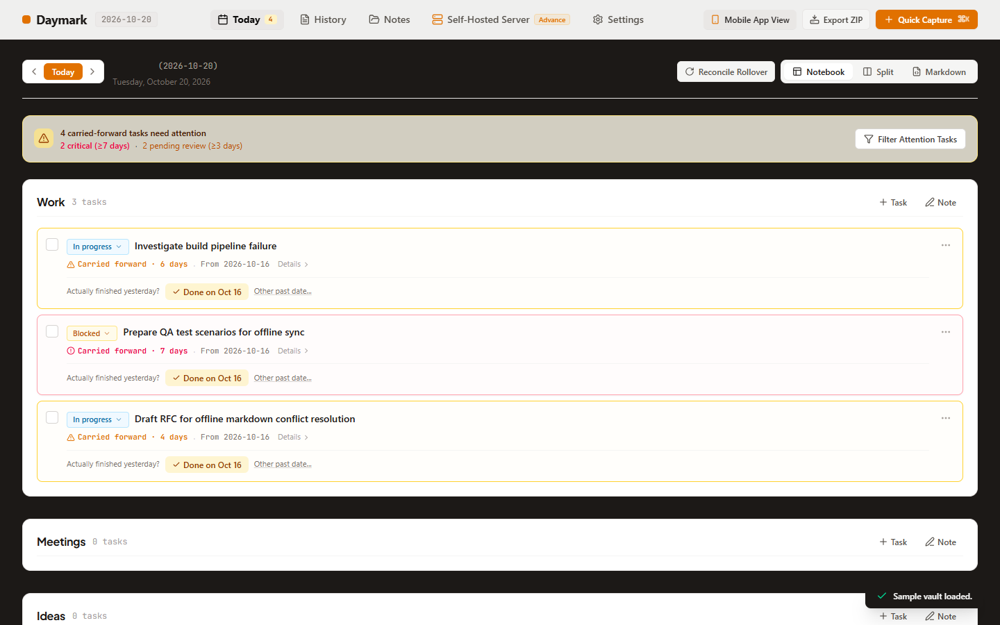

# Cycle 1: Android-ready local app (PWA, single device)

Date: 2026-10-20 · Branch: `cycle-1-android-ready-local-app` (from `cycle-0-repo-and-ai-configs`)

An Android user can install Daymark from Chrome and use it daily and offline, with the real date and durable data. No server needed.

## What shipped
**Real date and automatic rollover**
- "Today" is the real local date. It refreshes at midnight and when the app regains focus (phones throttle timers while asleep). `simulatedToday` is now an empty-by-default developer override; the old demo date in saved settings is ignored.
- Unfinished tasks are carried into the new day automatically, and also after loading sample data or importing a backup.

**Bugs found by the new tests and e2e run, now fixed**
1. The default Notebook view never rendered the task list (tasks only showed in Split view).
2. Rollover resurrected tasks completed via historical correction.
3. Rollover carried a stale older copy of a task instead of its newest version (lost status edits and wrong `carriedFromDate`).
4. The Markdown parser dropped section notes that follow tasks, and turned indented checklist items into new top-level tasks.
5. Empty custom headings and Windows (CRLF) line endings were not handled by the parser.
6. Day-difference math used `floor` and could be off by one across DST changes (now `round`).
7. Service worker registration was skipped because the page had already loaded by the time the vault finished initialising.

**Durable storage**
- Vault moved from `localStorage` to IndexedDB (hydrated before first render), one-time migration of existing data, persistent-storage request, and save failures shown as a message instead of silent loss.
- First run starts with an empty vault and a welcome dialog (empty or sample data). The fake sample sync log is gone.
- Import: Settings accepts a vault ZIP or JSON backup. ZIP exports now include a full-fidelity `vault.json` (export, wipe, import restores identical data), and ZIPs of plain Markdown (e.g. Obsidian) import too. Importing asks for confirmation before replacing a non-empty vault. Notes with identical titles no longer overwrite each other in exports.

**Android PWA**
- Offline app shell via `public/sw.js` (production builds), real PNG icons (192, 512, maskable), valid manifest with working shortcuts (`?action=capture`, `?tab=notes`).
- Install button (Chrome `beforeinstallprompt`), offline banner, safe-area padding, toast moved above the bottom nav, duplicate header removed on phones, viewport no longer blocks pinch-zoom.
- "Mobile & Code" developer tab hidden unless `?dev` or `localStorage.daymark_dev=1`.

## Screenshots
Android 412x915 and desktop 1440x900. The sample vault is dated Oct 14-16, so on 2026-10-20 its tasks arrive as carried-forward with aging alerts.

| Screen | Image |
| :--- | :--- |
| Android: first-run welcome |  |
| Android: task captured |  |
| Android: offline banner and offline capture |  |
| Android: sample vault with carry-forward |  |
| Desktop: sample vault with carry-forward |  |

## How it was verified
- `npm run lint`, `npm test` (26 tests), `npm run build`, `npm run validate:ai`: pass.
- `npm run test:e2e`: 15 checks pass against the production build in emulated Android Chrome: manifest and icons, first-run welcome, real date, capture, persistence across reload, service worker control, offline reload, offline capture surviving an offline reload, `?action=capture` shortcut.

## Known gaps
- Not verified on a physical Android device or the Chrome install flow itself (the install prompt and installed-app launch were not exercised); only emulated Chrome.
- iOS Safari not tested.
- Data is on one device only; sync is Cycle 3. Deleting site data deletes the vault, so export backups regularly.
- Desktop layout: the "Today" heading and date label are dark text on the dark page background (hard to read). Planned for Cycle 4 desktop polish.
- Wording: the carry-forward card says "Actually finished yesterday?" even when the task came from several days ago.
- Fonts load from Google Fonts; they are cached after the first online visit but a first visit offline falls back to system fonts.
- The e2e script is not yet part of CI.

## Usage vs. estimate
| | Estimated | Actual |
| :--- | :--- | :--- |
| Claude sessions | 2-3 | 1 (this session also covered Cycle 0) |
| Tokens (approx.) | 4-7M | not measured here; check `/usage` |
| Pro 5-hour windows | 1.5-2 | not measured here |

## Next cycle
[Cycle 2: Android native shell and home-screen widget](../../ROADMAP.md#cycle-2-android-native-shell-and-home-screen-widget)
