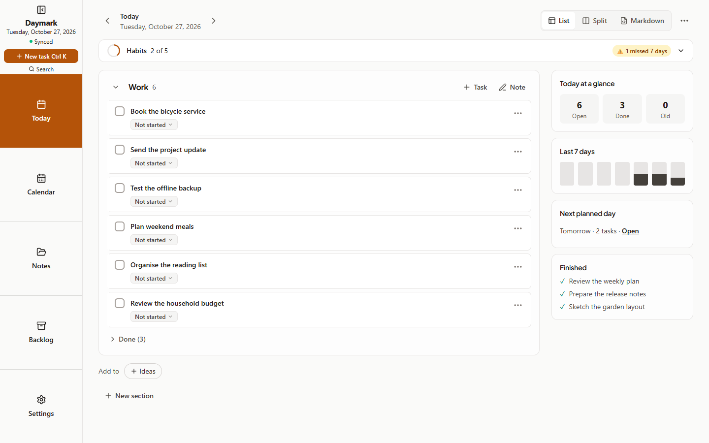
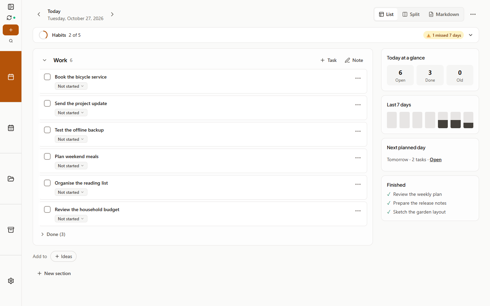
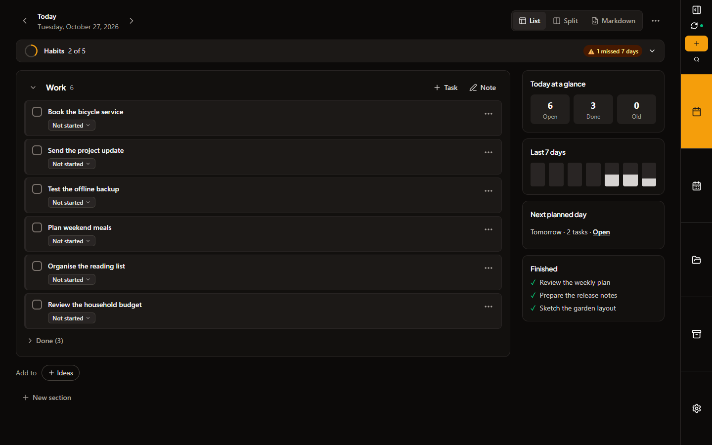

# Cycle 10.1: Minimize the desktop menu

Date: 2026-10-27 · Branch: `cycle-10-backlog-side-menu-guides` · Tag: none

## What changed

Use **Minimize menu** at the top of the desktop rail to switch from 168px to 64px and return 104px to your content. Use **Expand menu** to restore the full menu. Navigation, capture, search and sync remain available as named icons with hover/focus labels. The choice is remembered on this device, separately from synced Appearance settings. Left/right placement and Notes focus mode preserve it; phones retain their bottom navigation.

## Screenshots

Captured with `node scripts/capture-screenshots.mjs cycle-10-1` using disposable sample vaults at 1440×900. All three images were visually inspected.

| View | Screenshot |
| :--- | :--- |
| Expanded menu |  |
| Minimized, left |  |
| Minimized, right, dark |  |

## Verification

- Targeted tests: 42 passed, including safe storage failures, persistence, Notes focus restoration and visible-text accessible names.
- Full Vitest: 98 files, 1,104 passed; one existing platform-specific skip.
- TypeScript: exit 0.
- Helpers: 23/23. Offline PWA: 16/16.
- Full QA: 466/466, including 264 compact-menu matrix checks and two badge/shortcut accessible-name axe checks.
- UX: 92 checks passed in the final full run; NAV-06 hit a startup sync-wait timeout while a native rebuild was finishing, then passed with `node scripts/ux-suite.mjs --only=NAV-06` (including the console check). All 93 functional checks are verified across those runs. The [full report](../../reports/ux-ui/results.json) retains the timeout; [separate retry evidence](../../reports/ux-ui/cycle-10-1-rerun.json) records the pass.
- Raw UX scans: 48 light/dark screens and 56 responsive checks; zero scan errors, page overflow or console errors. The menu's new accessible-name findings are resolved; only the previously documented calendar, activity-log and landmark findings remain.
- Production Vite build and `npm run android:build -- --test`: exit 0; debug APK built, 44 Kotlin tests with zero failures/skips. Existing build-size/Vite/Gradle advisories remain.
- `npm run build:site`: exit 0 with the updated guide. `npm run validate:ai`: 69/69, including the three captured hotfix images.

## Decisions and limitations

- The compact width uses physical pixels so S/M/L text sizes reclaim the same space. An initial rem-based width failed the Small/Large browser regression and was corrected.
- Labels are portalled outside the short-height top scroller so keyboard tooltips are not clipped. Escape dismisses a focused icon's label without moving focus. Deferred minor: a label opened only by hover while focus is elsewhere remains until the pointer moves away.
- Device-local storage failure keeps the choice in memory; a reload then returns to expanded. Sign-out clears the preference with other Daymark local keys.
- No task, Markdown, sync schema or dependency change. No version bump, push, deployment or release is included.
- Physical Android interaction is not part of this desktop-only change; the shared bundle and Kotlin tests are checked for the handoff.
- Cycle 10's existing calendar accessible-name, activity-log keyboard-scroll and portal/editor landmark findings remain follow-ups; see the [cycle 10 handoff](../cycle-10/README.md).
- Independent review found no blocking code issues; the hover-only Escape behavior above was the remaining minor finding. Final accessibility-name correction is verified by the executor's RED/GREEN tests and browser axe coverage.

## Execution rulings

- The approved follow-up overrides Cycle 10's earlier exclusion of an icon-only menu; the rest of that cycle's constraints stand. The added scope is limited to desktop presentation.
- Work stays on the existing feature branch. PowerShell ledger operations replace the skill's Bash-only bookkeeping scripts, preserving task boundaries and test evidence; this trades automated bookkeeping for explicit records.
- Title scrolling follows whether its actual contents fit, including the new toggle. A 900px window can still need a small local scroll at larger text sizes. Visibility and keyboard hit-testing remain required; content area scrolling and the six-part layout are unchanged.
- Verification logs and the independent review are retained in the ignored hotfix workspace for audit. No sibling continuation artifacts were removed.
- The isolated UX startup timeout was rerun after the scan runner exited, rather than repeating the other passing checks. Its original failure is retained alongside the successful retry; this verifies the case without claiming a load/stress guarantee.

## Usage

Exact processed-token totals and earlier Claude usage are unavailable; no estimate is represented as measured usage.
