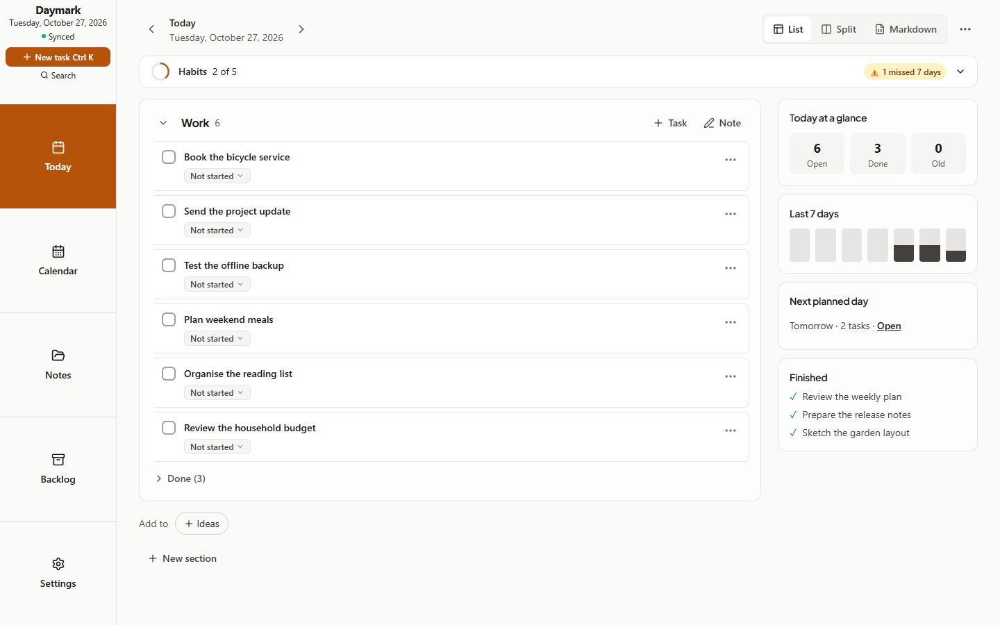
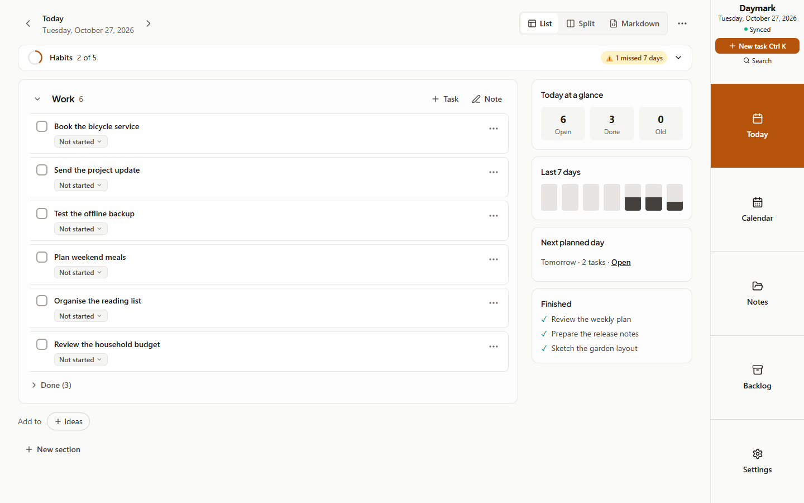
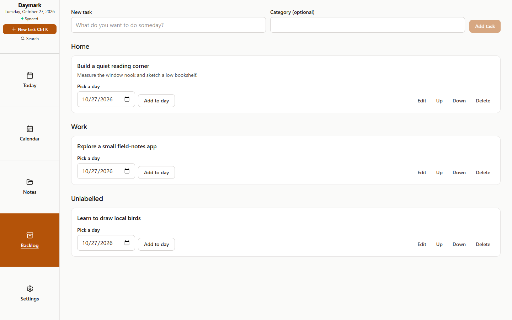
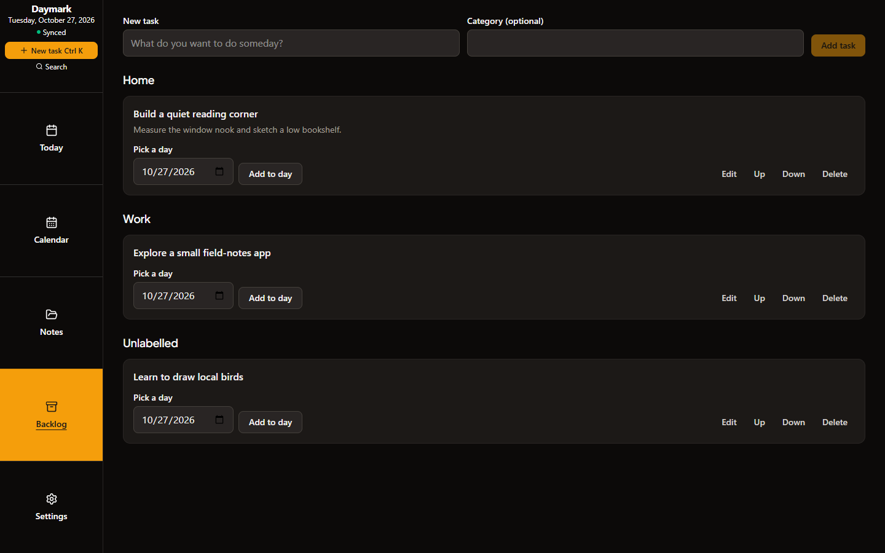
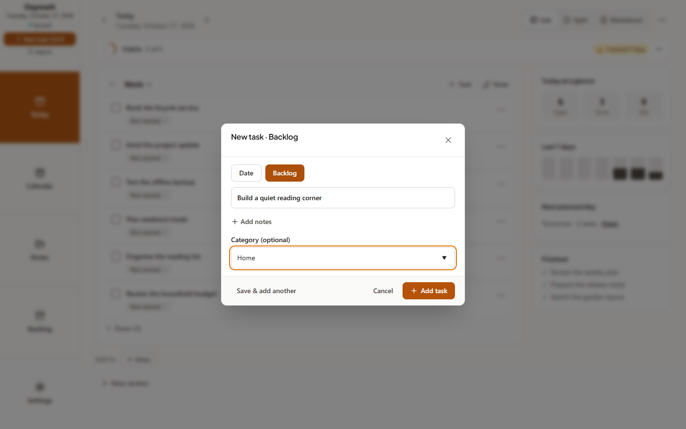
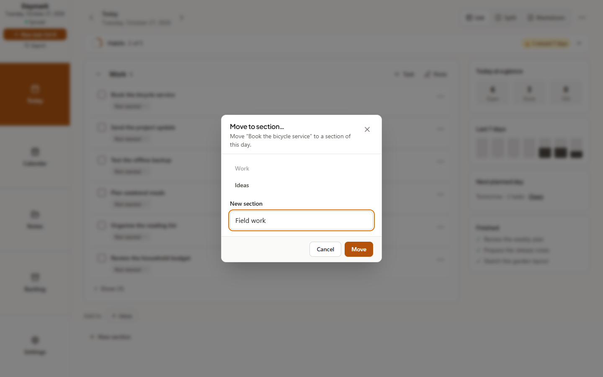
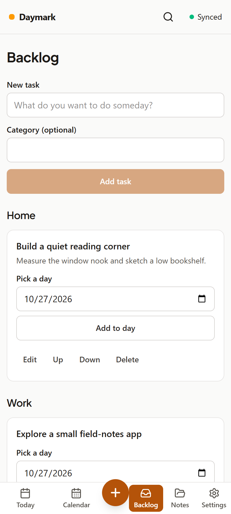
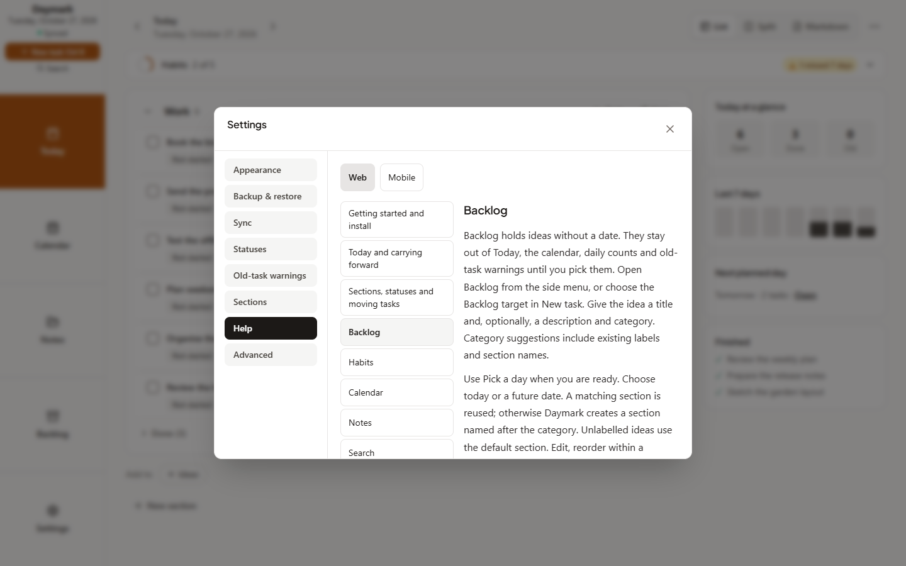
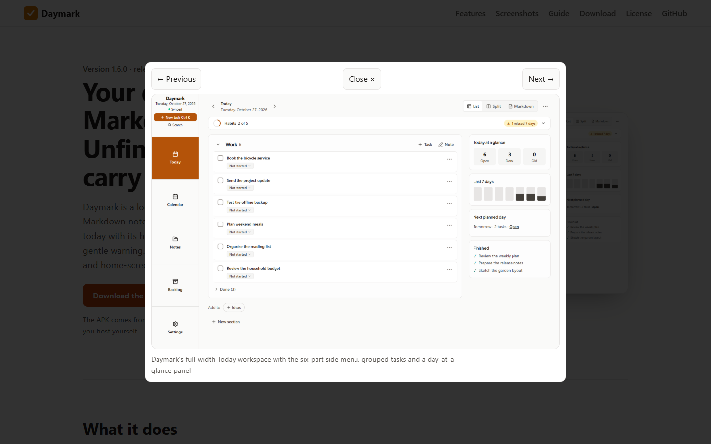

# Cycle 10: Backlog, side menu and guides

Date: 2026-10-27 · Branch: `cycle-10-backlog-side-menu-guides` · Tag: none

This is an implementation and QA handoff for the next minor release. No release, version bump, push or deployment is included.

## Implemented

- Undated Backlog ideas with category labels, capture, editing, manual ordering, delete/Undo and picking into today or a future day. Ideas stay outside daily counts and warnings until picked. Open daily tasks can return to Backlog.
- Desktop six-part side menu, configurable Left/Right in Appearance, with sync, capture and search controls. Notes focus mode hides it; desktop content retains its full-width layout.
- Move to section for open and completed tasks, including a new section, with history and guarded Undo.
- Phone Backlog tab, six navigation slots and a centered capture button. Compact controls remain at least 44 physical pixels, including Small text; long category names wrap.
- Screenshot lightbox with keyboard/swipe navigation and no-JavaScript image links.
- Thirteen shared Markdown guide topics, each with Web and Mobile instructions, bundled offline in Settings → Help and rendered into the website Guide.

## Screenshots

Captured from disposable sample vaults with `node scripts/capture-screenshots.mjs cycle-10`. Desktop is 1440×900; the phone viewport is 412×915 at device scale 2. No personal vault was used.

| Screen | Image |
| :--- | :--- |
| Desktop rail, left |  |
| Desktop rail, right |  |
| Backlog |  |
| Backlog, dark |  |
| Capture to Backlog |  |
| Move to section |  |
| Phone Backlog |  |
| Help |  |
| Website lightbox |  |

## Verification

Verification covers the implementation branch; releasing 1.7.0 remains a separate request.

| Check | Observed result |
| :--- | :--- |
| TypeScript / `npm run lint` | Exit 0 |
| Vitest | 97 files; 1,098 passed, one existing Windows POSIX-permission skip |
| `npm run test:helpers` | 23 passed |
| `npm run build` | Exit 0; existing large-chunk advisory |
| `npm run build:site` | Exit 0; GitHub version lookup succeeded on the approved network retry |
| Rail browser checks | 36/36, including short-height keyboard navigation and light/dark × S/M/L accessibility |
| Phone Backlog browser checks | 20/20, including internal overflow, 200-character categories, centered capture and 44px controls |
| `npm run android:build -- --test` | BUILD SUCCESSFUL; 44 Kotlin tests, zero failures/skips; debug APK built |
| `npm run test:qa` | 200/200 checks passed, including restored Undo after reload and preserved parked history |
| `node scripts/ux-suite.mjs` | 92/92 checks; 48 light/dark screen scans and 56 responsive checks; zero scan errors, page overflow or console errors |
| `npm run test:sync` | 20/20 two-device checks passed, including restart and concurrent picks |
| `npm run test:e2e` | 16/16 PWA checks passed, including offline reload/capture/ZIP export and manifest shortcut |
| `npm run validate:ai` | 68/68 checks passed, including the cycle 10 documentation and nine image links |

The guide's measured JavaScript increase was 7,629 bytes gzip, below the 100KB budget. The Android build does not add a native backlog store or widget.

The first concurrent PWA run reached its shortcut assertion before the dialog appeared; an isolated rerun passed. The final run also passed after adding an explicit, bounded wait for the expected dialog. The initial sandboxed site lookup could not reach GitHub; its approved network retry succeeded.

## Implementation decisions

- Concurrent picks onto different days retain both same-id daily copies; repeated local picks are no-ops. This follows carried-task identity and avoids destructive cross-document deduplication.
- Park/pick histories survive competing backlog edits. Stale offline daily copies are closed without removing tasks, documents, fields or journal notes. Genuine later picks and carries remain open; visual daily and Week lists omit parked history.
- Snapshot Undo refuses after intervening edits instead of overwriting newer data. Its refusal message stays visible.
- Undo of a move to Backlog records a cancellation of that specific park operation in both histories. Sync preserves the restored task, including after a lost park response; an older cancellation cannot override a later ordinary deletion.
- The 168px rail leaves 632px at an 800px viewport; the plan's simultaneous 640px minimum was mathematically impossible. Short windows scroll only the rail's Title part.
- Weighted phone tab widths preserve the specified order and exact plus-button centering. Equal-width six-slot placement would shift the third slot left of center.
- The guide implements the thirteen explicitly named topics; the plan's isolated reference to fourteen was a counting error. One pure parser serves Vite raw imports and the site build; site prose is escaped before rendering.

## Known gaps

- Raw axe scans retain `label-content-name-mismatch` on calendar date cells and `scrollable-region-focusable` on the server activity log (serious), plus `region` landmark warnings around menus and the note editor (moderate). These appear across 14 screen/theme scans; the calendar naming and activity-log code predate this cycle. The 92 passing functional checks do not mean zero accessibility findings. See `docs/reports/ux-ui/scans.json` for selectors and counts.
- Physical-device pinch zoom and native Android UI interaction were not exercised; browser touch checks, offline PWA checks and Kotlin unit tests cover the automated portions.
- Crossing the 768px device-layout threshold by resizing requires reloading, an existing initial-layout behavior.
- Older 1.6.0 clients cannot display backlog-specific closure metadata and may drop it when rewriting Markdown. A raced offline copy retained for its edited text can appear as Done history on those clients. Update the server and clients together for the full experience.
- Deferred export presentation details: a literal Unsorted category can duplicate that heading, an empty backlog creates an empty Backlog.md, and a newline inside an imported title splits a checklist line. JSON restoration data remains intact.
- Recovered backlog reconciliation can remain memory-only until recovery or a real edit releases the persistence guard. The existing lifecycle/task-actions circular import remains a maintenance follow-up.
- Existing build size warnings remain. Backlog intentionally has no native widget.

## Usage versus estimate

Claude began the cycle and Codex continued from its ledger. Exact Claude sessions, processed tokens and Pro usage windows are unavailable in this continuation runtime; no estimate is reported as measured usage.

## Next step

Review the completed handoff, then request release 1.7.0 separately.
