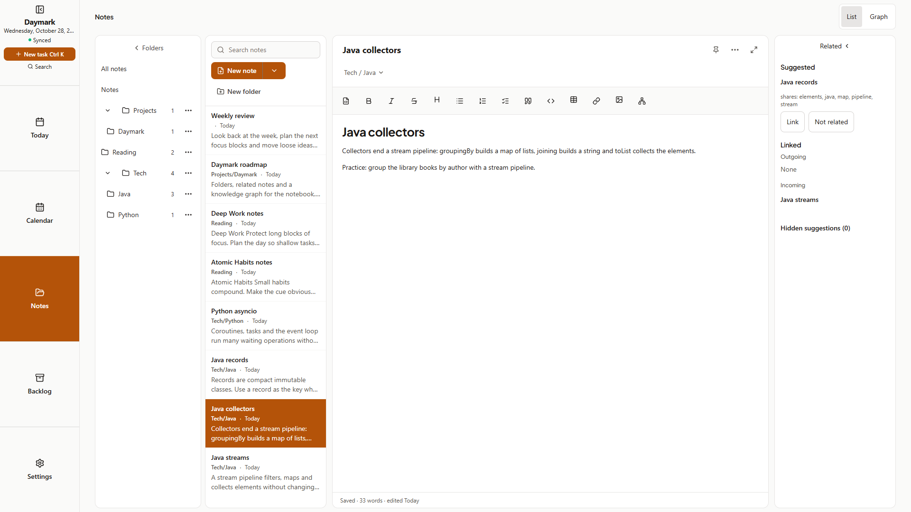
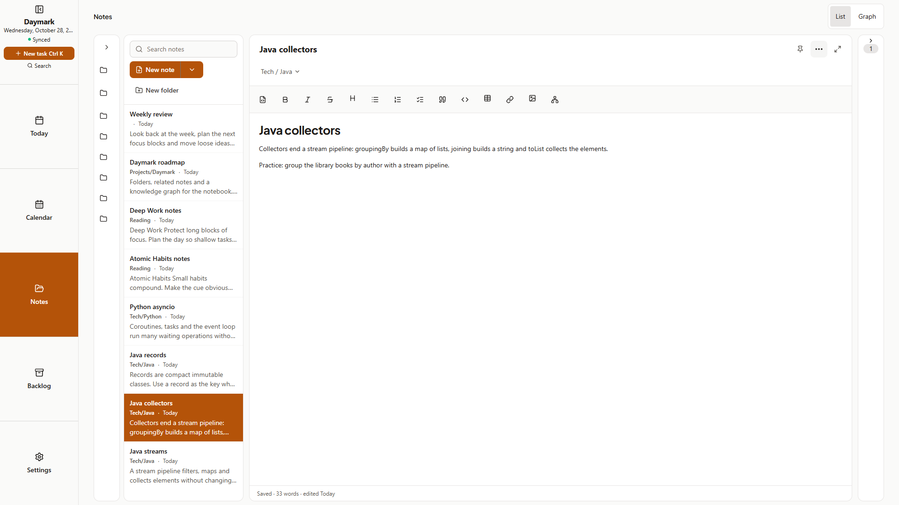
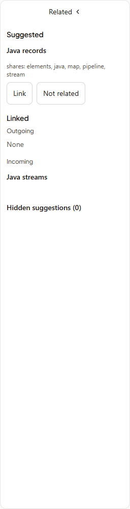
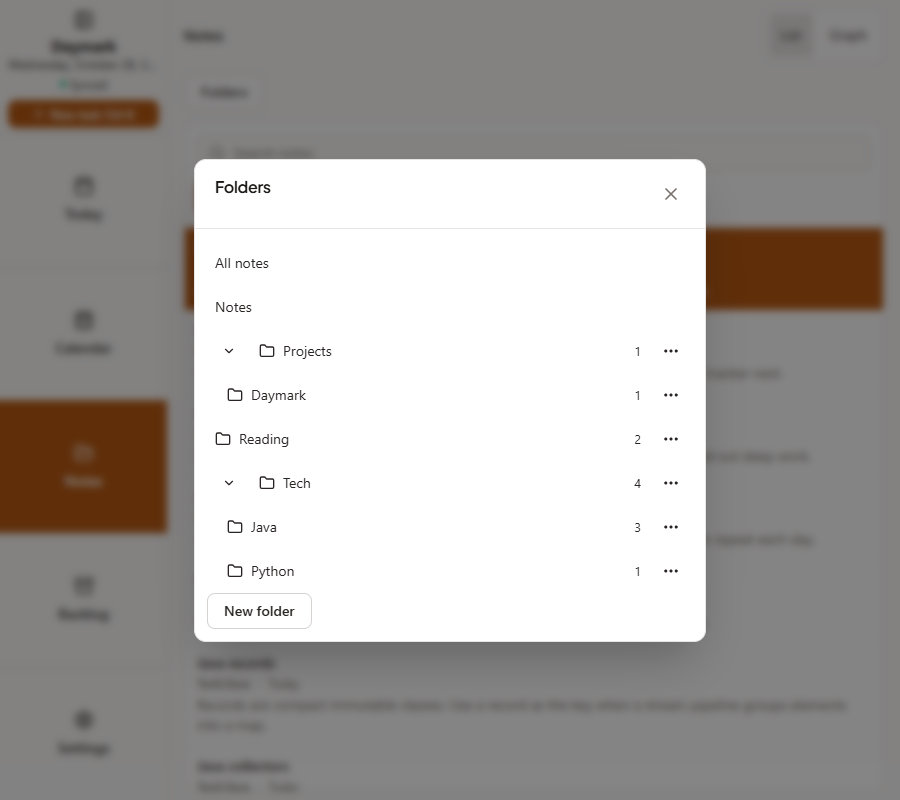
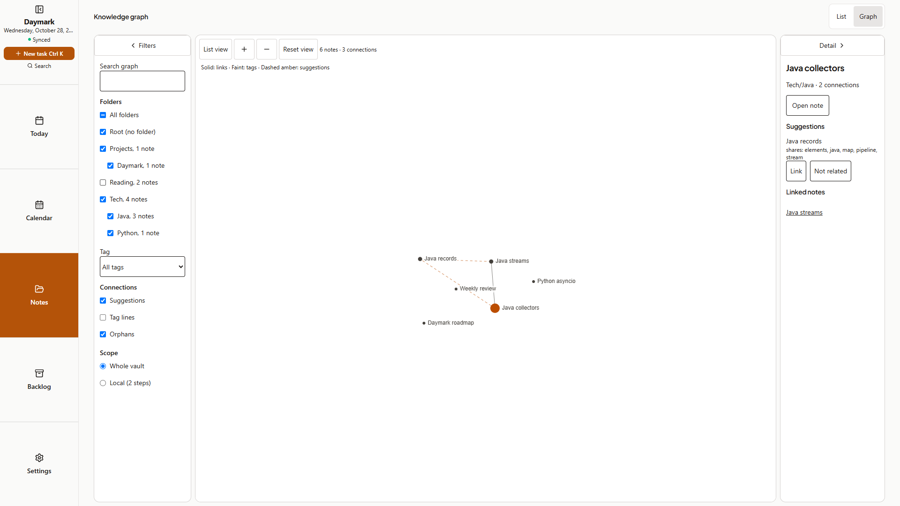
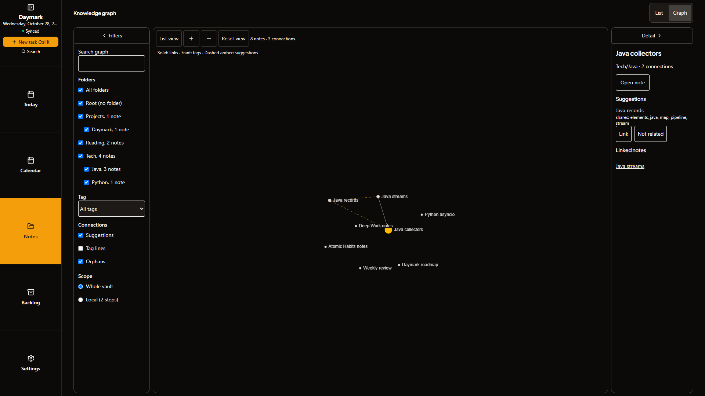
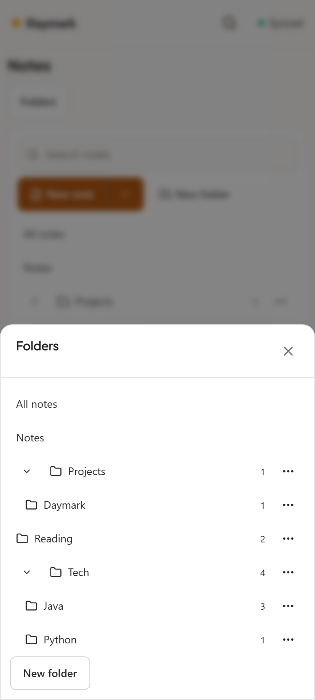
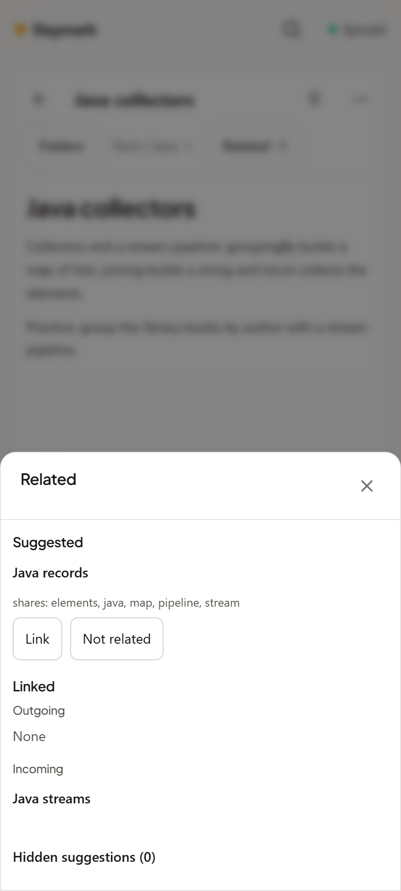

# Cycle 11: Note folders, Related notes and the knowledge graph

Date: 2026-10-28 · Branch: `cycle-11-note-folders-and-graph` · Tag: none

This is an implementation and QA handoff for the next minor release. No release, version bump, push or deployment is included.

## Implemented

- Nested note folders (`Tech/Java`): a folder tree with note counts, empty folders, New folder / New folder inside / Rename folder / Move folder / Delete folder (notes move up to the parent and are never deleted, with Undo), drag and drop of notes and folders on desktop, and Move to folder on phones. Existing flat folders are simply top-level folders. The ZIP export writes folders as real directories under `Daymark/Notes/`.
- Synced folder list and dismissals: a `notemeta` sync entity (empty folders and the pairs marked Not related) behind a `notemeta` feature flag, so older clients keep working and show `Tech/Java` as one flat folder name without losing a note.
- Related panel: an on-device relatedness engine suggests notes that share distinctive words with the open note. Link writes a safe `[[wiki link]]`, Not related hides the pair, Hidden suggestions restores it. Linked notes show outgoing and incoming. The panel minimizes to a counted strip, becomes an overlay when space is tight and a sheet on phones.
- Knowledge graph (List | Graph at the top of Notes, tablet and desktop): links, dashed suggestions and optional tag lines; folder filter with checkboxes (including Root (no folder)), tag, Suggestions / Tag lines / Orphans, search highlighting, Whole vault or Local, pan and zoom, a detail pane and a paged, keyboard-friendly List view with the same Link / Not related actions. Suggestions are scored progressively so large vaults stay responsive.
- Pane preferences are remembered per device: folder tree, Related, graph filters and graph detail can each be minimized.
- Guide: the Notes topic (Web and Mobile) covers folders, Related, the graph and minimizing panes; Shortcuts and gestures, Sync and the server, and Backups mention folders, the keyboard paths and the directory export.

Task 8 follow-ups: the four UX-suite selectors broken by the folder UI were updated; accessible names on the new UI now contain their visible text; the graph keeps its previous suggestion edges until the first new publish; paging the graph list keeps keyboard focus and announces through an always-mounted polite status.

## Screenshots

Captured from a disposable sample vault with `node scripts/capture-screenshots.mjs cycle-11`. Desktop shots are 1920×1080, the narrow shot 900×800 and the phone viewport 412×915 at device scale 2. No personal vault was used.

| Screen | Image |
| :--- | :--- |
| Folder tree, notes list, editor and Related panel side by side |  |
| Folder tree and Related minimized (icons and a count) |  |
| Related panel (Suggested, Linked, Hidden suggestions) |  |
| Narrow window: the Folders drawer |  |
| Knowledge graph with Reading unchecked in the folder filter |  |
| Knowledge graph, dark |  |
| Phone Folders sheet |  |
| Phone Related sheet |  |

## Verification

Verification covers the implementation branch; releasing remains a separate request.

| Check | Observed result |
| :--- | :--- |
| TypeScript / `npm run lint` | Exit 0 |
| Vitest (`--maxWorkers=2`) | 118 files; 1,372 passed, 1 existing Windows POSIX-permission skip |
| `npm run test:helpers` | 23 passed |
| `npm run build` | Exit 0; existing large-chunk advisory |
| `npm run build:site` | Exit 0 |
| `npm run validate:ai` | 70/70 checks passed, including the cycle 11 documentation and image links |
| `npm run android:build -- --test` | BUILD SUCCESSFUL; 44 Kotlin tests, zero failures or skips; debug APK built |
| `npm run test:qa` | 595/595 checks passed, including 129 cycle 11 checks (ZIP directories, Help text, keyboard-only paths, axe on tree, Related and graph in light and dark) |
| `node scripts/ux-suite.mjs` | 93/93 test cases; 48 light/dark screen scans and 56 responsive checks; zero console errors |
| `npm run test:sync` | 28/28 two-device checks passed, including concurrent folder renames |
| `npm run test:e2e` | 16/16 PWA checks passed |

One earlier full UX run reported a 20-second timeout in NAV-06 (Rail Today returns to Today) while a leftover server from an interrupted attempt still held the port; the test passed in isolation and the full rerun passed 93/93.

## Implementation decisions

- Folder row names start with the visible name and count (`Java, 2 notes, in Tech`) so accessible names contain their visible text; the full path is the row's tooltip.
- Chevron and plus/minus glyphs on the new pane toggles and graph toolbar are icons, so the buttons' accessible names ("Minimize folders", "Zoom in") contain their visible words.
- The graph shows the previous suggestion edges while rescoring; they are filtered against the current notes and dismissals, so nothing stale or dismissed is drawn.
- Guide parts are limited to 250 words each by the guide test, so folders, Related and the graph are summarised inside the existing Notes topic rather than a fourteenth topic.

## Known gaps

- Raw axe scans in the UX suite still report `label-content-name-mismatch` on calendar date cells, `scrollable-region-focusable` on the server activity log and `region` landmark warnings around menus and the note editor. They appear in the same screens as before this cycle; none are on the folder tree, Related panel or graph, which are covered by the cycle 11 QA axe checks.
- The graph is for tablet and desktop widths; phones use the folder list and Related sheet.
- Physical-device interaction was not exercised; browser touch checks, offline PWA checks and Kotlin unit tests cover the automated portions.
- Older clients show nested folders as one flat name, and do not receive Not related choices.

## Next step

Review the completed handoff, then request the release separately.
