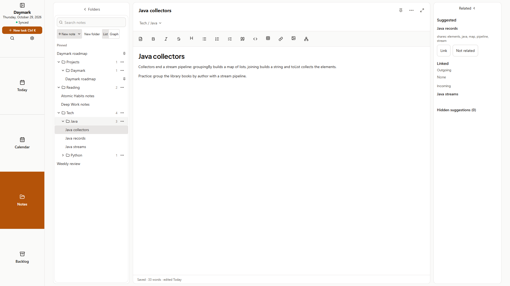
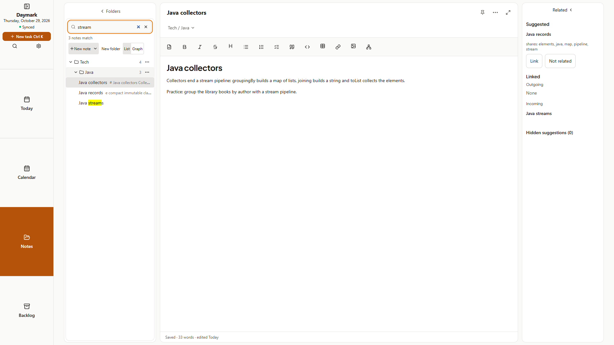
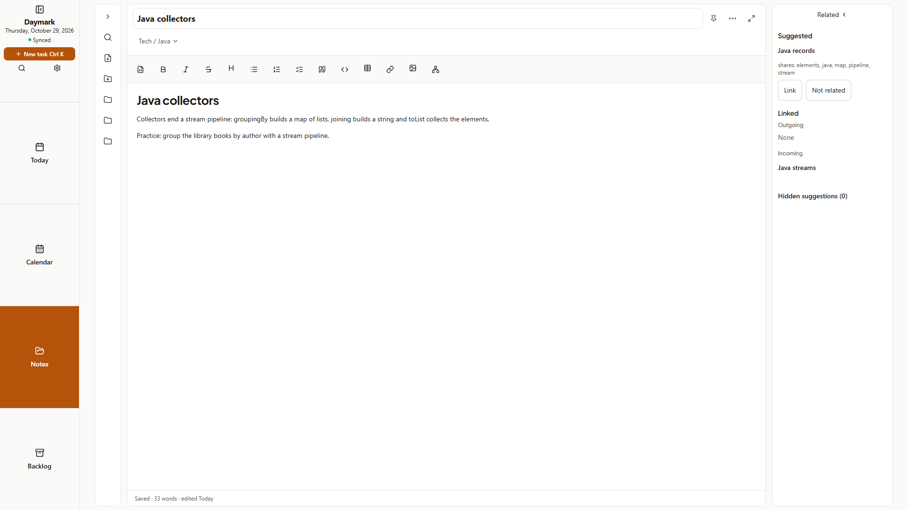
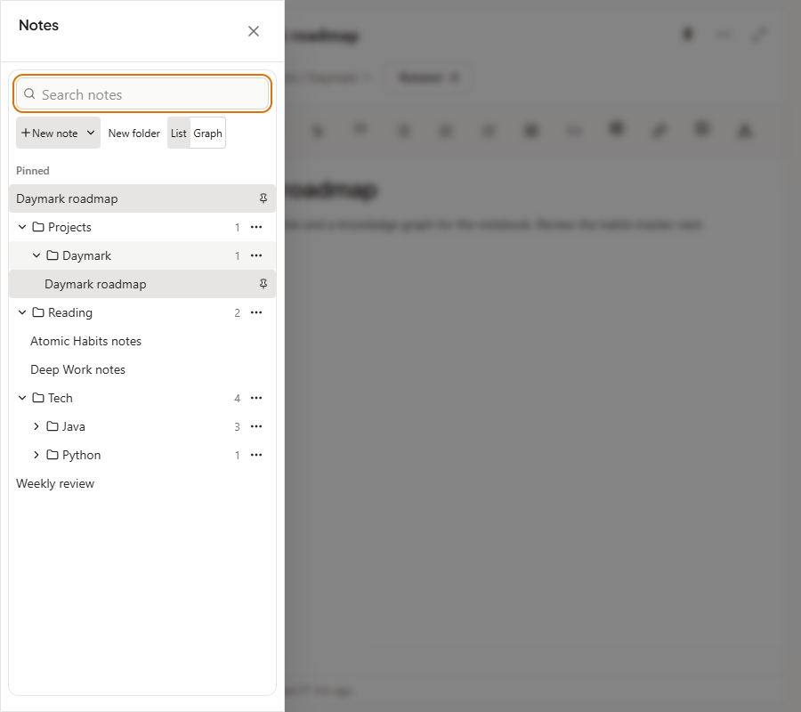
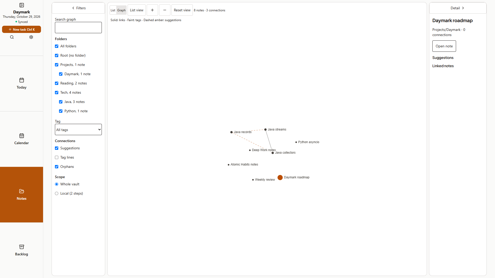
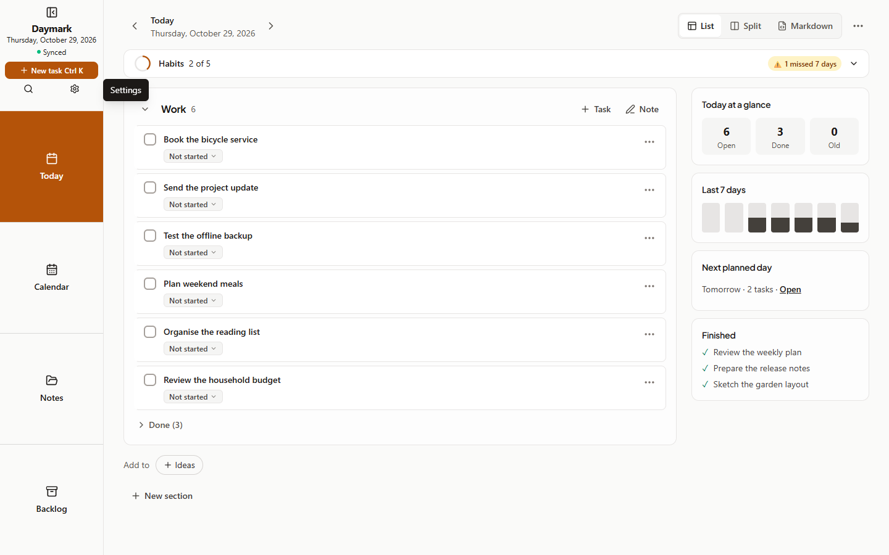
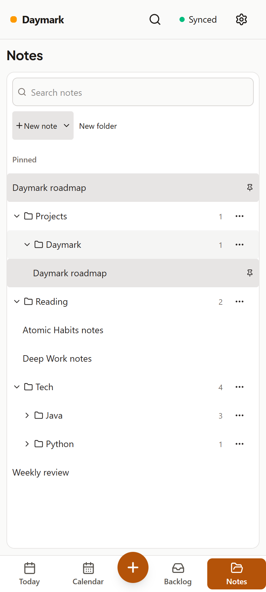
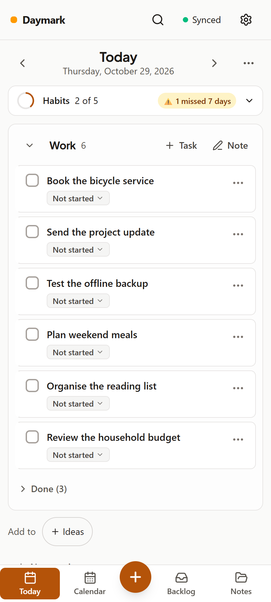

# Cycle 12: One-column Notes navigation

Date: 2026-10-29 · Branch: `cycle-12-notes-one-column` · Tag: none

This is an implementation and QA handoff for the next minor release. No release, version bump, push or deployment is included.

## Implemented

- One navigation column for Notes. It holds Search, then New note (with its template arrow), New folder and a List | Graph switch, then a folder tree with each note listed by its title inside its folder. The separate folders pane, the notes list and the "All notes" / "Notes (top level)" rows are gone; unfiled notes are listed after the top-level folders and a Pinned group sits on top.
- Search in place: typing filters the tree, announces "N notes match" and dims the open note if it does not match. Nothing leaves the column.
- Current folder: the folder you select is where New note and New folder land.
- Moving things: drag a note onto a folder, or onto the Move to top level strip that appears while dragging. Phones keep Move to folder in the note.
- Keyboard: arrow keys, Home, End and Enter move through the tree; Shift+F10 or the Menu key opens a folder's actions. Long vaults use a windowed tree.
- No Notes header row. The page title row is removed; the List | Graph switch lives in the column.
- Responsive column: wide windows show the column, editor and Related; Minimize folders shrinks the column to a strip (Search, New note, New folder, up to eight top-level folders and a +N button); windows from 768 to 1099 px open the column as a drawer from the Notes button; phones show the column, then the editor with Back.
- Side menu: five parts (Title, Today, Calendar, Notes, Backlog) with Settings as a small gear button in the Title part next to Search. On phones Settings is a gear in the top header and the bottom bar is Today, Calendar, New task, Backlog, Notes.
- Guide, README, project knowledge and the website describe the new navigation.

## Screenshots

Captured from a disposable sample vault with `node scripts/capture-screenshots.mjs cycle-12`. Wide desktop shots are 1920×1080, the Today rail shot 1440×900, the drawer 900×800 and phone shots 412×915 at device scale 2. No personal vault was used. Every image was opened and checked before it was listed here.

| Screen | Image |
| :--- | :--- |
| Wide desktop: one column (Pinned, folders with notes inside), the editor and Related |  |
| Search filtered in place ("3 notes match") |  |
| Minimized column: Search, New note, New folder and folder buttons |  |
| Narrow window: the column as a drawer |  |
| Graph mode with the List \| Graph switch in the toolbar |  |
| Five-part side menu with the Settings gear next to Search |  |
| Phone: the Notes column |  |
| Phone: Search, sync and the Settings gear in the top header |  |

## How to try

1. Run `npm run dev` (or build and run the production server), sign in and open Notes.
2. Select a folder, then choose New note: it is created there. Type in Search and watch the tree filter.
3. Drag a note onto a folder; drag again and drop it on Move to top level.
4. Focus the tree and use the arrow keys, Home, End, Enter and Shift+F10.
5. Narrow the window below 1100 px to get the drawer; use Minimize folders for the strip; try List | Graph.
6. On a phone width, open Notes from the bottom bar, pick a note, then use Back.

## Checks

Numbers are from full runs of each suite on this branch, one at a time.

| Check | Observed result |
| :--- | :--- |
| TypeScript / `npm run lint` | Clean |
| Vitest (`--maxWorkers=2`) | 123 files, 1,457 passed, 1 skipped |
| `npm run test:helpers` | 23 of 23 passed |
| `npm run build` | Built |
| `npm run build:site` | Built |
| `npm run validate:ai` | All checks passed, 0 failures |
| `npm run test:qa` | 817 checks, 0 failed |
| `node scripts/ux-suite.mjs` | 103 passed, 0 failed (includes the accessibility scans) |
| `npm run test:sync` | 32 checks passed |
| `npm run test:e2e` | All checks passed |
| `npm run android:build -- --test` | Build successful, Kotlin unit tests passed |

## Known limits

- The graph is for tablet and desktop widths; phones show the column and the Related sheet.
- The drawer replaces the column only between 768 and 1099 px; the minimized strip lists at most eight top-level folders and a +N button for the rest.
- Physical-device interaction was not exercised.
- The List | Graph switch is hidden on phones.

## Next step

Review the handoff, then request the release separately.
