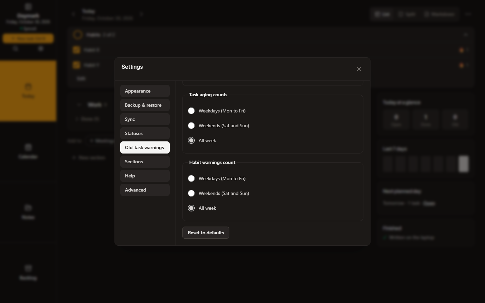
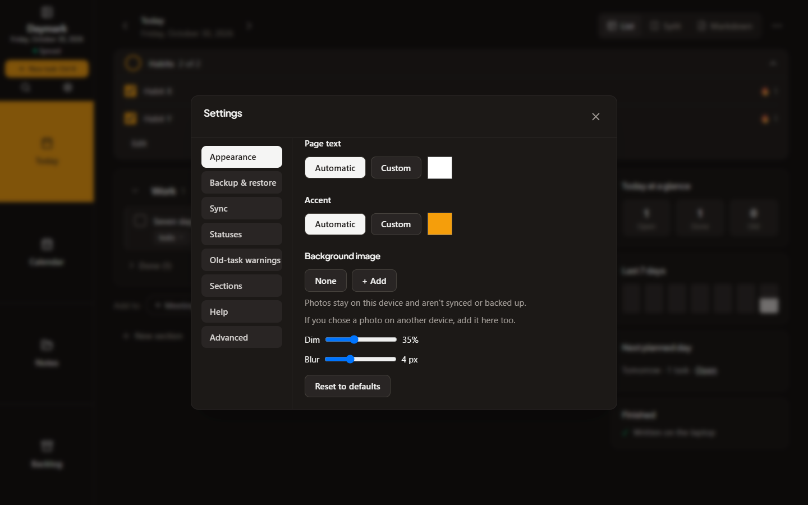

# Cycle 13: Cross-device sync audit and alert counting days

Date: 2026-10-30 · Branch: `cycle-13-sync-audit` · Tag: none

This is an implementation and QA handoff for the next release. No release, version bump, push or deployment is included. The app version is still 1.9.1.

## What was audited

Every kind of data that syncs between devices was tested by simulating two or three devices (laptop, phone, a late-joining third device) that edit, go offline, reconnect and sync in different orders:

- Daily documents and tasks (including moving a task, merging a day, finishing a task on one device while another carries it forward).
- Standalone notes and their folders (rename against move, delete against edit, long offline edits).
- Settings.
- Habits and habit ticks.
- The backlog (capture, pick, undo, delete).
- Pictures inside notes (failed uploads, notes that arrive before their picture, damaged files, third device joining later).
- A seeded random test: three devices make random edits and sync in random order, and afterwards every device must be identical and no edit that should survive may be missing. 25 fixed seeds pass.

## Real problems found and fixed

| Problem | What it meant for you |
| :--- | :--- |
| Settings were overwritten as one block. | Changing one setting on the phone while the laptop changed another could silently undo the laptop's change. Settings now merge setting by setting. |
| Habits and backlog items were merged as whole items. | Editing the name of a habit on one device and its details on another kept only one edit. They now merge field by field, and a field you cleared stays cleared. |
| A device with a wrong clock far in the future won every conflict. | One mis-set phone could overwrite good changes from your other devices. Timestamps far in the future are no longer trusted. |
| A far-future day stamp defeated a backlog undo. | Undoing a backlog pick could be silently reversed by a device with a bad clock. |
| More than 5000 pending changes got a device permanently stuck. | A device that had been offline for a long time could never sync again. It now sends its changes in batches, limited both by count and by size (about 8 MB per request, so a large pile of notes stays well under the server's 25 MB limit). A single change bigger than that is sent on its own. |
| A damaged picture on the server was never repaired. | A broken picture stayed broken for every device. The server now notices damaged files and the next upload repairs them. The picture check also reuses earlier results, so it no longer re-reads every file on each poll. |
| Merging a day renumbered task order. | The renumbering looked like fresh edits and could stop a deletion on another device from taking effect. Merging no longer invents order changes. |
| Picking the same backlog item on two devices dropped its history. | The two copies of the task lost part of their history. Duplicate picks now keep it. |
| Moving a task while another device edited it could leave it on two days. | The task now stays on the moved day and its edit is kept. |
| Two devices changed the same note's folder or title without a reported clash. | The newer change wins, and the clash is now reported. |
| An untouched offline rollover copy could undo edits to a moved task. | The moved task keeps its title, status and other edits even when the server has no shared base. Genuine competing edits are reported by task and field; a completion is kept. |
| Reset on Old-task warnings could undo itself after syncing. | Reset now explicitly selects All week for both counting groups when a choice already exists, so the reset reaches other devices and stays reset. Untouched devices keep the optional setting absent. |
| An earlier move away could undo another device's later move into that day. | A later move of a task to a day is no longer undone by another device's earlier move away. Both devices settle on one copy at the later destination. |
| Different moves to the same day shared a history ID and one could disappear. | Task history now keeps every distinct move, while identical repeated events appear once. |

The fixes cover the tested races. Remaining limitations are listed below.

## Scenarios now covered by tests

Settings changed on two devices at once; habit and backlog field edits and clears; wrong-clock devices; backlog undo; a long backlog of pending changes; interrupted and retried uploads; damaged and missing server pictures; folder rename against move; note delete against edit; two devices syncing together; a lost response and retry; a late third device; old-version devices; the seeded three-device random test; and the browser two-device test below.

The browser test (`npm run test:sync`) now also checks, using the real Settings screen on a laptop and a phone: both counting groups default to "All week"; two devices change different settings while offline and both changes survive; weekday counting chosen on one device is used on the other and changes a carried task from "7 days old" to "5 days old".

An earlier browser run showed a duplicate carried task. Its likely cause (a move racing an edit on the old day) was found by reading the code and verified with a reproducing test. The cause was not caught live in the browser; subsequent browser runs passed. Browser verification of this final fix wave is for the controller.

## New: choose which days count for alerts

Settings, Old-task warnings, has two new choices: **Task aging counts** and **Habit warnings count**. Each can be Weekdays (Mon to Fri), Weekends (Sat and Sun) or All week (the default). Warnings stay visible on days that do not count; only the age stops growing. Changing the choice updates existing ages straight away, and it syncs between your devices. The Android widget follows the same choice.

| Screen | Image |
| :--- | :--- |
| Settings, Old-task warnings: the two counting groups, both on All week |  |
| Settings, Appearance, on a device with no photos: the background image section and its hint |  |

## Compatibility with older versions

Devices on 1.9.1 or earlier keep syncing with updated devices in both directions without losing data. The new alert-day setting is optional, an older device ignores it, and when an older device syncs back it does not erase or reset what an updated device wrote. A device without the setting counts all week. Choosing one counting group stores only that group, so two devices that change the two groups while offline keep both choices after they sync. This is covered by tests that sync an old-format device against an updated one.

## Known limitations

- Background photos stay on the device where you chose them. They are not synced or backed up. A device with no photos shows a short hint to add the photo there too, and falls back to no photo without errors. The hint cannot tell whether you chose a photo elsewhere, so a device with no photos and None selected always shows it.
- A lost server response while a note is in a text conflict can, rarely, create a second conflict copy.
- If a large sync fails partway through its batches, retrying can create an extra conflict copy for a note in a text conflict. Successful earlier batches have already reached the server, while the client retries from its previous state.
- Android widget severity thresholds stay fixed at 3 and 7 days; the widget uses the selected counting days but does not follow customized severity thresholds.
- In a rare sequence where two devices toggle the same setting back and forth between syncs, one device's change can be overwritten without a conflict notice.

## Checks

Follow-up checks run one suite at a time. Browser results below are the controller's runs at `b4c4c1c`, before the O1/O2 follow-up; they were not rerun here.

| Check | Observed result |
| :--- | :--- |
| `npm.cmd run lint` | Clean |
| `npx.cmd vitest run --maxWorkers=2` | 148 files, 1,843 passed, 1 skipped |
| Convergence (`--maxWorkers=2`) | 52 passed: 25 original seeds, 25 carry/move races, and both O1 sync orders |
| Exploratory seed 13 with carry fixture | No task/move losses; unchanged oracle still reports the known setting-toggle limitation above |
| `npm run test:helpers` | Earlier controller run: 23 of 23 passed; not rerun in this wave |
| `npm.cmd run build` | Built; existing Vite config-loader and chunk-size warnings |
| `npm run test:sync` | Controller at `b4c4c1c`: 2 of 2 runs passed |
| `npm run test:qa` | Controller at `b4c4c1c`: 0 failed of 822 checks |
| `npm run validate:ai` | Earlier controller run: all checks passed, 0 failures; not rerun in this wave |
