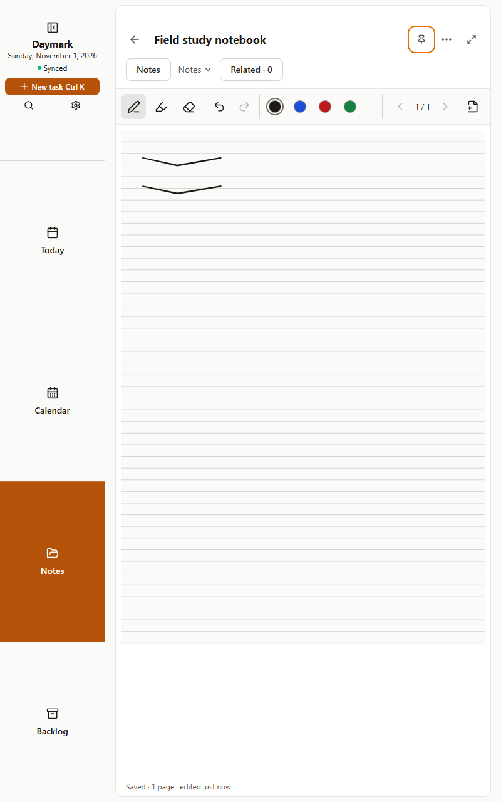
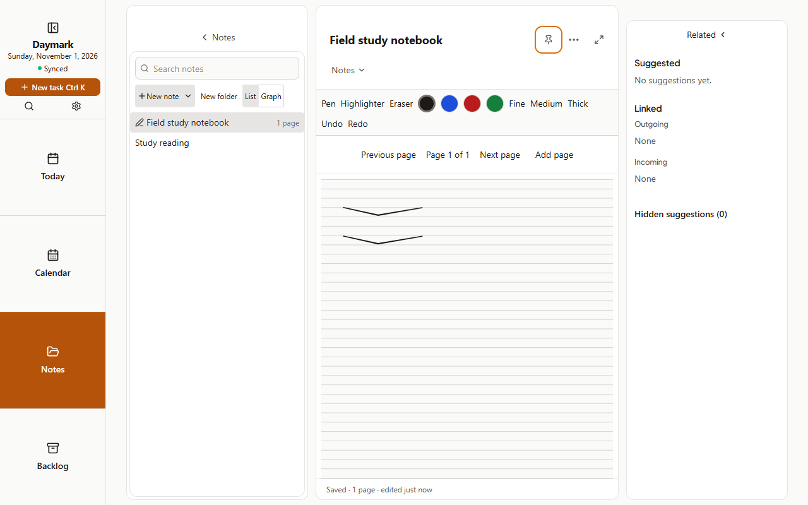
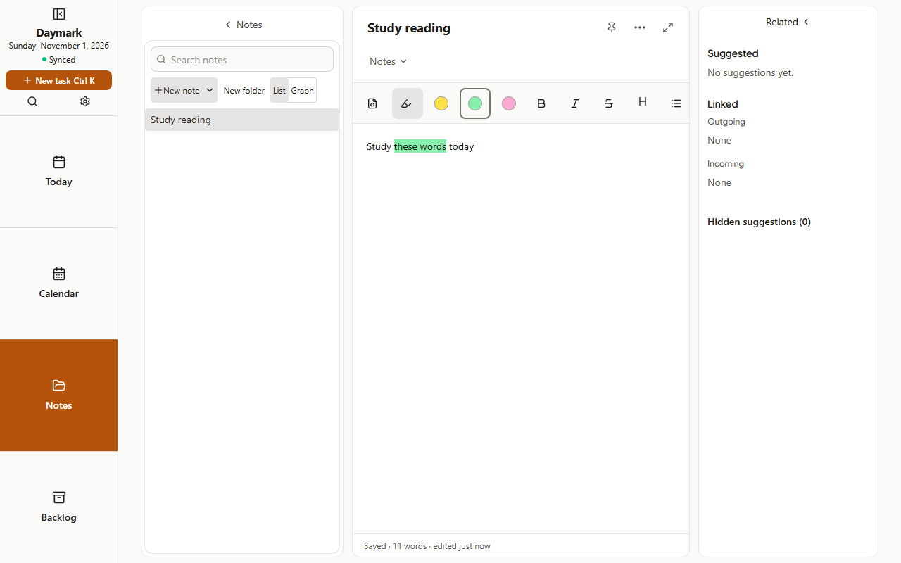
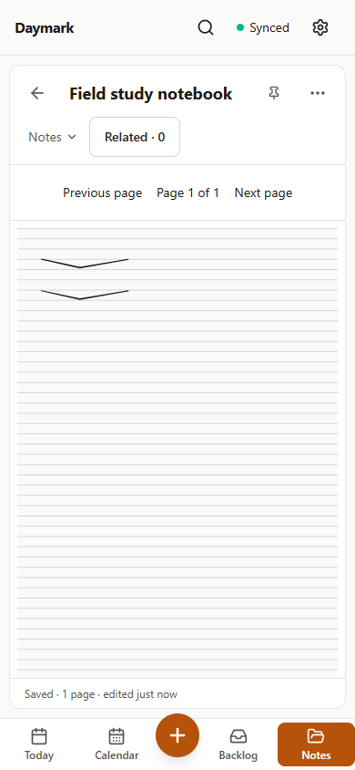

# Cycle 14: write with the pen, read everywhere

Date: 2026-11-01 · Release: 1.11.0

Handwritten study pages now live beside your typed notes and travel through your own sync server.

## What's changed

- **Handwritten notebooks:** open Note templates beside New note, choose Handwritten note, then lined, grid or blank paper. Use pressure-sensitive pens, a highlighter and an eraser with area and whole-stroke modes. Undo, Redo and page controls keep writing manageable. Notes keep their folders, titles and pins; the column shows a pen icon and page count.
- **Read on your other devices:** devices without pen input open handwritten pages read only. Pen input enables writing tools. Ink syncs page by page; concurrent strokes are kept together. ZIP and JSON backups include ink; Markdown export carries a short placeholder. Older apps keep syncing without erasing the ink, but need updating to view it.
- **Highlight typed notes with the S Pen:** turn on Highlighter in the note toolbar, choose a colour and drag across words. The highlight snaps to those words and stays with them through edits and sync. Turn the tool off for ordinary pen behaviour. Finger and mouse drags keep their usual behaviour.
- **Tablet controls clear the status bar:** top controls reserve the Android inset in portrait and landscape, including Notes navigation, dialogs and the graph.
- **Widgets follow your warning settings:** task widgets use Needs attention after, Urgent after, the aging warnings switch and counting days, so their warnings agree with the app. Older widget data still uses the usual 3- and 7-day defaults when settings are missing.
- **Signed Android releases:** future updates use a stable release signing key. The first switch needs the steps below.

## One-time switch to the signed APK

1. **Sync (or make a backup) first.** Make sure your latest notes have reached the server, or save a ZIP or JSON backup somewhere outside the app. Uninstalling deletes anything stored only in the app.
2. **Uninstall the old app.**
3. **Install the signed APK**, `daymark-1.11.0.apk`, from the release. `SHA256SUMS` accompanies it.
4. **Sign in again** to your sync server. If you used a backup instead of sync, restore it.

There is a new signing key. Android refuses to update an app signed with a different key, which is why uninstalling is necessary once. Later updates signed with this same key can install over the app.

For the person building releases: back up the keystore and its passwords securely in separate locations. Losing them prevents future updates from installing over the app. The signing setup and backup instructions are in [Getting started and install](../../guide/getting-started.md#building-signed-android-releases). Keep signing files and passwords outside the repository.

## Screenshots

Screenshots come from `node scripts/capture-screenshots.mjs cycle-14` in a desktop browser; they show the layout, not how writing feels on a real tablet.

| Screen | Image |
| :--- | :--- |
| Tablet landscape, 1280 × 800, forced 24px inset |  |
| Tablet portrait, 800 × 1280, forced 24px inset |  |
| Lined handwritten note |  |
| Grid handwritten note |  |
| Typed-note highlighter |  |
| Read-only handwritten note at phone width |  |

## Known limits

- Ink drawing runs in the app's WebView. The owner's trial on the Samsung tablet is the final acceptance, and the APK has not been tried on a real device. Browser pointer checks cannot establish real S Pen latency or palm rejection.
- Daymark 1.10.0 keeps typed-note highlights when it edits a note, but shows them as raw `<mark>` tags instead of colours; update every device to 1.11.
- Finger scrolling on a page you can write on has no momentum, and pinch zoom is off on writable pages.
- Handwriting is not searchable (title only). There is no handwriting recognition, lasso selection, shape tool or inserted picture support on handwritten pages.
