# Cycle 15: Markdown rendering audit

Date: 2026-11-06 · Branch: `cycle-15-markdown-audit` · Tag: none

Testing-cycle handoff. **No product fixes shipped in this cycle.** Baseline revision: `2c84344` (release 1.11.1). Audit completion is separate from product release readiness: the audit is complete, the product is **not** release-ready for Markdown because D1 and D2 lose or hide content ([ledger](../../testing/markdown-rendering.md)).

## What shipped
- Fixture corpus: 33 focused fixtures plus a mixed note in `fixtures/notes/rendering/` (hand-written literal expectations in `cases.json`), loader and self-tests in `src/test/`.
- Diagnostic audit suite (`vitest.markdown-audit.config.ts`, `src/markdown-audit/*.audit.ts`): renderers, editor transitions, clipboard events, full-fidelity versus Markdown-only archives.
- Browser runner `scripts/e2e-markdown-rendering.mjs`: disposable production server, 3 viewports × light/dark × Notes, Today, Calendar.
- `.ai-configs/scripts/validate-configs.mjs` no longer link-checks `fixtures/` (they hold intentionally broken links); `.gitattributes` keeps fixture bytes (`-text`).
- Compatibility table and defect ledger: [`docs/testing/markdown-rendering.md`](../../testing/markdown-rendering.md). Machine results: [`rendering-results.json`](./rendering-results.json) (initial and rerun files retained).

## Results (baseline, each reported separately)
| Run | Result |
| :--- | :--- |
| `npm run lint` | pass |
| `npm test` (normal suite, includes the fixture-loader self-tests) | 162 files, 2020 passed, 1 skipped |
| `npm run build` | pass |
| Audit: renderers | 192 tests, 160 pass, 32 fail (product findings) |
| Audit: editor transitions | 125 tests, 119 pass, 6 fail |
| Audit: clipboard + archive | 45 tests, 44 pass, 1 fail |
| Browser matrix (merged) | 2410 records: 2212 pass, 174 fail, 24 not-applicable, 0 blocked |
| `npm run validate:ai` | pass (74 checks) |

Failures are the defects D1–D7 in the ledger. Audit commands exit non-zero by design when the product fails.

## Screenshots
Focused combined-note captures from `node scripts/e2e-markdown-rendering.mjs` (1440×900, 390×844, 1024×1366; light and dark). Three were opened and inspected individually; the rest are not individually reviewed.

| Surface | Desktop | Phone | Tablet |
| :--- | :--- | :--- | :--- |
| Notes, light | 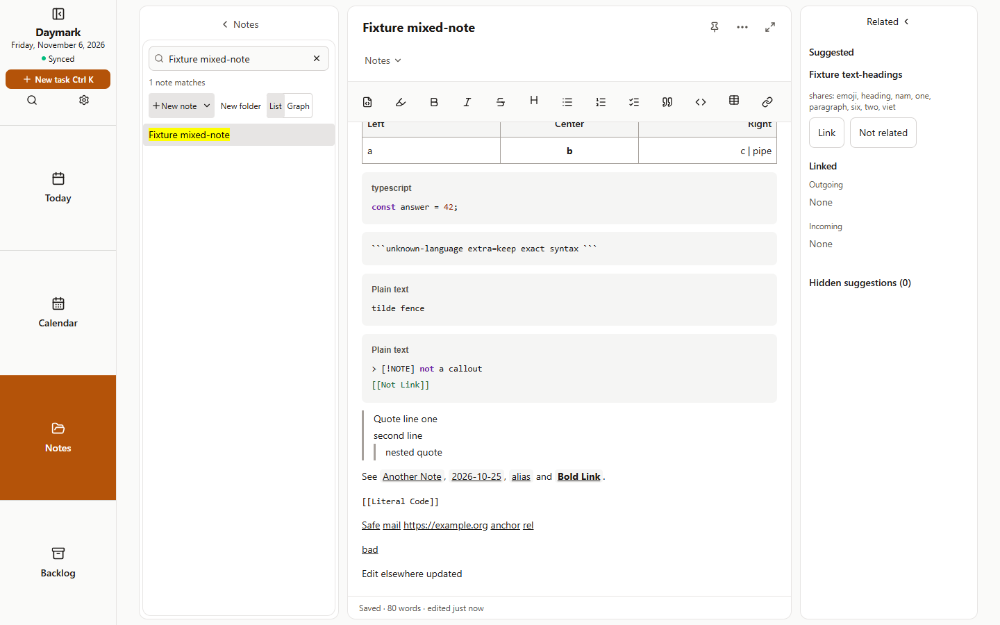 | 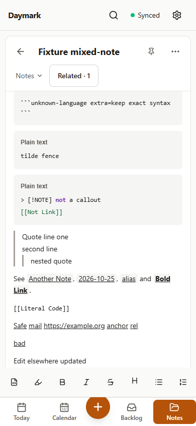 | 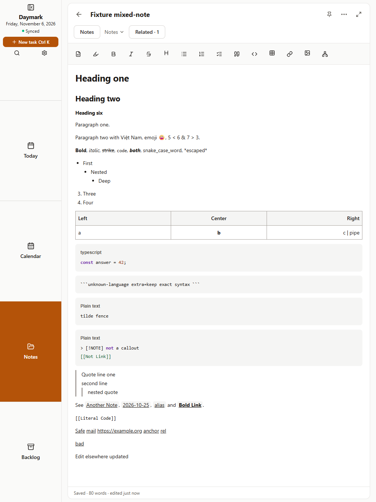 |
| Notes, dark | 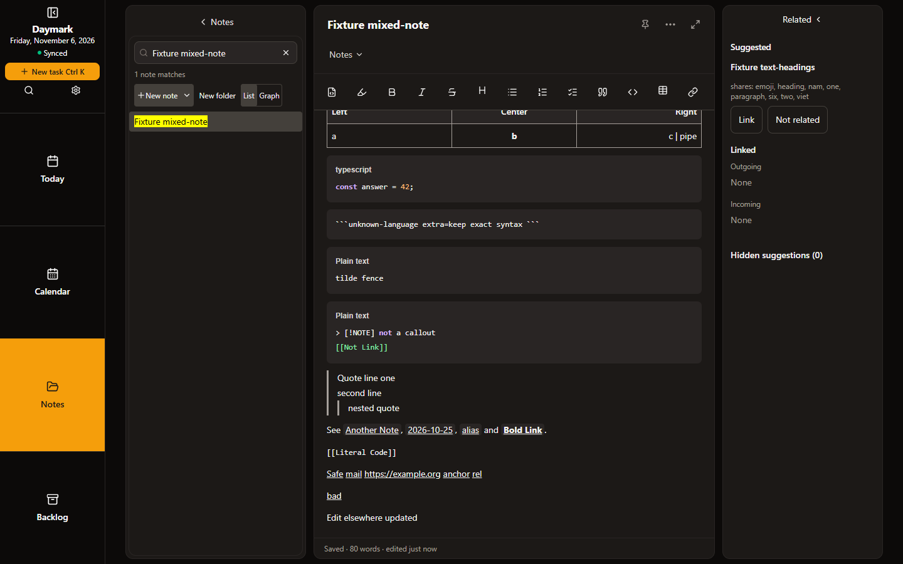 | 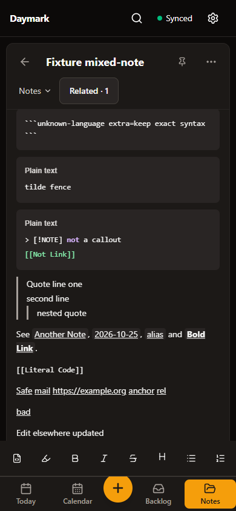 | 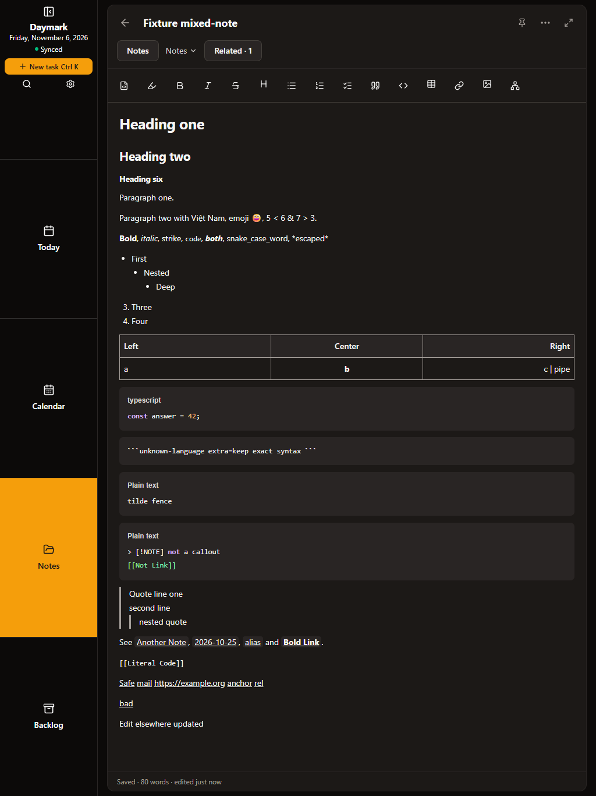 |
| Today, light | 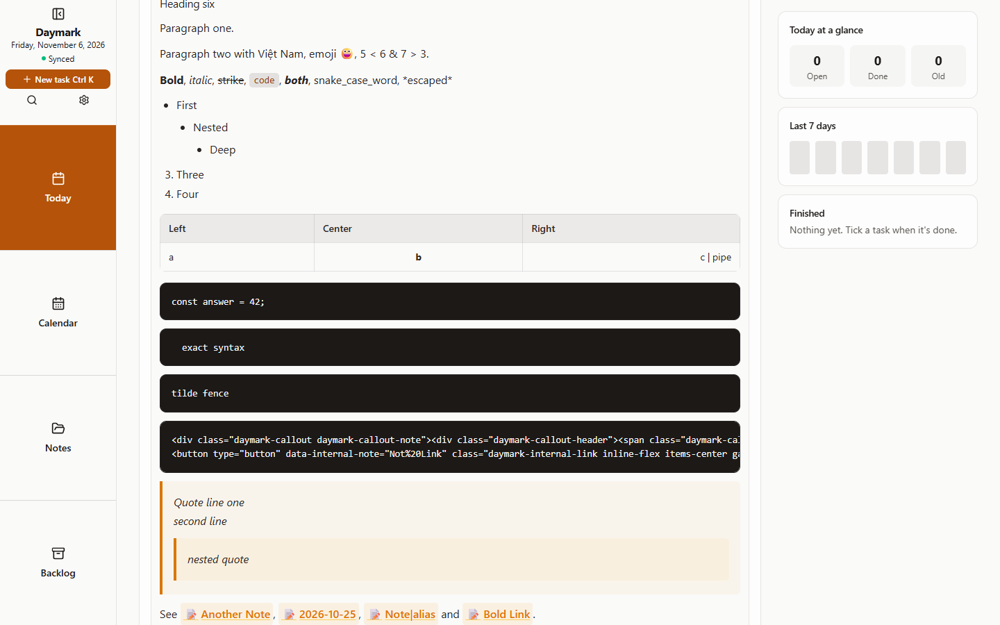 | 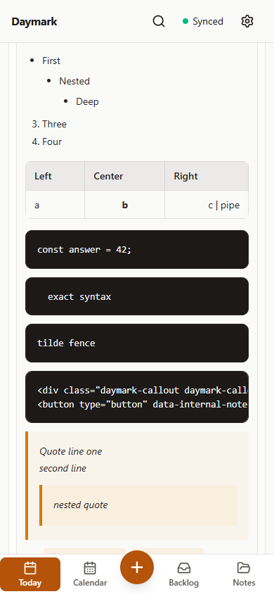 | 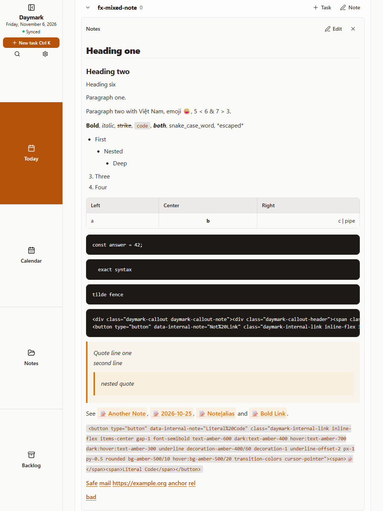 |
| Today, dark | 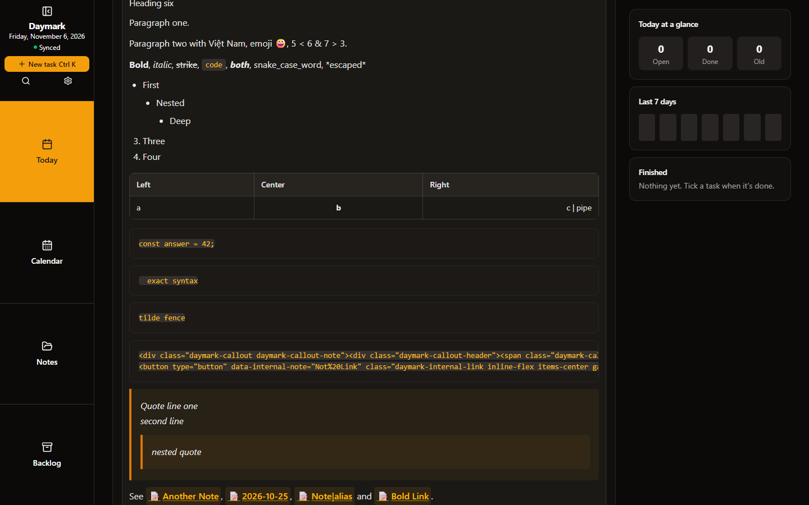 | 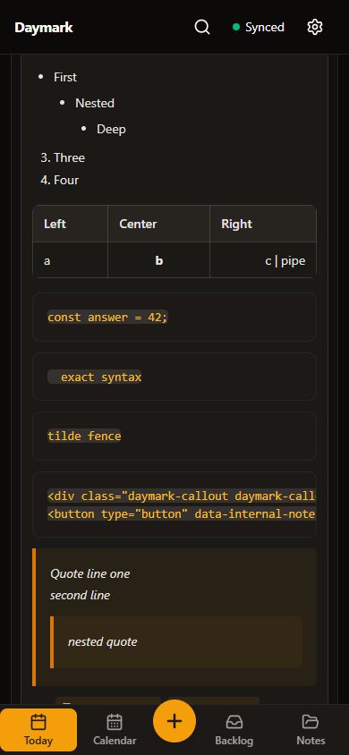 | 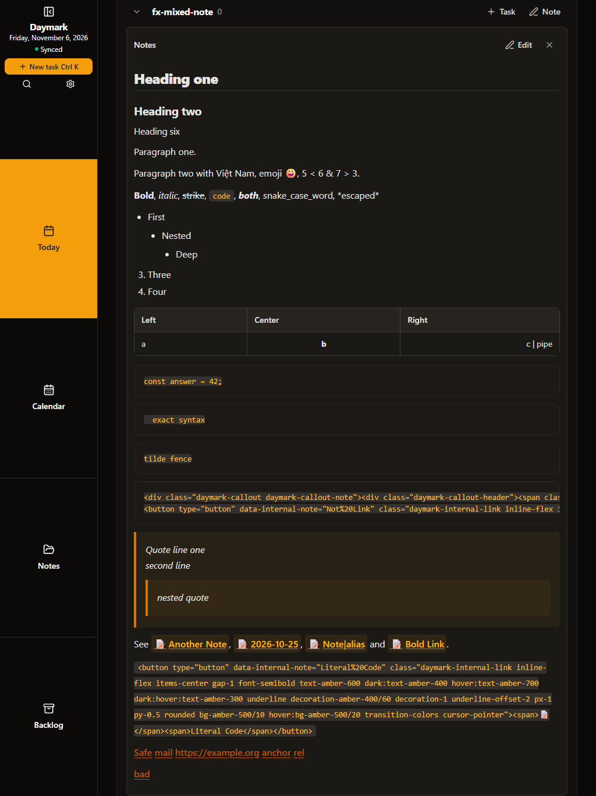 |
| Calendar, light | 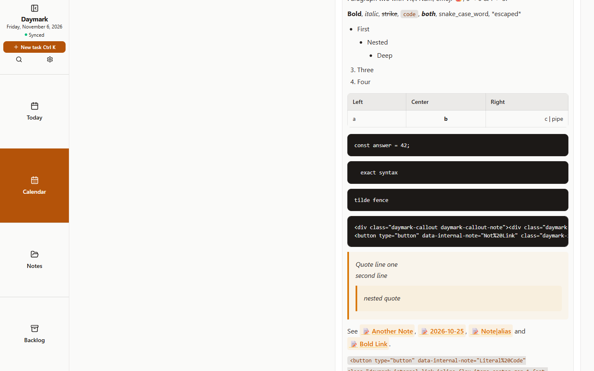 | 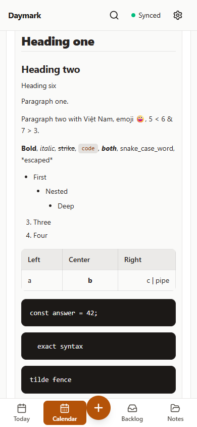 | 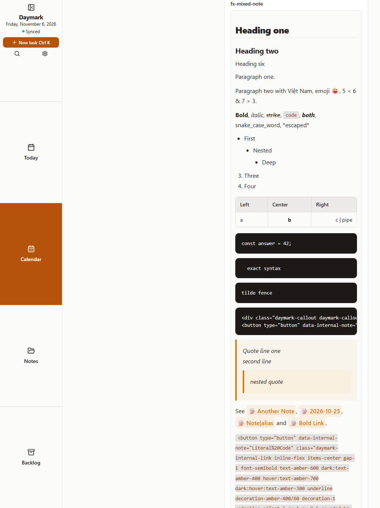 |
| Calendar, dark | 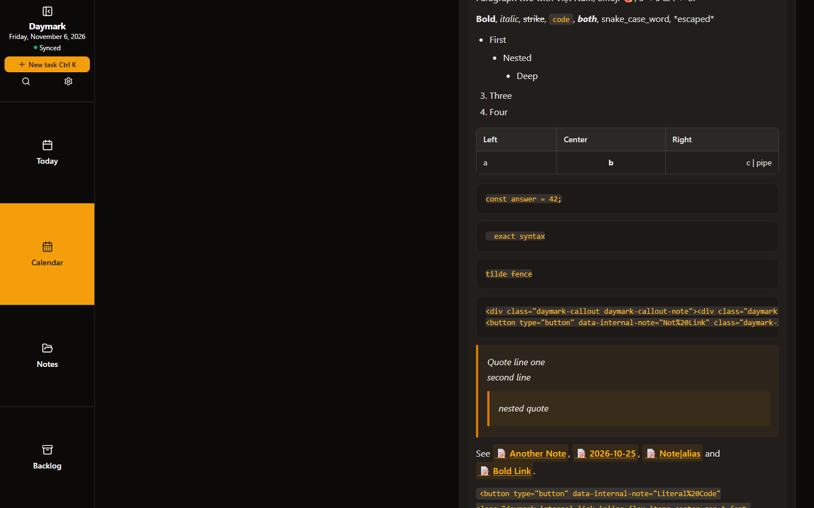 | 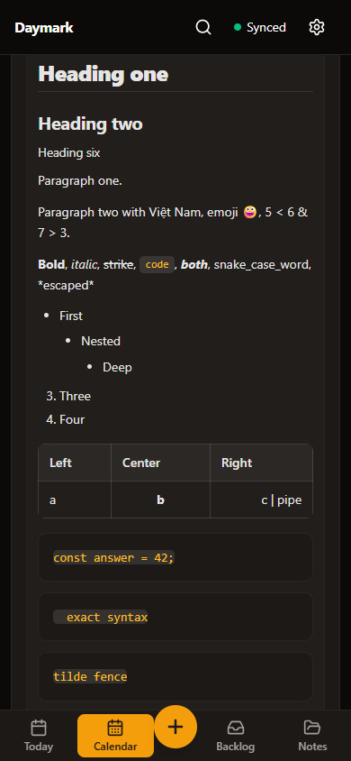 | 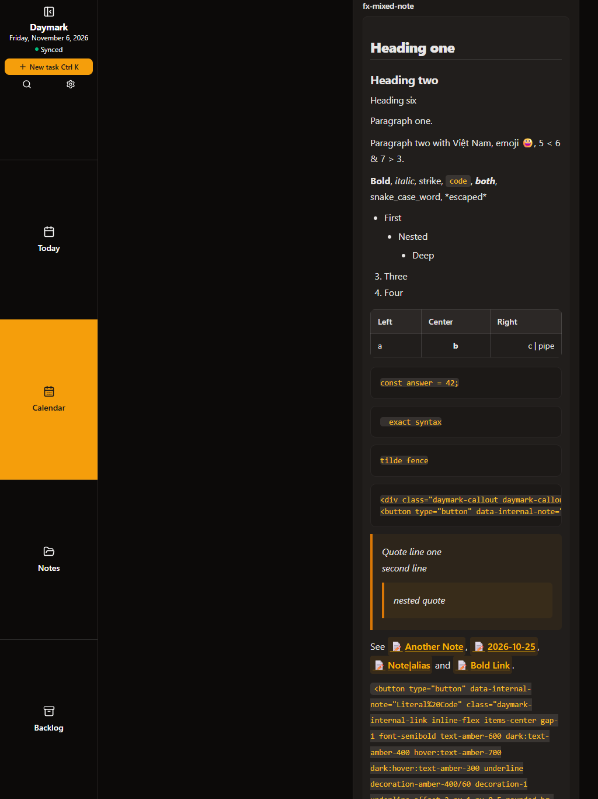 |

The Today phone/dark and Calendar tablet/light shots show defect D5: raw callout and button HTML inside a code block.

## How it was verified
Commands run in the baseline worktree with only audit tooling added: `npm run lint`, `npm test`, `npm run build`, the three audit files via `vitest run --config vitest.markdown-audit.config.ts`, and `node scripts/e2e-markdown-rendering.mjs`.

## Known gaps
- Standard release captures (`capture-screenshots.mjs cycle-15`, Android 412×915) and `ux-audit.mjs` were not run.
- Synthetic clipboard only; viewport emulation only; no physical Android or S Pen check.
- Internal-link click navigation and wiki-link creation not exercised in the browser.
- Unresolved intermittency: 3 single Notes edit-save failures in the first matrix did not recur (details in the ledger).
- Only 3 of 18 screenshots were opened individually.

## Usage vs. estimate
Actual session and token totals are unavailable to this runtime; none are claimed.

## Next cycle
Cycle 16 fixes D1–D7: see [ROADMAP](../../ROADMAP.md).
