# Cycle 16: Markdown fixes

Date: 2026-11-06 · Branch: `cycle-15-markdown-audit` · Tag: none

Fixes the defects confirmed by the [Cycle 15 audit](../cycle-15/README.md) ([ledger](../../testing/markdown-rendering.md)). Spec and record: [design](../../superpowers/specs/2026-11-06-cycle-16-markdown-fixes-design.md), [plan](../../superpowers/plans/2026-11-06-cycle-16-markdown-fixes.md). Not released, tagged or pushed.

## What shipped
- **D1–D3:** one shared frontmatter recogniser for the Daily parser, preview and Notes, so dividers no longer swallow text; rules keep their spelling (`----`, `***`, `___`, `- - -`) through edits. Adopted from candidate commit `7c808d0`.
- **D4:** a header must start at character zero and contain only mapping entries, comments, list items or indented lines. Prose lines, four-dash closers and a leading blank line leave ordinary Markdown visible.
- **D5:** code (fenced and inline) is no longer rewritten into callouts or wiki-link buttons in preview.
- **D6:** unchanged highlight markup keeps its spelling (no added `data-color`).
- **D7:** reclassified, no change: pasted plain `[[Note]]` stays visible text.
- **Trade-off:** `---` / `title: x` / prose / `---` is now a divider plus a setext heading, normalised on edit (text kept) instead of an opaque raw block.

## Screenshots
Same focused combined-note captures as Cycle 15, taken on the fixed build (compare with the [baseline](../cycle-15/README.md)). Two were opened individually: Today phone/dark and Calendar tablet/light now show code blocks holding the literal `> [!NOTE] not a callout` and `[[Not Link]]`; the other 16 were not individually inspected.

| Surface | Desktop | Phone | Tablet |
| :--- | :--- | :--- | :--- |
| Notes, light | 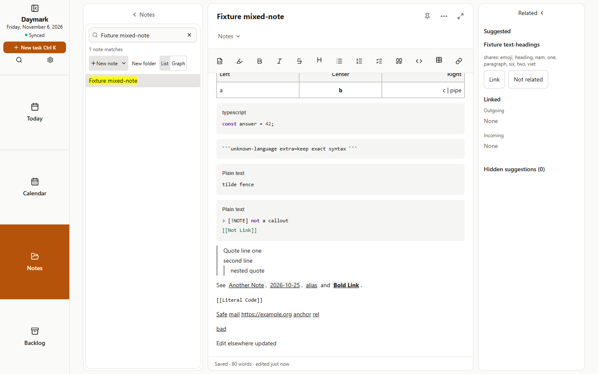 | 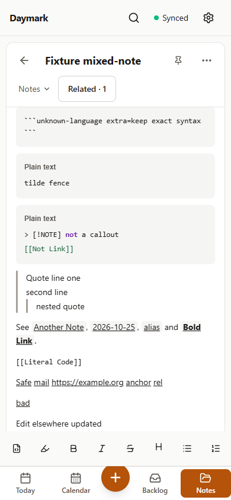 | 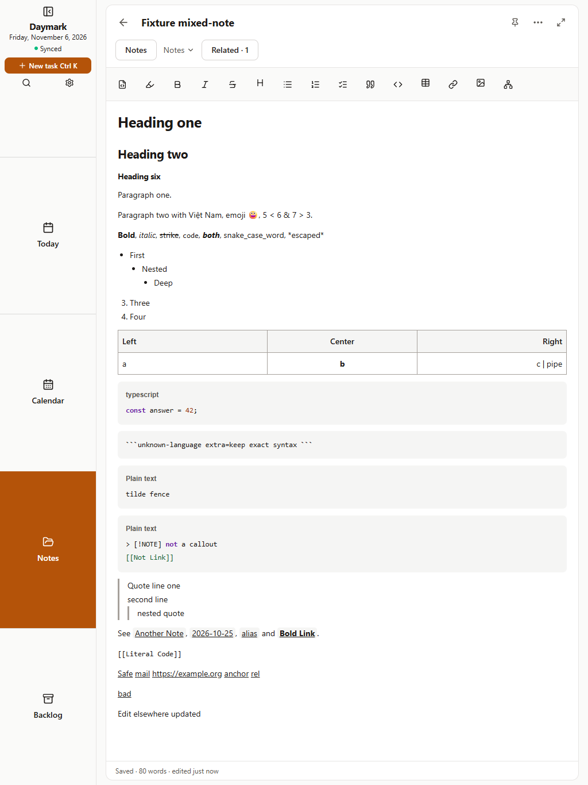 |
| Notes, dark | 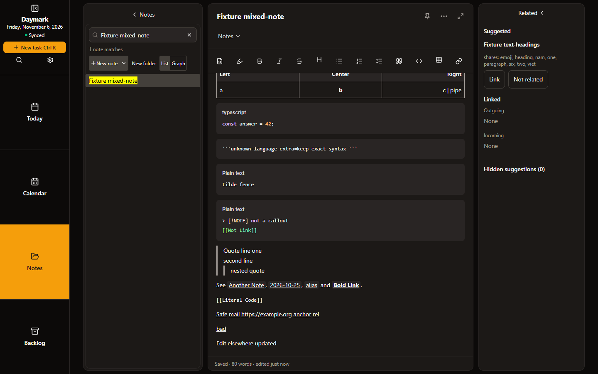 | 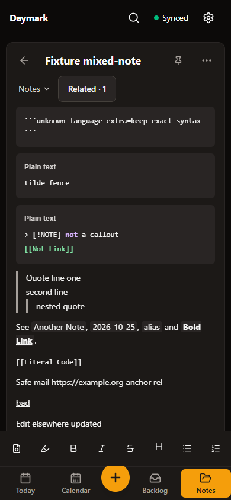 | 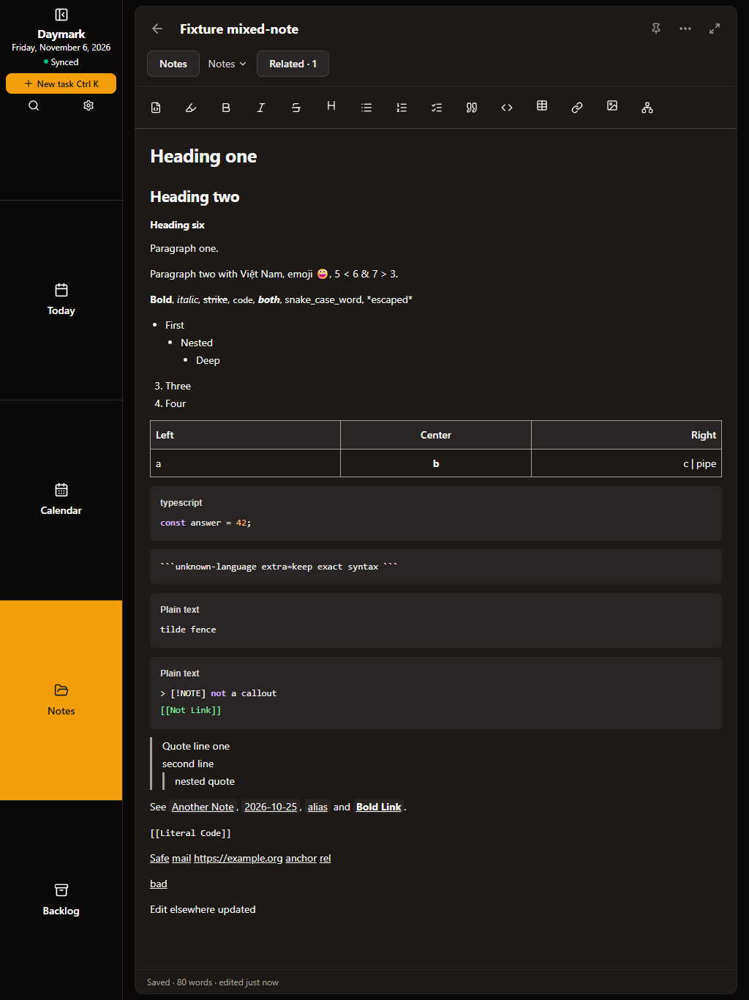 |
| Today, light | 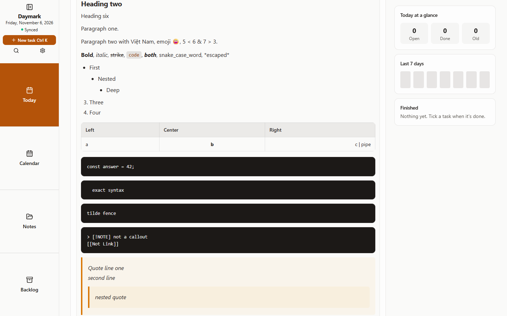 | 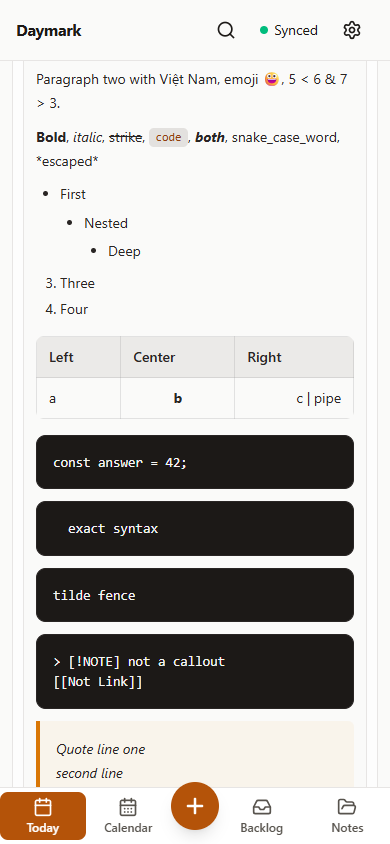 | 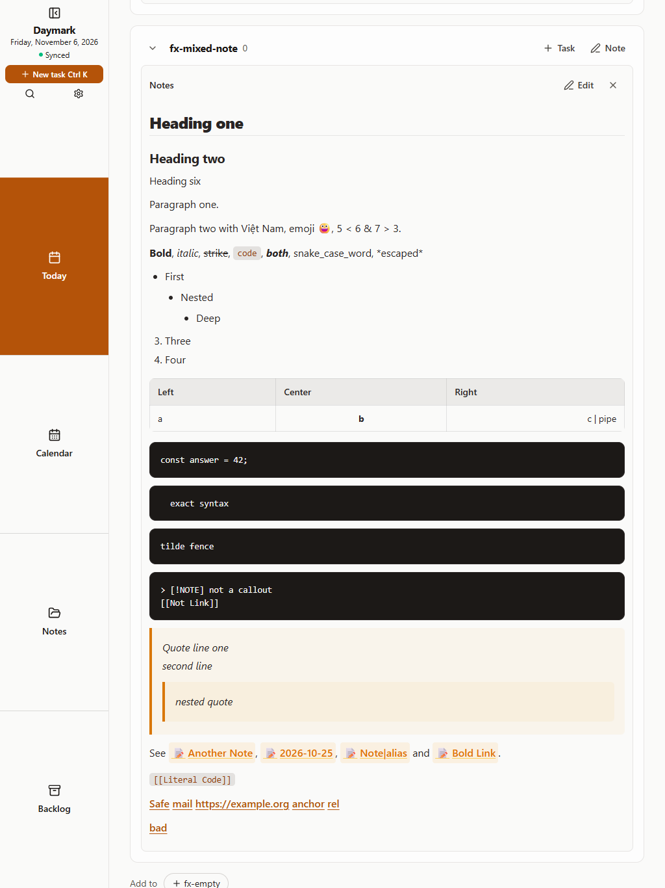 |
| Today, dark | 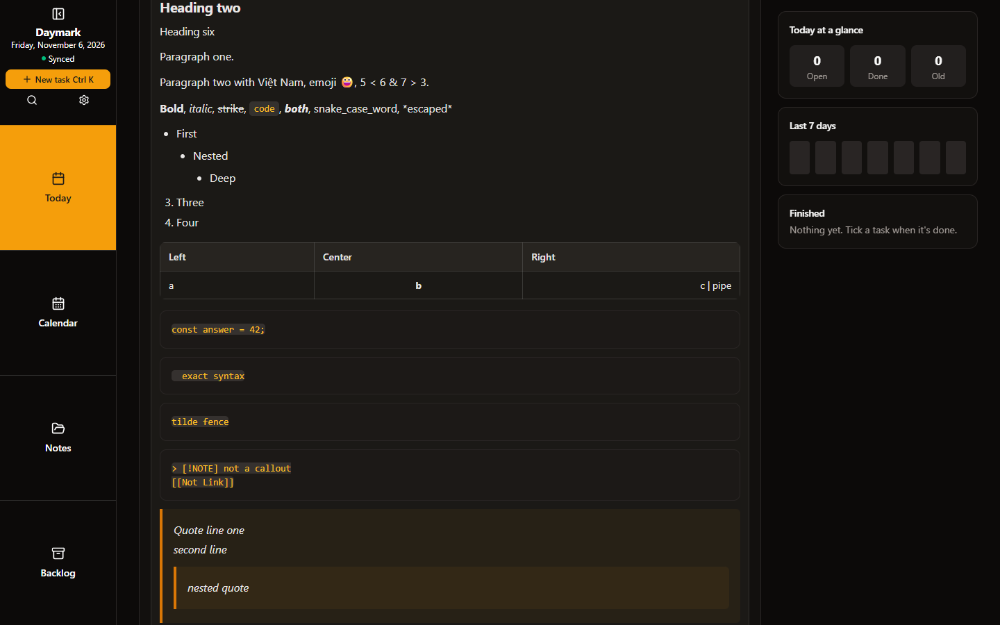 | 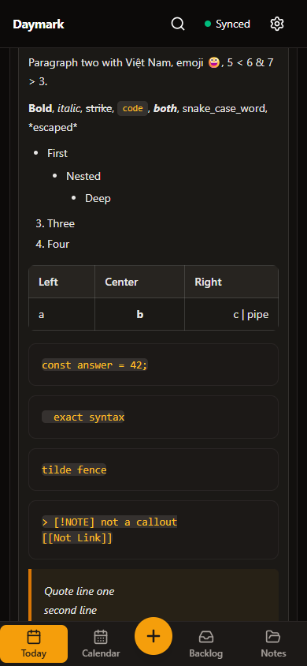 | 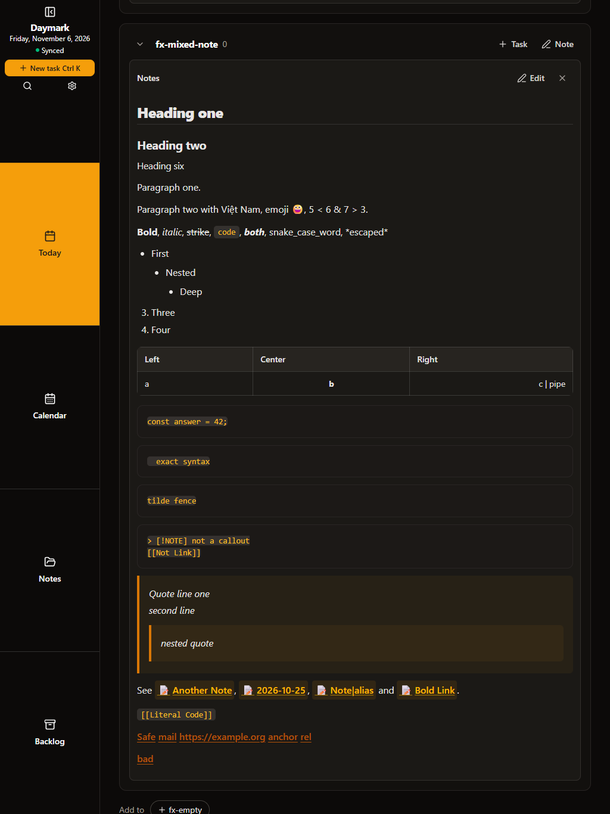 |
| Calendar, light | 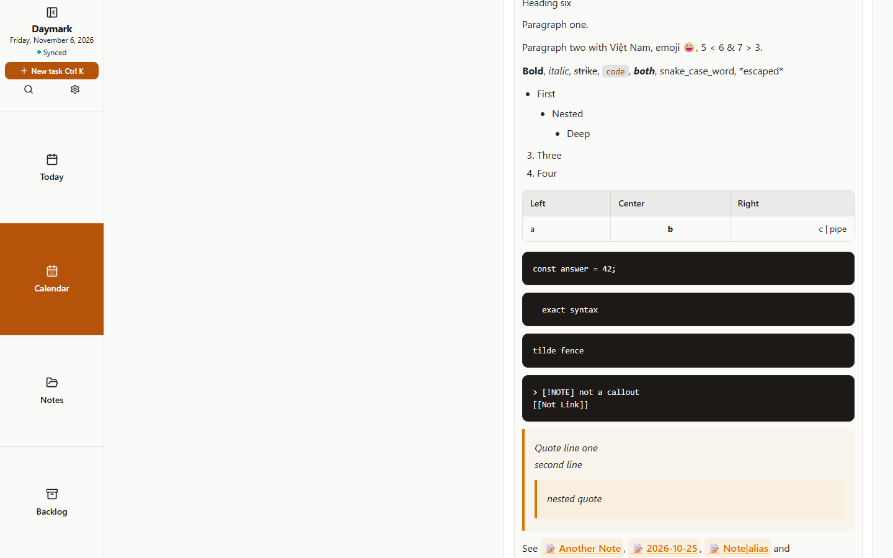 | 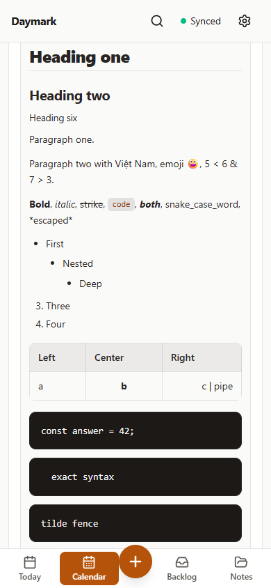 | 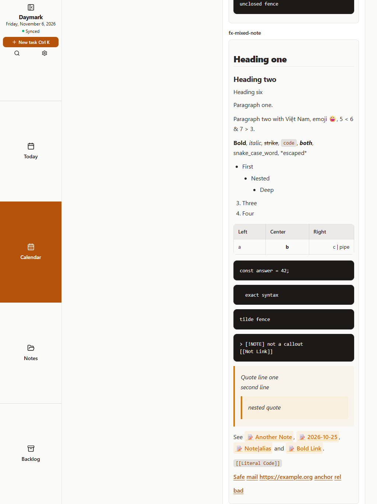 |
| Calendar, dark | 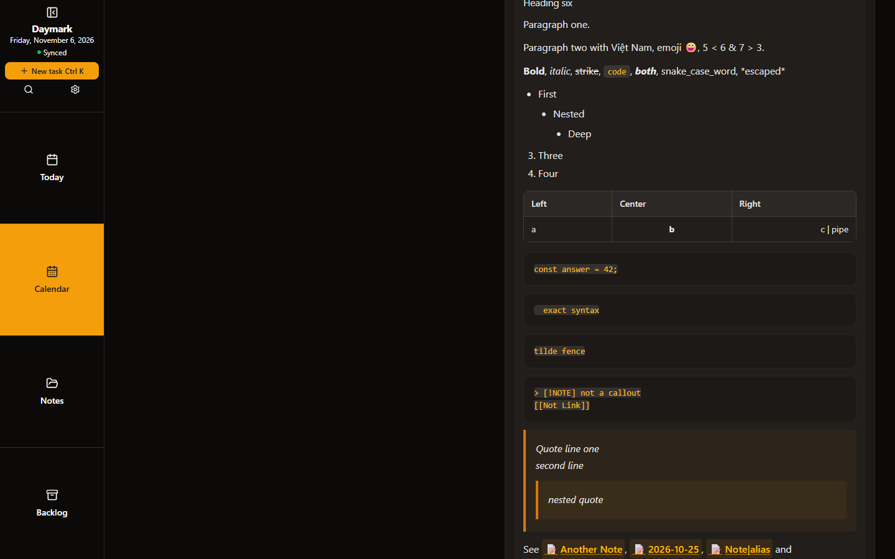 | 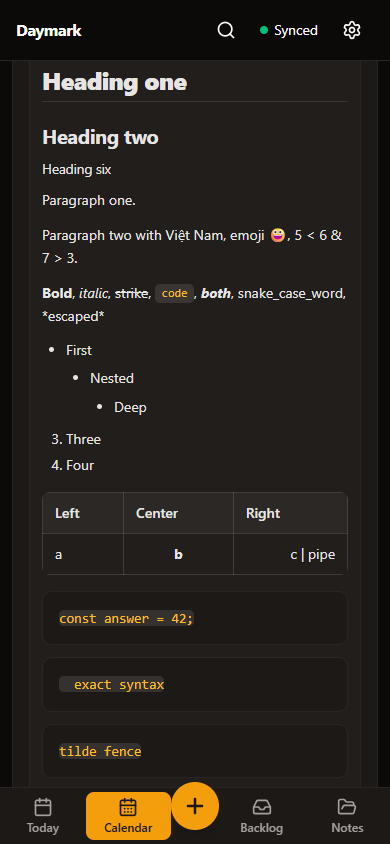 | 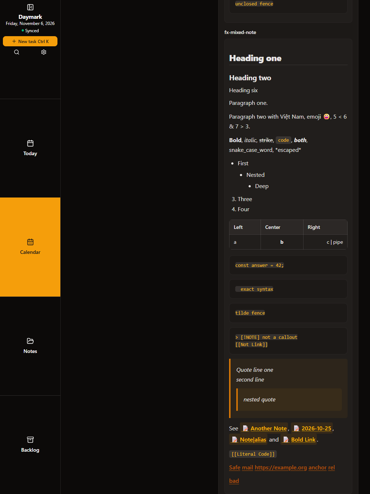 |

## How it was verified
| Run | Baseline (Cycle 15) | After fixes |
| :--- | :--- | :--- |
| `npm run lint` | pass | pass |
| `npm test` | 2020 passed | 165 files, 2057 passed, 1 skipped (adds the fix regression tests) |
| `npm run build` | pass | pass |
| Audit: renderers | 160/192 | 192/192 |
| Audit: editor | 119/125 | 125/125 |
| Audit: clipboard + archive | 44/45 | 45/45 (D7 expectation changed, see above) |
| Browser matrix | 2212 pass, 174 fail, 24 n/a | 2388 pass, 0 fail, 24 n/a |

Results: [`rendering-results.json`](./rendering-results.json), [`audit/`](./audit). Two expectations changed in this cycle and should be reviewed: D7 (pasted `[[Note]]`) and the `frontmatter-prose-line` fixture (`semantic` instead of `verbatim`).

## Known gaps
- Same as Cycle 15: synthetic clipboard, viewport emulation, no physical Android or S Pen, internal-link click navigation not exercised, the 3 earlier single intermittent edit failures did not recur but remain unexplained.
- Release smoke on the Android build and `capture-screenshots.mjs` release shots were not run.

## Usage vs. estimate
Actual session and token totals are unavailable to this runtime.

## Next cycle
Not planned. Publishing 1.11.2 (or folding into the next release) is a separate decision: [ROADMAP](../../ROADMAP.md).
