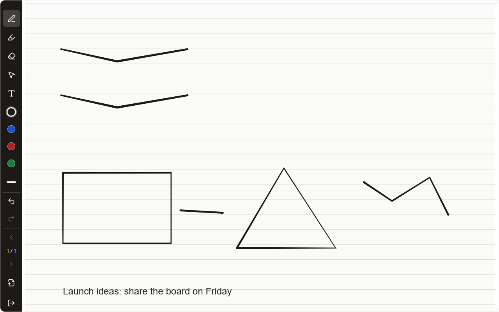
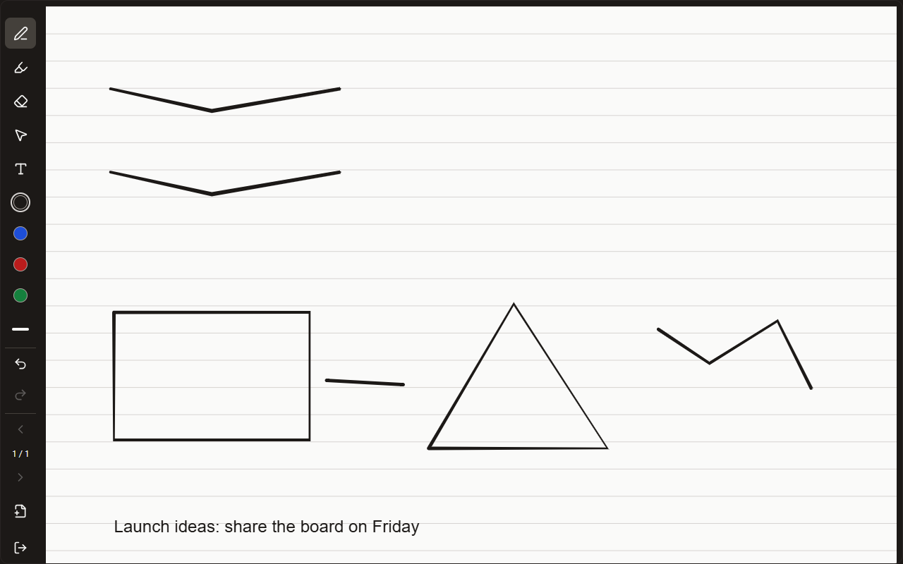
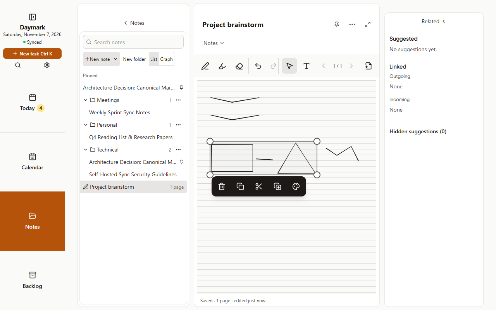
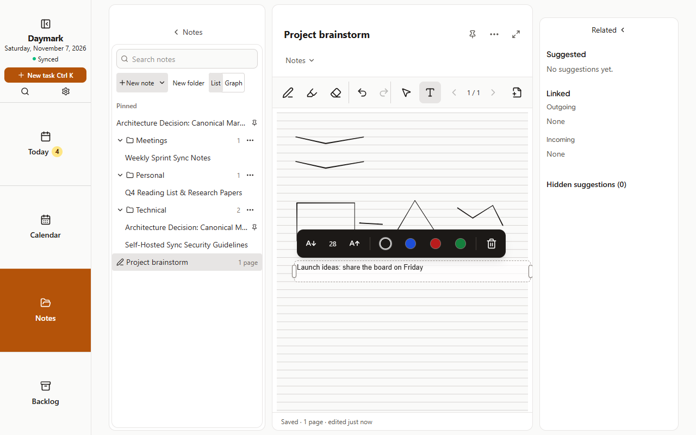
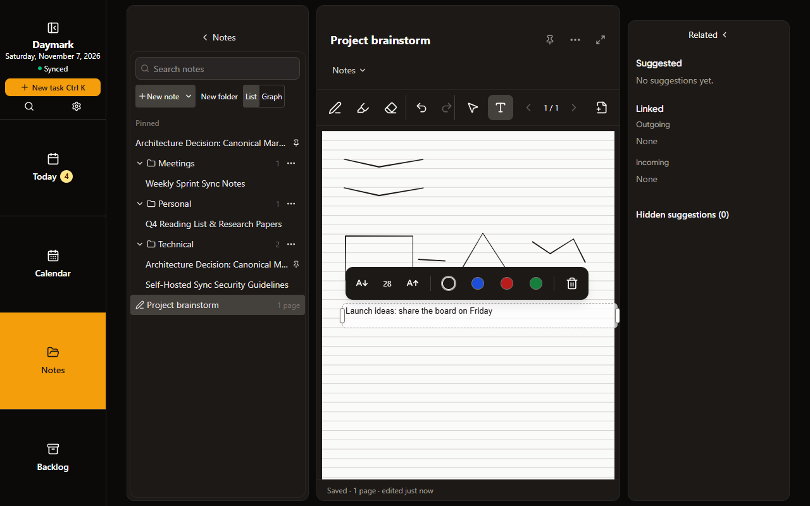
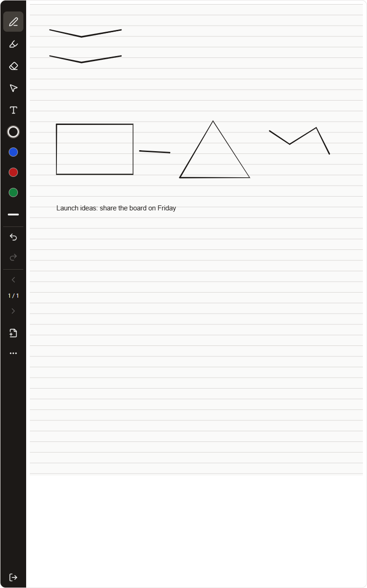
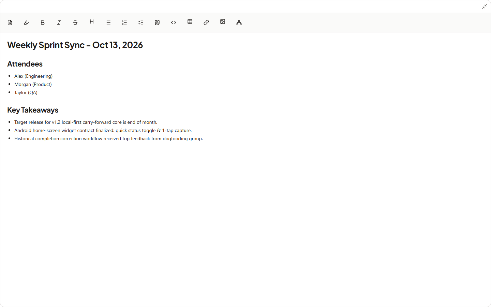

# Cycle 17: Pen writing and full screen

Date: 2026-11-07 · Branch: `cycle-17-pen-writing` · Release: 1.12.0 (tag `v1.12.0`)

Better tablet writing and a clean full screen for every note. Spec and record: [design](../../superpowers/specs/2026-11-06-cycle-17-pen-writing-fullscreen-design.md), [plan](../../superpowers/plans/2026-11-06-cycle-17-pen-writing-fullscreen.md), [S Pen side button finding](./spen-button.md). Released in Daymark 1.12.0.

## What shipped
- **Full screen** for typed and handwritten notes on desktop, tablet and phone: the title, folder picker, Related and footer are hidden; Esc, Exit or Android Back leaves it. Handwritten notes get a dark **side rail** (left or right) that clears the Android status bar.
- **S Pen side button erases** while held, then the pen draws again. In the Android app this needed native code, because the WebView drops strokes drawn with the button held ([details](./spen-button.md)). A pen eraser end also erases.
- **Select:** draw a loop around ink or text boxes, then move, resize from a corner, recolour, delete, copy, cut, paste or duplicate. Dragging and resizing now follow the pen live. Tapping Select again (or pressing S) goes back to the last pen, highlighter or eraser.
- **Text boxes** with a keyboard, so laptops and phones can write on handwritten pages too. An open box has a frame, side grips for its width, and a bar for text size, colour and Delete. Text is saved however the box is closed. 1.11 devices keep text boxes when they sync.
- **Draw-and-hold shapes:** draw a line, arrow, rectangle, ellipse, circle or triangle and hold the pen still at the end to tidy it; Undo brings the freehand stroke back.
- **Guide:** a new Handwriting and pen topic; the Notes topic covers full screen.

## Screenshots
Captured with `node scripts/capture-screenshots.mjs cycle-17` on a disposable server with sample data; the notebook was written with real pen events (shapes snapped by holding). All 8 were opened and checked.

| | |
| :--- | :--- |
| Tablet full screen with the side rail, snapped shapes and a text box  | Dark theme  |
| Selection frame, corner handles and action bar  | Open text box: frame, side grips, size, colour and Delete  |
| Open text box, dark theme  | Tablet portrait full screen  |
| Typed note in full screen, desktop  | Typed note in full screen, phone  |

## How it was verified
| Run | Result |
| :--- | :--- |
| `npm run lint` | pass |
| `npm test` | 172 files, 2215 passed, 1 skipped |
| `npm run test:helpers` | 37 passed |
| `npm run build` | pass |
| `npm run test:e2e` | 47 checks pass (full screen on phone, tablet and desktop; text without a pen; select, move and undo; shape hold) |
| `npm run test:sync` | 56 checks pass, including a 1.11 device keeping text boxes; last run before the final two UI commits, which do not touch sync |
| `npm run android:build -- --release --test` | pass; 9 S Pen button Kotlin tests pass |
| Galaxy Tab S9 FE, Android 16 | The owner confirmed that the side button erases (also seen in the page's event log over USB), text boxes save, and resizing works. The Select toggle (last test build) and the rail clearing the status bar were not explicitly confirmed |

## Known gaps
- Pen behaviour was checked on one Samsung tablet only. Other stylus makers and the installed PWA in Chrome were not tried with the side button.
- Samsung Air Command can still open on a hover press, depending on the tablet's S Pen settings.
- The UI redesign (live drag, text box bar) was approved from tablet use, not a formal usability review.

## Usage vs. estimate
Actual session and token totals are unavailable to this runtime.

## Next cycle
[Cycle 18: tags, suggestions and Help](../../superpowers/specs/2026-11-06-cycle-18-tags-suggestions-help-design.md). Cycles 17 and 18 shipped together in Daymark 1.12.0: [ROADMAP](../../ROADMAP.md).
