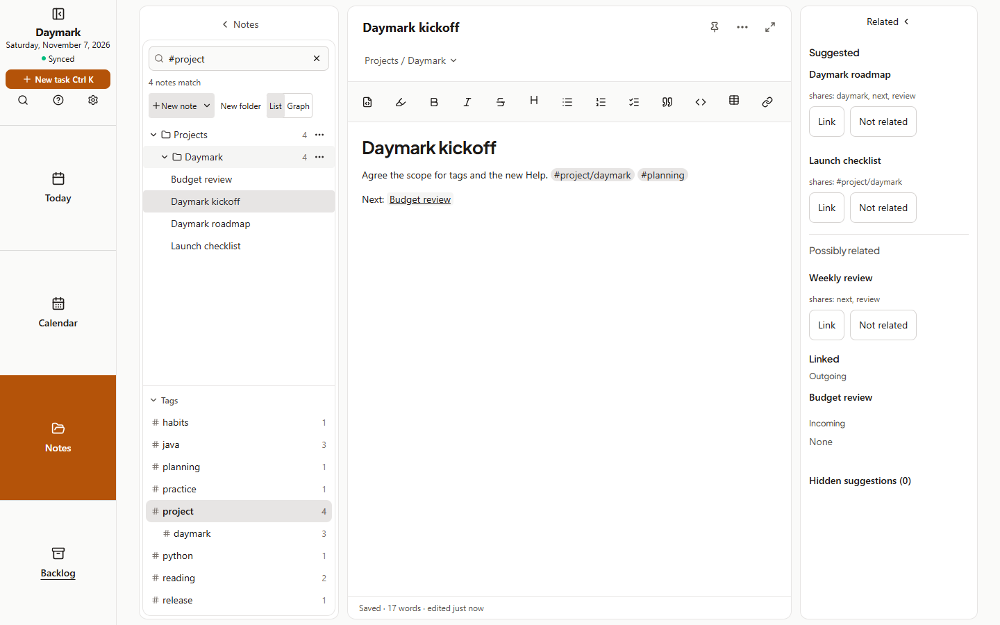
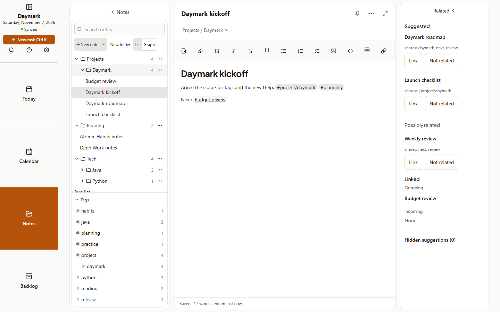
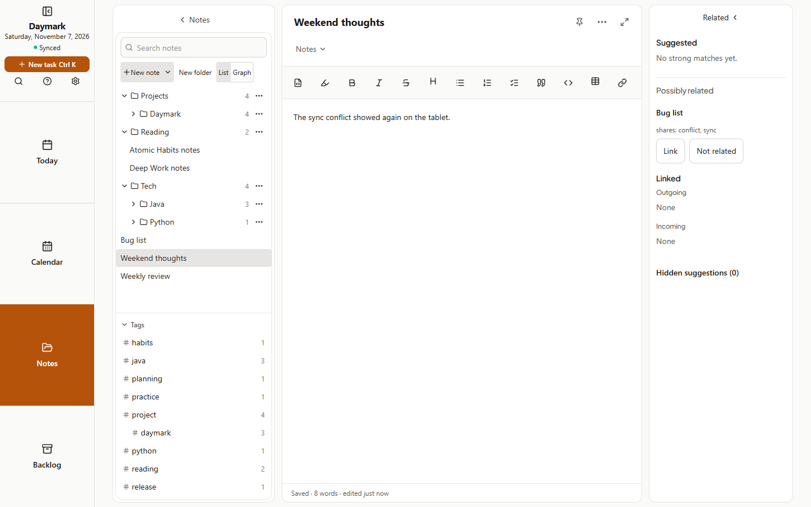
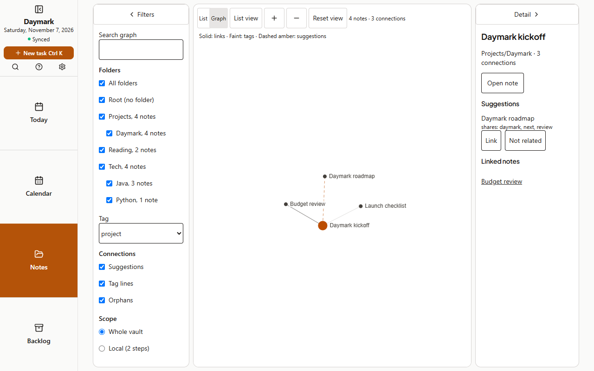
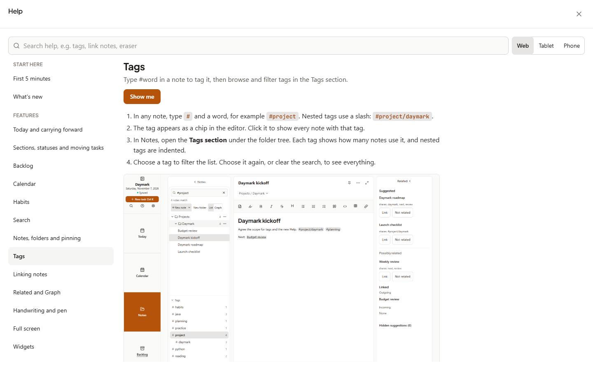
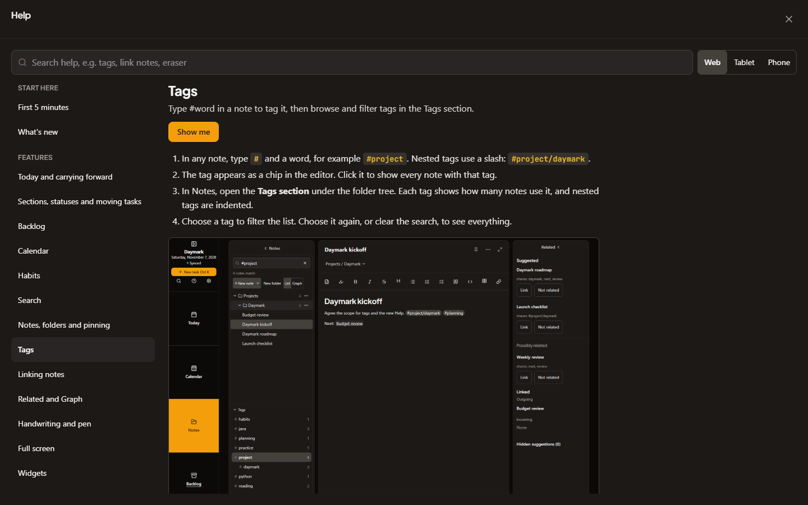
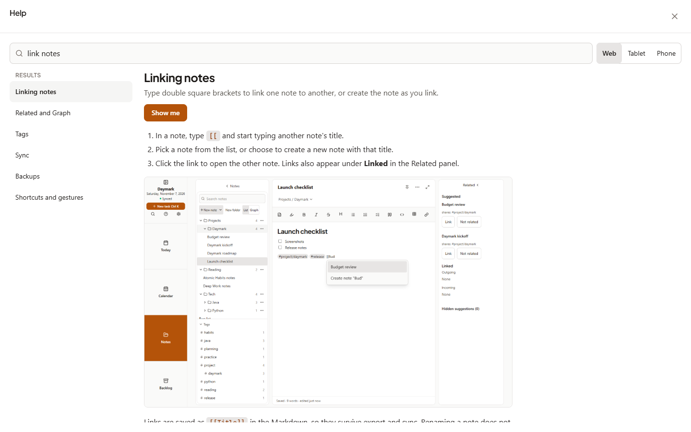
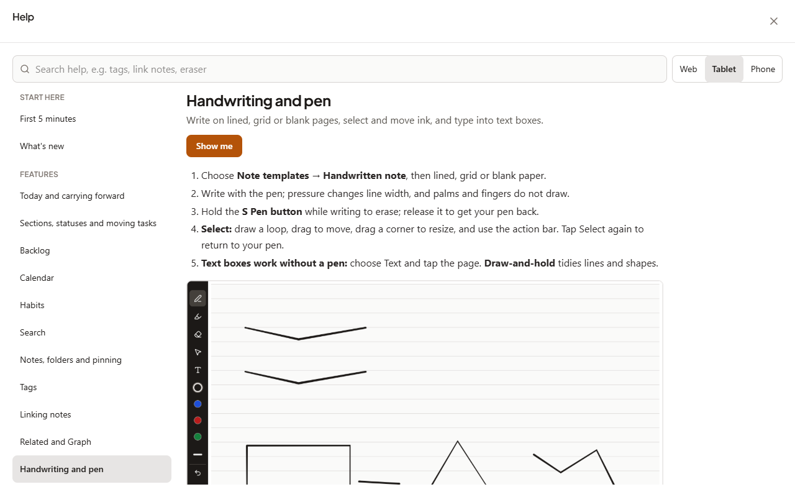
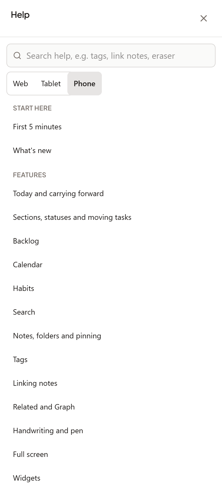

# Cycle 18: Tags, Related suggestions and Help

Date: 2026-11-07 · Branch: `cycle-18-tags-suggestions-help` · Release: 1.12.0 (tag `v1.12.0`)

`#tags` now work everywhere the app reads tags, Related suggestions show up for short English notes and say why, and Help is a full-size page. Spec and record: [design](../../superpowers/specs/2026-11-06-cycle-18-tags-suggestions-help-design.md), [plan](../../superpowers/plans/2026-11-07-cycle-18-tags-suggestions-help.md). Released in Daymark 1.12.0.

## What shipped
- **Tags:**
  - Type `#project` or `#project/daymark` in a note; frontmatter `tags:` counts too.
  - `#` inside code, links, URLs, headings and HTML, `#123`, and hex colours such as `#ffcc00` are not tags.
  - Tags show as chips in the rich editor; clicking one filters Notes by that tag.
- **Tags section and filter:**
  - A Tags section under the folder tree shows counts and indents nested tags.
  - Searching `#project` filters to that tag and its nested tags; any other `#...` search is plain text.
- **Graph tag view:**
  - The Tag filter lists the real tags and keeps nested ones.
  - Tag lines join notes sharing a tag, in any letter case.
  - Handwritten text-box tags take part.
  - Link always writes into the typed note, and is hidden between two handwritten notes.
- **Handwritten notes:**
  - Text-box text and `#tags` feed search, Graph and Related.
  - More note actions → Tags… sets tags without a text box.
- **Related:**
  - A shared tag is enough on its own to suggest a note.
  - A secondary **Possibly related** group appears only when there are fewer than 5 strong matches, with at most 3 entries.
  - Every suggestion says why: `shares: sync, conflict, #daymark`.
  - Graph is unchanged: no Possibly related edges, and the old small tag bonus.
- **Help:**
  - A full-screen view with search, a Web | Tablet | Phone switch, Start here and Features groups, steps, screenshots, Show me and See also.
  - Opens from the new rail Help button, Settings → Help and `?`. The separate shortcuts dialog is gone.
- **Guide:**
  - 20 shorter topics in `docs/guide`, including First 5 minutes, What's new, Tags, Linking notes, Related and Graph, and Full screen.
  - Screenshots come from `node scripts/capture-screenshots.mjs guide`.
  - The website guide builds from the same files.

## Decisions made while building
- **Tags are read from the text, never saved into `note.tags`.** Saving a note never changes its `tags` field, so there are no extra sync writes, and a 1.12 device and this version agree byte for byte. `note.tags` keeps the old sample tags and holds the handwritten Tags… field.
- **Related scoring:**
  - The shared-tag bonus equals the suggestion threshold (0.30).
  - The Possibly related floor is 0.05, together with at least two shared meaningful words.
  - Short notes score low because their titles dominate. The fixture pairs score 0.074 and 0.118, and no unrelated fixture pair shares two words.
- **Android signing instructions** moved from the user guide to [android-release-signing.md](../../android-release-signing.md).

## Screenshots
Captured with `node scripts/capture-screenshots.mjs cycle-18` on a disposable server with sample data. All 9 were opened and checked.

| | |
| :--- | :--- |
| Tags section filtered by #project  | Tag chips in the editor, Related reasons  |
| Possibly related with its reason  | Graph tag view: tag lines, #project filter  |
| Help, desktop  | Help, dark theme  |
| Help search: "link notes"  | Help, tablet instructions  |
| Help, phone topic list  | |

The in-app guide screenshots live in [docs/guide/images](../../guide/images/).

## How it was verified
| Run | Result |
| :--- | :--- |
| `npm run lint` | pass |
| `npm test` | 178 files, 2295 passed, 1 skipped |
| `npm run test:helpers` | 39 passed (guide format, shipped topics and screenshots, site build) |
| `npm run build` | pass |
| `npm run test:e2e` | 56 checks pass. The 9 new ones: Tags section, tag chip, `#project` filter, Related reason, Graph tag filter, Graph tag line, `?` opens Help, Help search, Show me |
| `npm run test:sync` | 56 checks pass |
| Markdown audit (`vitest.markdown-audit.config.ts`) | 372 passed, 0 failures, including the new tag fixture |
| `npm run validate:ai` | pass |
| `npm run test:qa -- C10-H1` and `-- C11-Help` | pass, after pointing both at the new Help view |
| Whole-branch review (fresh reviewer) | 0 critical, 4 important, all fixed with tests that failed first. A fifth finding was also fixed: tag lists were rebuilt on every pen stroke |

## Known gaps
- Deferred from review:
  - A guide value that starts with "s" right after the colon, with no space (`show:search`), loses that letter.
  - Clicking a tag chip always opens the tag list, so you cannot click into it to edit.
  - A tag on most notes fills the strong suggestions for those notes.
  - `_#em_` is not read as a tag.
  - Help does not re-layout on rotate until it re-renders.
- Global Search (Ctrl/⌘ Shift F) does not include handwritten text-box text or stored tags. Notes search does.
- Old sample tags stored on typed notes cannot be removed from the app; only handwritten notes have a Tags… field.
- No tag chips in Markdown preview, because typed notes have no separate preview screen.
- Found, not fixed: opening a note in the rich editor rewrites a bare URL as a Markdown link to itself. This predates Cycle 18; the tag fixture uses a Markdown link instead.
- Named connections are deferred.
- Not tried on the tablet yet.

## Usage vs. estimate
Actual session and token totals are unavailable to this runtime.

## Next
Cycles 17 and 18 shipped together in Daymark 1.12.0. Named connections are next when tags have been used for a while: [ROADMAP](../../ROADMAP.md).
