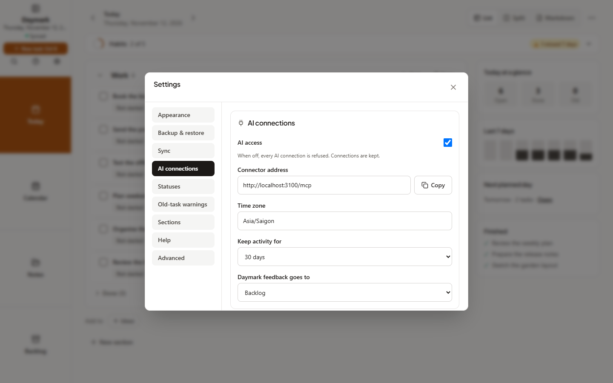
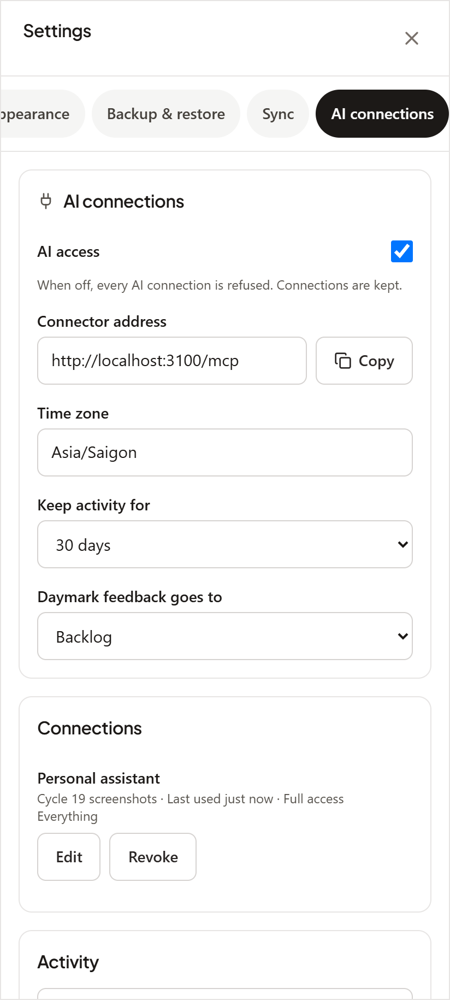
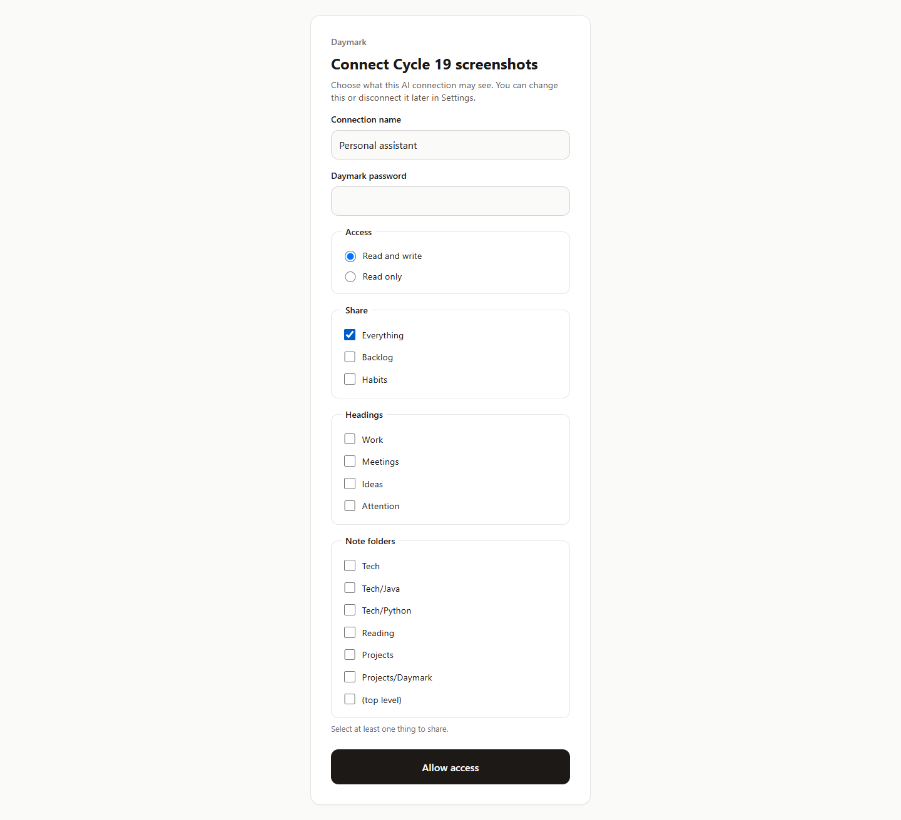
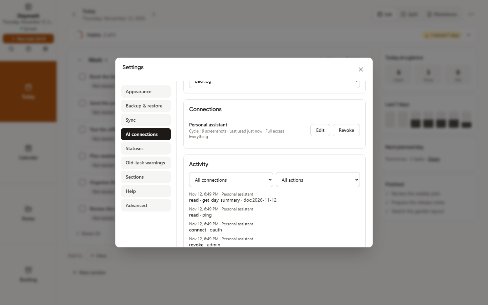

# Cycle 19: MCP server and AI connections

Date: 2026-11-12 · Branch: `feat/cycle-19-mcp` · Release: **No version was released or tagged by this plan.**

Daymark's self-hosted server now offers MCP tools for an AI client to read and update the areas the owner shares. Implementation is complete and verified; owner connector checks are pending. See the [design](../../superpowers/specs/2026-11-12-cycle-19-mcp-server-design.md), [setup guide](../../guide/ai-connections.md), [client skill](../../../skills/daymark/SKILL.md) and [API reference](../../../.ai-configs/project/api-and-sync.md#7-ai-connections-cycle-19-mcp).

## What shipped

- Streamable HTTP `/mcp` on the existing server, OAuth discovery and dynamic client registration, password consent with PKCE, rotating connection refresh tokens and revocation.
- Per-connection sharing for daily headings, note folders/subfolders, the whole backlog and habits, with full or read-only access. Device-only administration keeps the AI from changing its own grants.
- Tools for day summaries, reviews, search, task and note edits, backlog picks and habit ticks. AI writes use the shared vault revision path and reach devices through normal sync.
- **Settings → AI connections:** Connector address, AI access master switch, Time zone, Connections with Edit/Revoke, Activity filters and retention, and Daymark feedback goes to.
- Daily `mcp-audit/` activity and server-only `mcp.json` state. Retention is 30 days by default, configurable to 7 or a custom 1–365 days. The HTTP server and the stdio entry point both prune on startup and daily.
- Daymark feedback via `submit_daymark_feedback`, routed to backlog, today's section or a note folder. This submission-only exception also works for read-only connections without exposing the destination.
- Localhost HTTP and `npm run mcp:stdio -- --data <folder>` for separate local vaults, with exclusive directory locks and an editable built-in Local connection.
- An installable `skills/daymark/SKILL.md`, condensed MCP instructions, and an AI connections guide automatically loaded by Help and the website.

## Decisions made while building

- Hosted access uses `DAYMARK_PUBLIC_URL` (HTTPS origin); production omits MCP/OAuth routes until it is configured. `DAYMARK_MCP=off` disables hosted mounting independently of the saved AI access switch.
- Saved time zone wins over `DAYMARK_TZ`, then UTC; the first device opening AI connections fills an unset zone. Shared rollover rules support morning summaries and server-created days without duplicate carry-forward.
- Device access and MCP access tokens are separate types. Connection refresh tokens have no idle expiry; revocation, password changes and retained-token reuse end hosted access.
- Stdio trusts the OS user and initially grants Local full access. The server and stdio cannot own the same data directory simultaneously. Local vaults do not sync to the owner's hosted server or phone; cloud AI clients can still send tool results to their provider.
- `mcp.json` and `mcp-audit/` belong in stopped-server backups. A device vault ZIP does not include server credentials, connection settings or AI activity.

## Screenshots

Captured by the controller on 2026-11-12 with `node scripts/capture-screenshots.mjs cycle-19` after a production build. The scenario uses a disposable server, sample data, real OAuth consent and real `ping` / `get_day_summary` calls (visible in the Activity screenshot); it needs no owner's AI account and rejects `--url` to keep fixture writes off an owner's server. In the consent screenshot the scenario has already ticked **Everything**; the page itself starts with nothing shared, and the scope step appears only after the password.

Task 15's implementer could not start the browser in its sandbox, so the controller ran the capture on the normal host. All four images were produced and reviewed.

| View | Expected image |
| :--- | :--- |
| AI connections, desktop (1440×900) |  |
| AI connections, mobile browser (412×915) |  |
| Daymark OAuth consent |  |
| Activity populated by real calls |  |

## Verification

Full verification run by the controller on branch `feat/cycle-19-mcp` after all 15 tasks:

| Run | Result |
| :--- | :--- |
| `npm run lint` | Pass (exit 0) |
| `npm test` | Pass — 196 test files, 2437 passed, 1 skipped |
| `npm run test:helpers` | Pass — 40 passed, 0 failed |
| `npm run build` | Pass (exit 0) |
| `npm run validate:ai` | Pass (exit 0) |
| `node scripts/capture-screenshots.mjs cycle-19` and visual review | Pass — 4 images captured and reviewed |

## Manual connector checks

| Check | Outcome |
| :--- | :--- |
| MCP Inspector (`npx @modelcontextprotocol/inspector`) against `http://localhost:3000/mcp`: OAuth completes and the tools list | Not run yet — needs the owner's HTTPS server / accounts |
| Claude web custom connector against the owner's HTTPS server: “what's my day” | Not run yet — needs the owner's HTTPS server / accounts |
| Claude mobile voice: the same question | Not run yet — needs the owner's HTTPS server / accounts |
| ChatGPT connector: one read and one write | Not run yet — needs the owner's HTTPS server / accounts |
| Claude Code with the stdio entry point: one local write | Not run yet — needs the owner's HTTPS server / accounts |

## Known gaps

- Provider/account compatibility and mobile voice behavior await the owner's manual checks above; these are not claimed as passing.
- The mobile screenshot is the server web app in a phone viewport, not a native Android capture.
- Audit append failures are logged and do not roll back completed tool writes.
- No version bump, release, tag or commit is performed by Task 15; the controller commits the working tree.

## Usage vs. estimate

Actual session and token totals are unavailable to this runtime.

## Next

Full verification and screenshots are done. The owner's connector checks above are still to run before deciding on a release. See [ROADMAP](../../ROADMAP.md).
