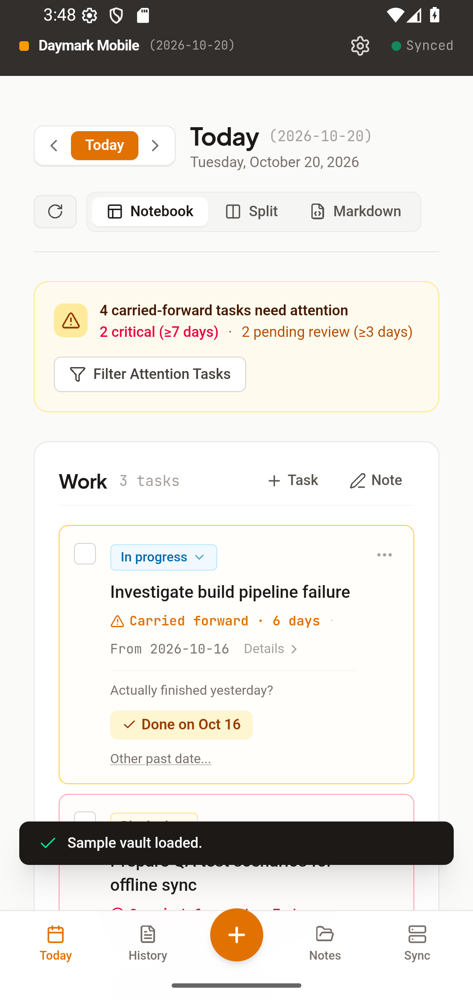
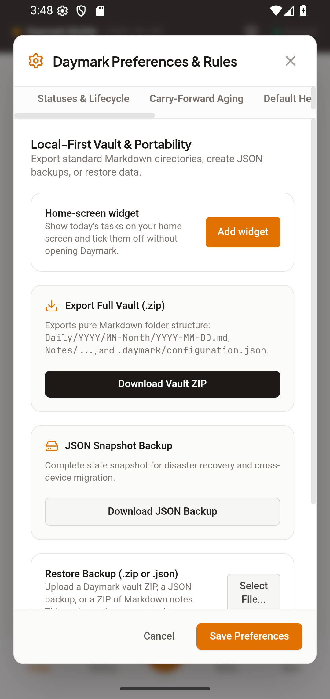
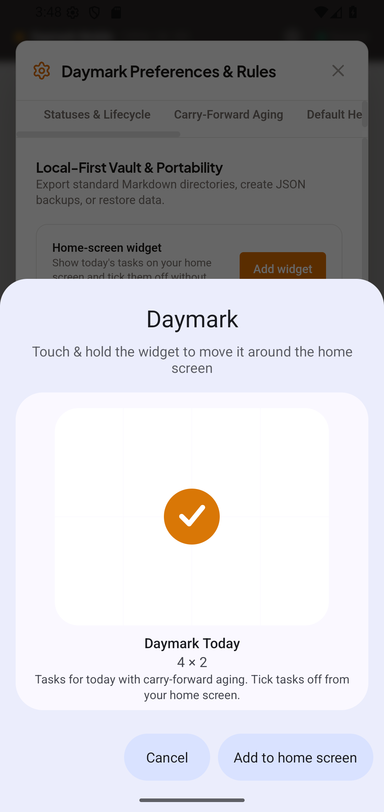
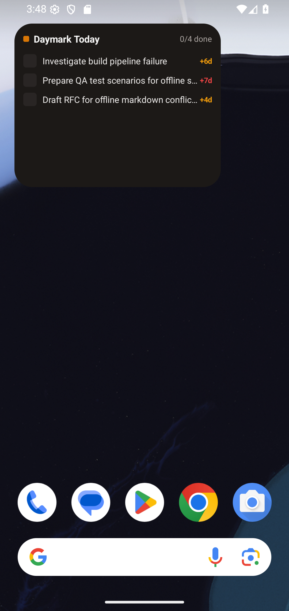
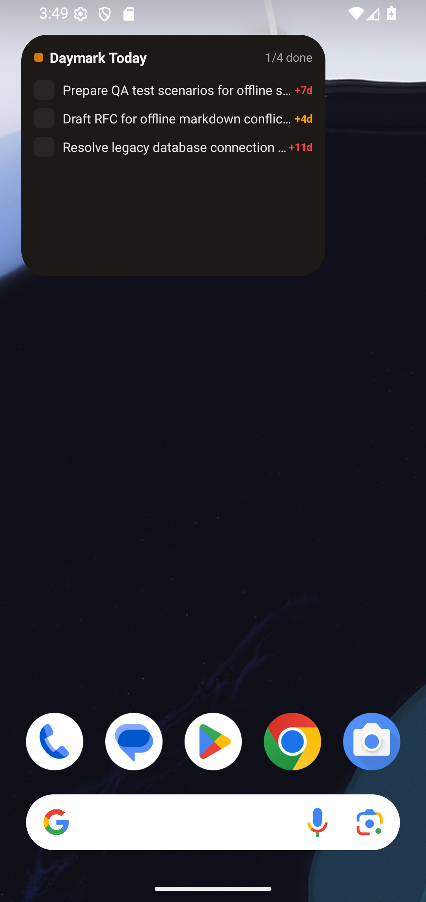
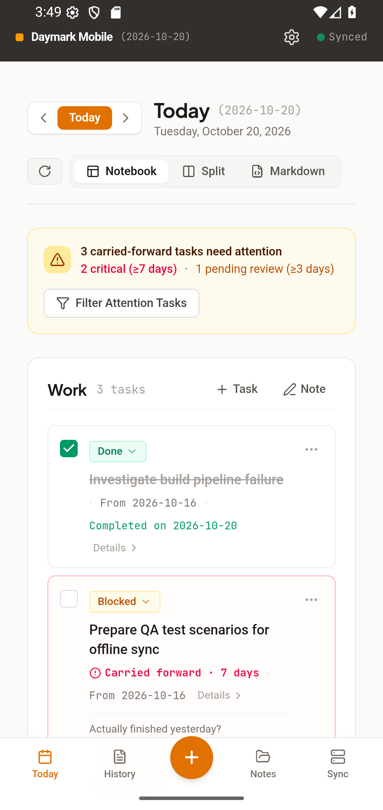

# Cycle 2: Android native shell and home-screen widget

Date: 2026-10-20 · Branch: `cycle-2-android-native-shell` (from `cycle-1-android-ready-local-app`)

Daymark now builds as an installable Android app (debug APK) with a real home-screen widget showing today's tasks. Verified end to end on an Android 16 emulator (Pixel 4 profile).

## What shipped
**Android app (Capacitor)**
- Real Android project in `mobile/android/` wrapping the existing web build, so the PWA and the app share one UI and one data model (ADR 8). Same app id on every build: `app.daymark.notes`.
- Daymark launcher icons (adaptive + legacy), splash, light status-bar icons on the dark header, "Opening your vault…" placeholder instead of a blank screen while the vault loads.
- The service worker is skipped inside the app (assets are bundled).

**Home-screen widget (Jetpack Glance)**
- Small / medium / large layouts, carry-forward age badges (+4d amber, +7d red), done counter.
- Tick a task on the widget: it redraws immediately and the toggle is queued; the app applies it when it next opens or returns to the foreground. If the day changed while the app was closed, the widget drops finished tasks until the app runs the rollover.
- "Add widget" button in Settings → Storage opens Android's add-to-home-screen prompt.
- Bridge: `DaymarkBridge` Capacitor plugin (`setSnapshot`, `consumeActions`, `pinWidget`); web side in `src/native/daymarkBridge.ts` and `src/hooks/useWidgetSync.ts`. No-ops in the browser.

**Gaps in Cycle 1 found and fixed here**
- On phones the Settings screen (backup, import, reset) was unreachable. Added a gear button to the mobile header.
- Blob downloads do not work in the Android WebView, so exporting did nothing. In the app, exports are written to cache and opened in the system share sheet (Drive, Files, email).

**Tooling**
- `npm run android:build [-- --test]` (web build, Capacitor sync, Kotlin unit tests, debug APK); finds JDK 21 and the SDK.
- `scripts/e2e-android-native.mjs`: drives the app over Chrome DevTools and the widget via adb/uiautomator.
- CI job that builds the APK, runs the Kotlin unit tests and uploads the APK.
- Old Compose sketches moved to `mobile/android-reference/` (not built).

## Screenshots
Android 16 emulator, captured by `scripts/e2e-android-native.mjs cycle-2`.

| Step | Image |
| :--- | :--- |
| 1. First launch in the app |  |
| 2. Sample vault rolled into today |  |
| 3. Settings → Storage with "Add widget" |  |
| 4. Android's add-widget prompt |  |
| 5. Widget on the home screen |  |
| 6. After ticking a task on the widget (1/4 done) |  |
| 7. App reopened: the task is Done in the vault |  |

## How it was verified
- `npm run lint`, `npm test` (32 tests), `npm run build`, `npm run validate:ai`, `npm run test:e2e` (web PWA, 15 checks): pass.
- `npm run android:build -- --test`: debug APK builds; 6 Kotlin unit tests pass (toggle flipping, stale-day handling, age and severity).
- `node scripts/e2e-android-native.mjs`: 13 checks pass on the emulator: first-run render, sample vault, snapshot written natively, Settings reachable, Add widget, system prompt, widget on home screen with tasks, tick removes the task and shows "1/N done", toggle queued, toggle applied to the vault on reopen, queue cleared.

## Known gaps
- Not tried on a physical phone; a different launcher may place or label the widget differently. Export-to-share-sheet and the file picker for import were not exercised on the emulator (only the Settings screen was).
- Debug build only. No release signing, no Play Store listing, no auto-update.
- The widget cannot create tasks or open Quick Capture; tapping the header opens the app. Widget changes reach the app only when it opens or resumes.
- The widget keeps one snapshot of today (up to 30 tasks); the large layout scrolls, small and medium show the first three.
- The native e2e needs a booted emulator or device and is not in CI; the CI Android job has not run on GitHub yet.
- A first run of the e2e right after install occasionally failed to attach to the WebView (retry passed); the attach loop waits up to 60 s.
- Same carry-over gaps as Cycle 1: desktop heading contrast, "finished yesterday" wording, iOS untested.

## Usage vs. estimate
| | Estimated | Actual |
| :--- | :--- | :--- |
| Claude sessions | 2 | 1 (shared with Cycles 0-1) |
| Tokens (approx.) | 3-5M | not measured here; check `/usage` |
| Pro 5-hour windows | 1-1.5 | not measured here |

## Next cycle
[Cycle 3: Self-hosted server and sync](../../ROADMAP.md#cycle-3-self-hosted-server-and-sync)
