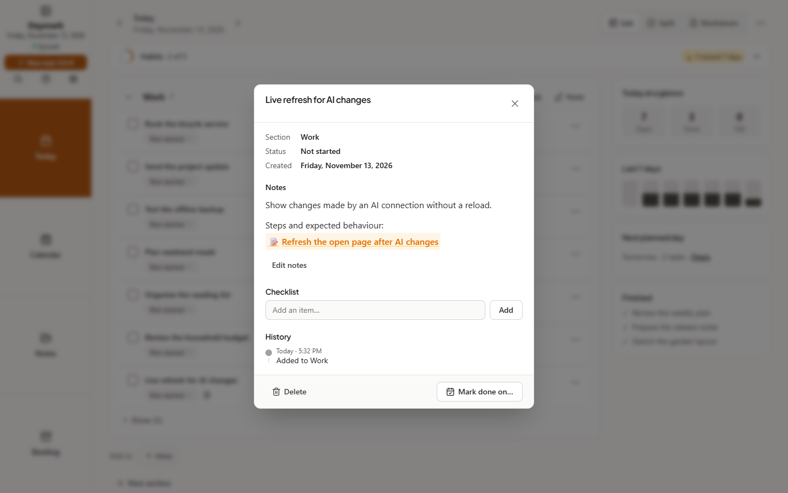
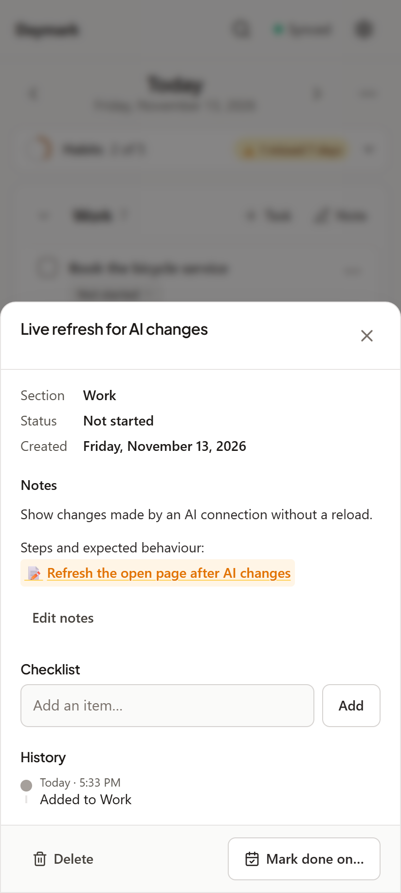
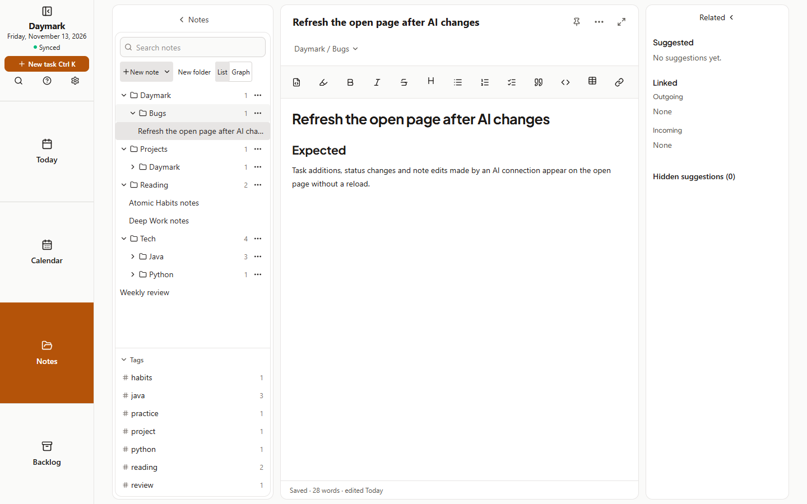

# Cycle 20: MCP feedback round 1

Date: 2026-11-13 · Branch: `feat/cycle-20-mcp-feedback` · Release: 1.13.2 (tag `v1.13.2`); follow-up 1.13.3 (tag `v1.13.3`)

The first round of fixes from the owner's own use of the Daymark connector. The four items were filed in Daymark on 2026-11-13, under the **Daymark** heading and in the note `Daymark/Bugs/Daymark - Refresh the open page after MCP changes`. See the [design](../../superpowers/specs/2026-11-13-cycle-20-mcp-feedback-design.md).

## What shipped

- **Open pages update instantly (F1).** The server has an authenticated Server-Sent Events stream at `/api/events`. After any write that raises the vault revision (a device's sync push, an MCP tool call, a restore), open signed-in pages get a `changed` event and sync at once. Events carry only the revision number. The stream:
  - debounces bursts into one event;
  - sends a heartbeat every 25 s;
  - closes when the access token expires, the password changes or the device is revoked, and the client reconnects with a fresh token.

  The client reads the stream with `fetch`, because `EventSource` cannot send the Bearer token. It runs only while the page is visible, backs off on errors, and keeps the 60 s timer as a fallback for servers without the endpoint. The note editor keeps the cursor in place when a remote edit arrives.
- **Folder tools in MCP (F2).** `list_folders` shows empty folders too. `create_folder`, `rename_folder` and `delete_folder` reuse the app's folder operations. `delete_folder` never deletes notes: like the app, it moves them to the parent folder, so it needs the folder and its parent shared.
- **`[[Note title]]` links open the note (F3).**
  - **Task notes** render as Markdown, with an **Edit notes** button. They used to be plain text, so links never worked.
  - **Today and Calendar section notes:** clicking a link opens the note in Notes.
  - **Matching:** one resolver matches titles case-insensitively across nested folders, accepts `Folder/Sub/Title` and Obsidian aliases, and prefers the same folder, then the newest note.
  - **Missing notes:** a link with no matching note is shown dashed instead of failing silently.
- **Clearer AI guidance (F4).** `skills/daymark/SKILL.md` and the MCP instructions now:
  - create a task or note when the owner explicitly asks for one about the app, with feedback staying the default;
  - let the AI create a folder when asked, and ask when several folders fit;
  - document `[[links]]` and the folder tools.
- **Docs:**
  - the AI connections guide covers instant updates and folder tools;
  - **What's new** lists 1.13.2;
  - the MCP API reference lists the folder tools.

## Follow-up in 1.13.3

After 1.13.2 was deployed, ChatGPT and an open Claude Code session still offered no folder tools, because AI clients cache the tool list. The server now records its tool set and, per connection, when the client last fetched it. **Settings → AI connections** marks connections with an old list **Needs refresh** and explains how to refresh ChatGPT, Claude and Claude Code / Codex; the mark clears on the client's next tool fetch. `serverInfo.version`, `/api/health` and `ping` report the Daymark release instead of a fixed `2.0.0`, and the skill tells the AI to suggest a refresh when a tool is missing.

## Screenshots

Captured with `node scripts/capture-screenshots.mjs cycle-20` against a disposable server with sample data.

| Screen | Image |
| :--- | :--- |
| Desktop 1440x900: task notes with a rendered note link |  |
| Android 412x915: the same sheet on a phone |  |
| Desktop 1440x900: the link opened the note in `Daymark / Bugs` |  |

## How it was verified

- `npm run lint`: clean.
- `npm test`: 2,497 passed, 1 skipped. New tests:
  - `server/events.test.ts`: another device's change produces an event, a no-op sync does not, unauthenticated requests are refused, bursts are coalesced, and the stream ends when access lapses.
  - MCP writes notify open pages; refused writes do not.
  - The folder tools, covering scope, parent grants, case-insensitive paths, notes kept on delete, and a device pull.
  - The link resolver.
  - A jsdom test of the exact reported case: a task linking to a note in `Daymark/Bugs`.
- `npm run test:helpers`: 41 of 41.
- `npm run build`: passes.
- `npm run test:sync`: 57 of 57. A new check confirms an open laptop page shows a task added on the phone **in 829 ms**, with no reload or **Sync now**.
- `npm run test:e2e` (Android PWA): all checks pass.
- `npm run test:qa`: 750 of 808. The same 58 checks fail on `main` (1.13.1) on this machine (C101 short-window tooltips, R1/D4 timeouts, two axe tree checks). They were present before this cycle and are not caused by it.
- `npm run validate:ai`: passes.

## Deployment

Deployed to the owner's server on 2026-11-13, behind Caddy, after a data backup (`daymark-backups/data-20261113-180007.tgz`). The container reports healthy and runs 1.13.2. Over HTTPS, `/api/health` and OAuth discovery answer 200; `/api/events` and `POST /mcp` without a token answer 401.

## Known gaps

- Live updates through the owner's Caddy proxy and on a real phone still need a hands-on check: open Daymark, ask the AI to add a task, and watch it appear. Other proxies must not buffer `/api/events` (the server sends `X-Accel-Buffering: no`).
- The owner's real-account connector checks from cycle 19 are still pending.
- The 58 pre-existing QA failures need their own investigation.

## Next cycle

- Record the owner's connector checks. Optionally serve the skill as an MCP resource. See [ROADMAP](../../ROADMAP.md).
