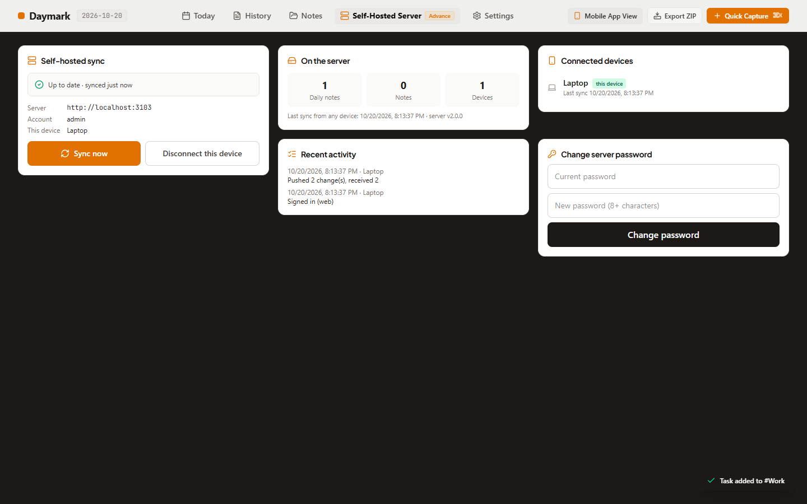
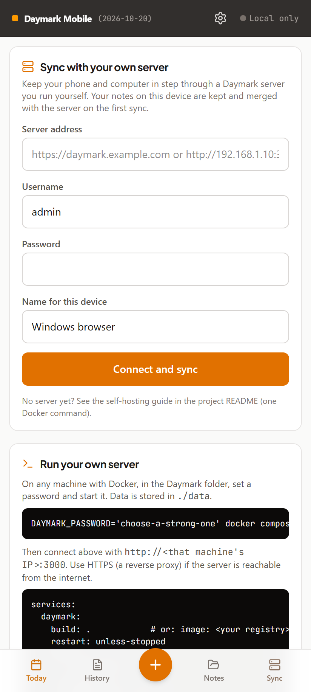
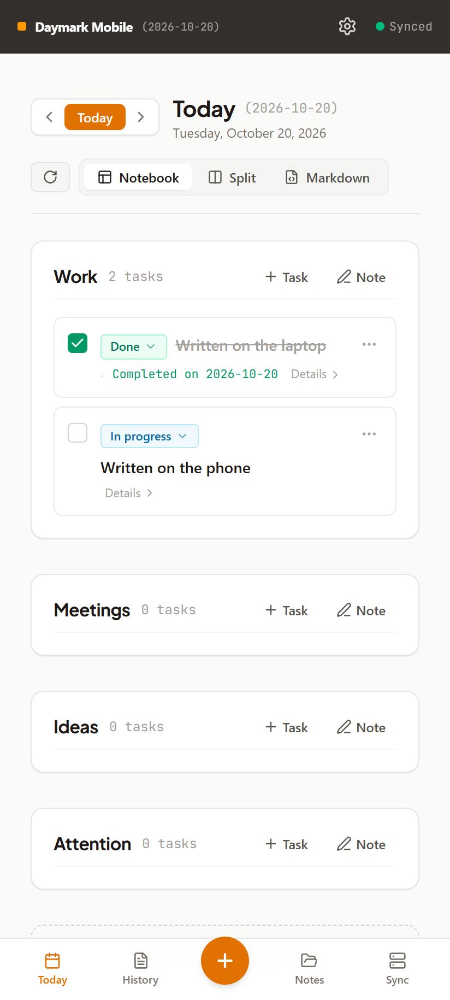
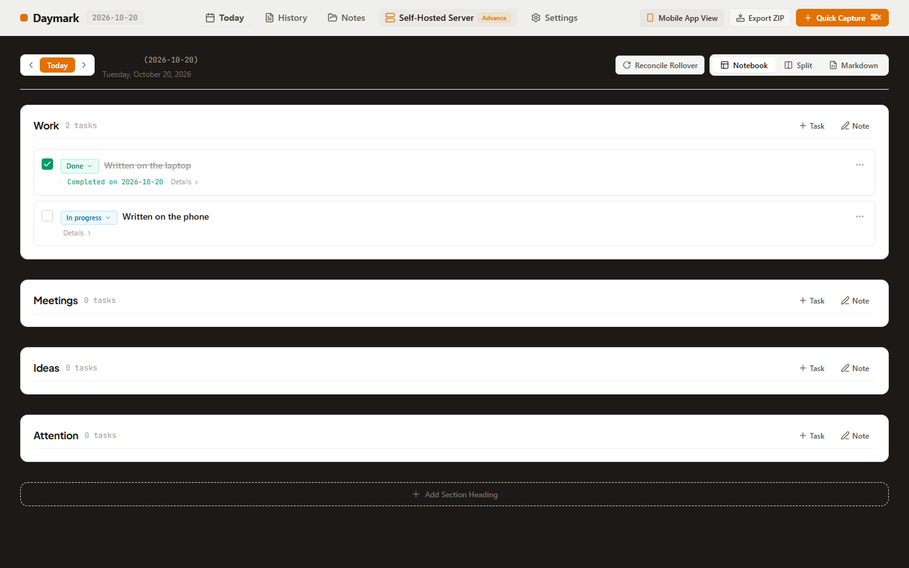
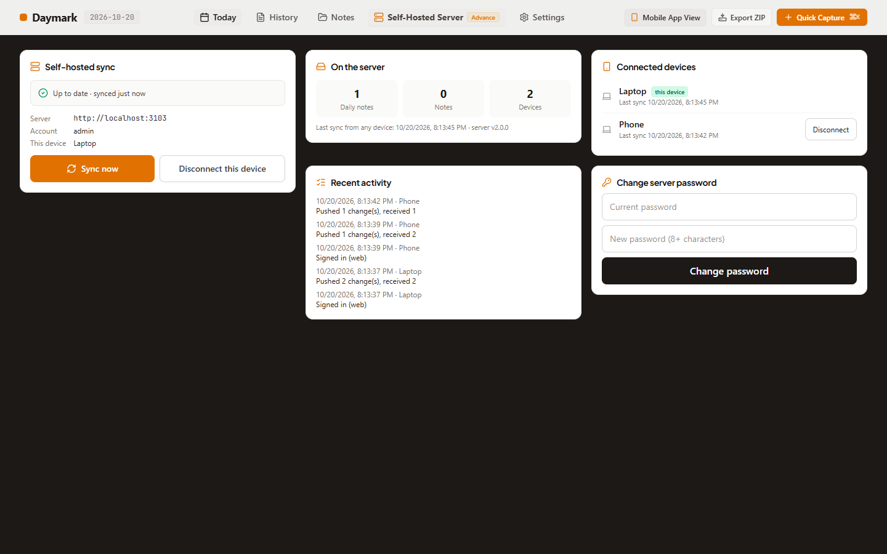
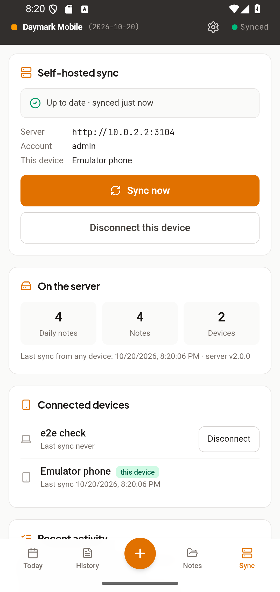

# Cycle 3: Self-hosted server and sync

Date: 2026-10-20 · Branch: `cycle-3-self-hosted-sync` (from `cycle-2-android-native-shell`)

Phone and computer now stay in step through a Daymark server you run yourself, without overwriting each other's work. The demo server and its fake data are gone.

## What shipped
**Secure, persistent server** (`server.ts`, `server/`)
- Real account: password required on first production start (8+ characters, known defaults such as the old `daymark2026` refused), stored scrypt-hashed in `data/auth.json`.
- Signed, expiring device tokens. Every API route except health and login requires one. Disconnecting a device or changing the password revokes tokens. Failed logins are rate-limited.
- Vault, devices and audit log persist as JSON files in `DATA_DIR` with atomic writes. Fake devices and logs removed. Health no longer reveals the username.
- CORS for other-origin clients, long-lived caching for hashed assets, and `--production` so `npm start` works on Windows too.
- Docker: `Dockerfile` (non-root, health check, `/data` volume), `docker-compose.yml`, `.dockerignore`; `.env.example` rewritten.

**Sync that merges instead of overwriting** (`src/sync/`, ADR 9)
- Three-way merge per daily-note task. Edits to different tasks on two devices both survive; an edit beats a concurrent delete; same-task conflicts keep the newest edit; notes text keeps both versions; diverged standalone notes get a "(conflict copy)". Conflicts are shown as a message.
- Incremental protocol (server revisions plus client bases); only changed entities travel after the first sync. Device-local settings (sync connection, date override) are never synced.
- Auto-sync on start, 2.5 s after changes, when coming online, when returning to the app, and every minute.

**App UI**
- One Sync panel (phone Sync tab, Settings → Sync, desktop "Self-Hosted Server"): connect with server address, user, password and device name; status; Sync now; disconnect.
- Server view: counts on the server, connected devices with Disconnect, recent activity, password change, and a setup guide when not connected.
- Real status in the phone header ("Local only", "Synced", "Syncing", "Offline", "Sync error") instead of a hard-coded "Synced".
- Removed: the separate admin login (it pre-filled the old default password), the demo admin dashboard, and the old connect screen (it ignored the entered server address).

**Android**: native HTTP (`CapacitorHttp`) and cleartext allowed, so the app can reach a LAN server on `http://`.

**Fixed along the way**: the lockfile generated on Windows lacked Linux native binaries for rolldown, which broke the Docker build and would have broken Linux CI. Regenerated.

## Screenshots
| Screen | Image |
| :--- | :--- |
| Laptop connected |  |
| Phone: connect form |  |
| Phone: laptop's task received, ticked, new task added |  |
| Laptop: phone's changes arrived |  |
| Server view: devices, activity, password |  |
| Android app synced with a server on the host (Android 16 emulator) |  |

## How it was verified
- `npm run lint`, `npm run build`, `npm run validate:ai`: pass.
- `npm test`: 59 tests. New: 16 merge tests, and 11 server tests that run the real API in-process (auth, forged token, rate limit, device revoke, password change, weak password, two-device convergence, delete plus conflict copy, local-only settings, restart persistence, invalid keys).
- `npm run test:sync`: 7 checks with laptop and phone browsers against a fresh production server (connect, both directions, completion, device list, restart, unauthenticated refusal).
- `npm run test:e2e` (PWA): pass. `node scripts/e2e-android-native.mjs`: 17 checks on the emulator, including the real app syncing over `http://10.0.2.2`.
- Docker: image builds; refuses to start without a password or with a weak one; healthy; serves the app; data survives a container restart.

## Known gaps
- Single account (one person, many devices); no multi-user sharing.
- No HTTPS built in: use a reverse proxy for internet exposure. On a LAN, traffic, including the password at sign-in, is unencrypted.
- First sync uploads the whole vault; the client keeps a full copy of synced entities (bases) next to the vault.
- Task history entries from two devices are not combined (one version of a task's history wins).
- Rate limiting and the sync queue are in-memory (single server process).
- Not tested on a physical phone against a real LAN server; the CI Android and Linux jobs have not run on GitHub yet (not pushed).

## Usage vs. estimate
| | Estimated | Actual |
| :--- | :--- | :--- |
| Claude sessions | 3 | 1 (continued session) |
| Tokens (approx.) | 6-10M | not measured here; check `/usage` |
| Pro 5-hour windows | 2-3 | about 1, with Opus 5.5 |

## Next cycle
[Cycle 4: Remaining (UI/UX polish, desktop, iOS, v1.0)](../../ROADMAP.md#cycle-4-the-rest-desktop-polish-ios-v10)
