# Cycle 4: UI/UX polish and v1.0.0

Date: 2026-10-20 · Branch: `cycle-4-ux-polish-v1` (from `cycle-3-self-hosted-sync`) · Version 1.0.0

A screen-by-screen audit (every main screen on phone 412 px and desktop 1440 px, light and dark mode; `scripts/ux-audit.mjs`) found the problems below. All are fixed and re-checked in fresh screenshots.

## What shipped
**Broken or misleading**
- Desktop in light mode: the page background was hard-coded dark, so page titles ("Today", "Notes", "History") were nearly invisible and the layout looked broken. Now follows light/dark properly.
- Raw Markdown and code showed `<!--` as an arrow (font ligature), which made the task metadata look corrupted. Ligatures are now off in all monospace text.
- Settings on phones was a small dialog whose tab bar ran off-screen, hiding Backup and Sync. It is now full-screen with all sections visible as wrapping chips, opens on **Backup & restore**, and Backup/Sync tabs show **Done** instead of an unrelated "Save Preferences".
- Android Back quit the app even with a dialog or the note editor open. Back now closes the dialog → leaves the editor → returns to Today → minimises the app.
- Deleting a task had no confirmation; it now asks.
- History opened on "yesterday" even when that day had no note (an empty panel). It now opens on the latest day that has one.
- "Actually finished yesterday?" appeared for tasks carried from several days ago. Now "Finished yesterday?" or "Finished earlier?".
- "Replace with sample data" now says plainly that it replaces everything, and confirms.

**Phone layout**
- Header shows just "Daymark" and the sync state; the duplicated ISO dates are gone from the header and title.
- Today: tighter spacing, empty sections collapse to one slim row, no Split view (unusable on a phone), no manual rollover button (it runs automatically).
- Quick Capture opens at the top (the keyboard no longer covers it), with a larger Capture button and shorter status labels.
- Checkboxes have a 44 px touch area; the task checkbox has an accessible name.
- Markdown editor header stacks on narrow screens.

**Desktop**
- Navigation: "Self-Hosted Server (Advance)" is now simply **Sync**; the shortcut hint shows **Ctrl K** on Windows/Linux and ⌘K on Mac.

**Performance and offline**
- Main bundle reduced from 586 kB to 465 kB (131 kB gzipped): JSZip (export/import) and the developer screen load on demand. The service worker precaches those chunks via a build-generated `asset-manifest.json`, so exporting works offline too (new e2e check).

**Release**
- Version 1.0.0 (web, server, Android `versionName` 1.0.0 / `versionCode` 100). README rewritten for users (install, self-host, backups) and developers. iOS: PWA meta tags added; the iOS widget sketches remain unbuilt.

**Security** (from the automated review of Cycle 3): the server's data directory is now created owner-only (0700) and its files written 0600, since `auth.json` holds the password hash and token secret.

## Screenshots
| Screen | Image |
| :--- | :--- |
| Phone: Today (light) | 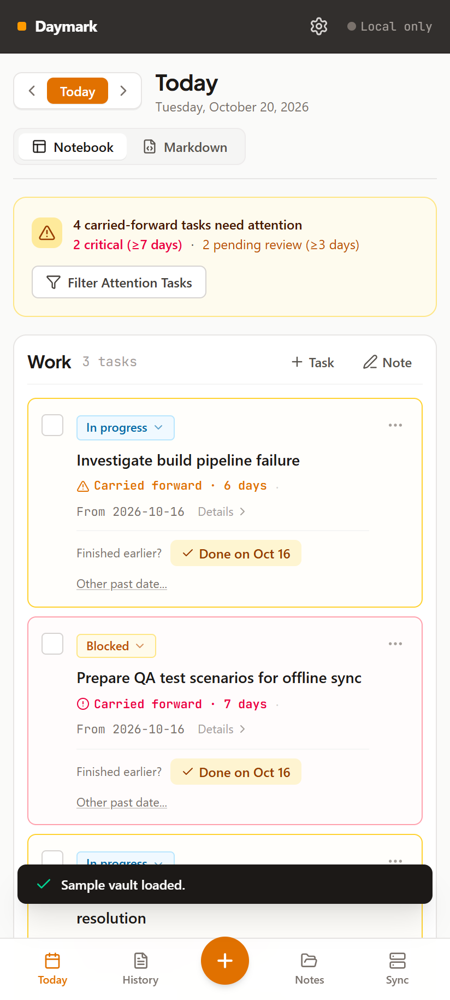 |
| Phone: Today (dark) | 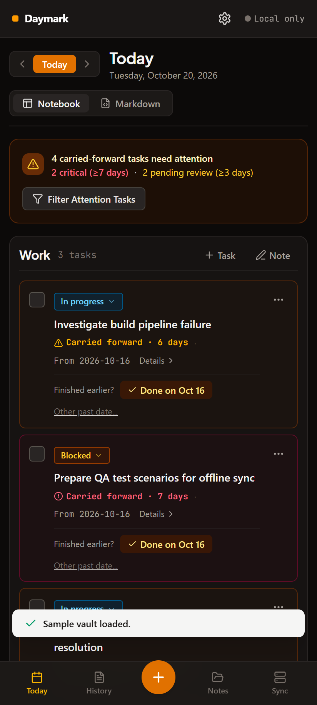 |
| Phone: Quick Capture at the top | 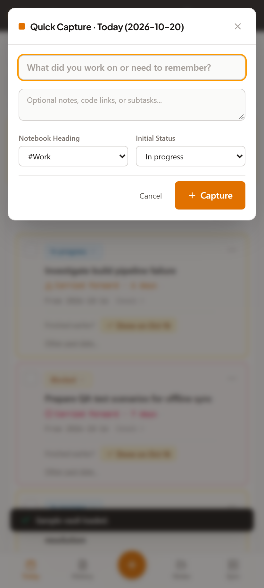 |
| Phone: full-screen Settings, Backup first | 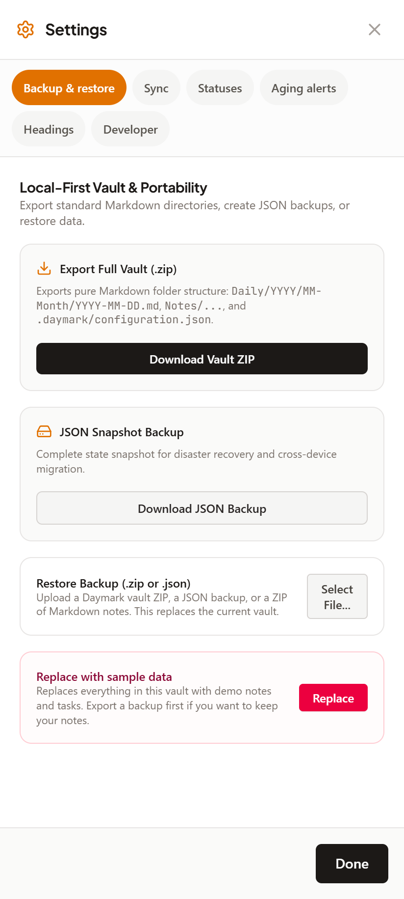 |
| Phone: History | 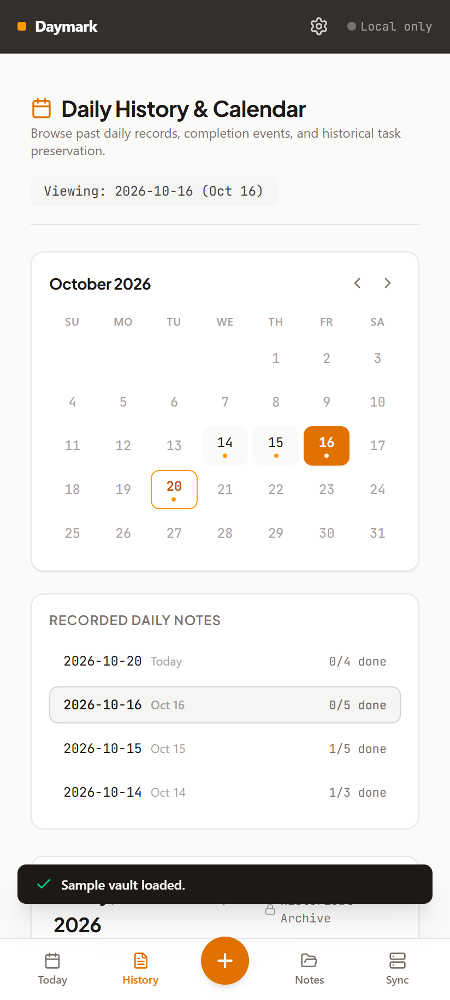 |
| Phone: note editor | 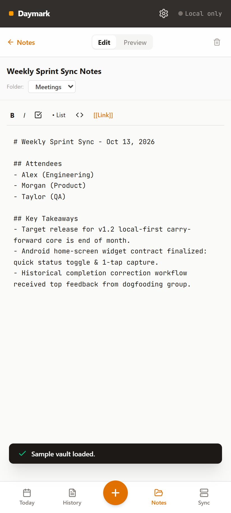 |
| Android app (emulator) | 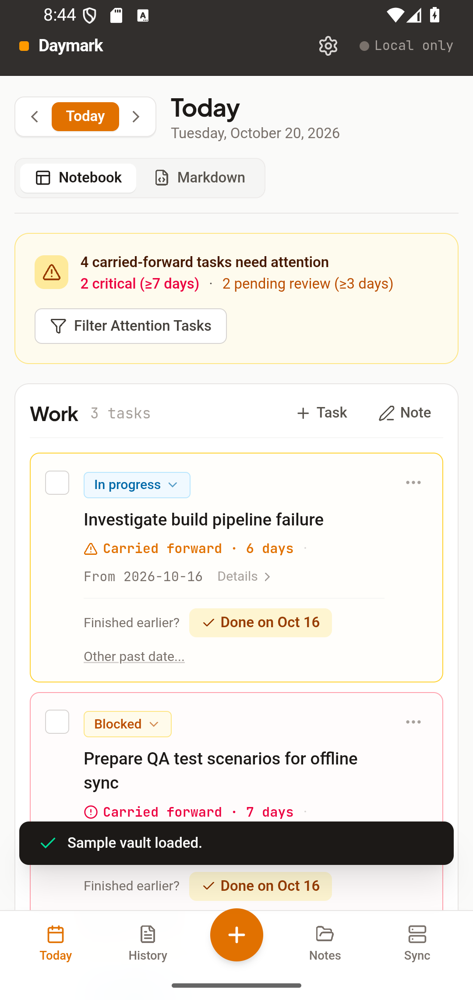 |
| Android widget (emulator) | 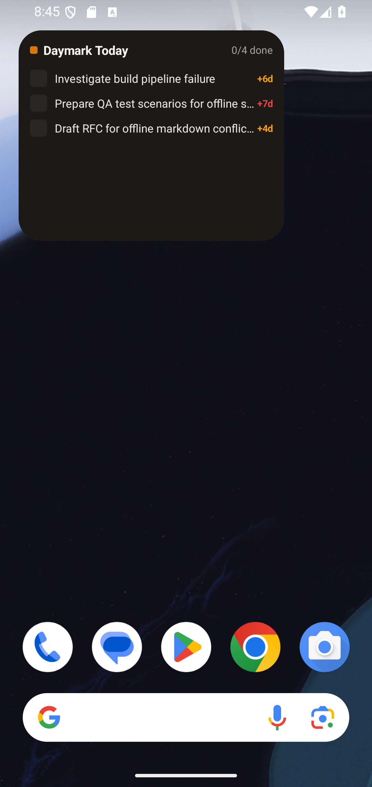 |
| Android app synced (emulator) | 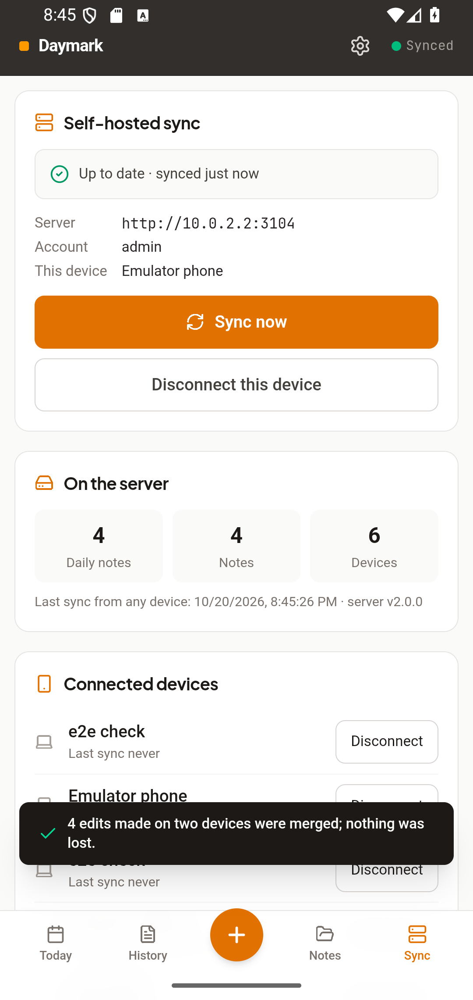 |
| Desktop: Today (light, previously dark gutters and an invisible title) | 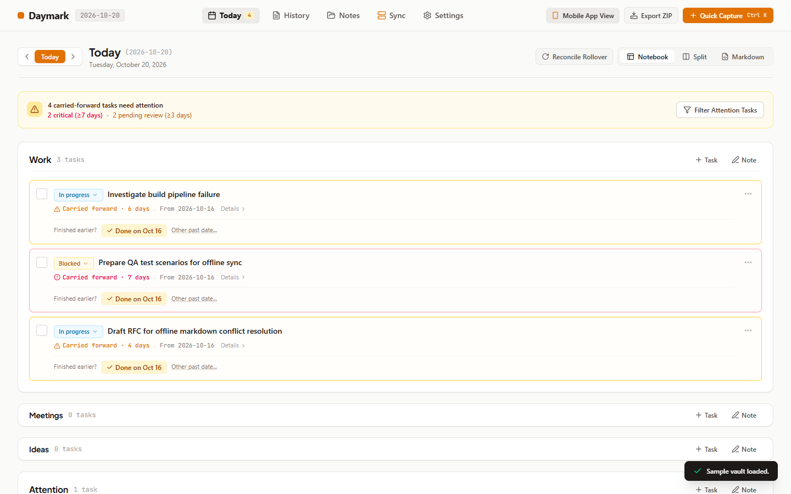 |
| Desktop: Today (dark) | 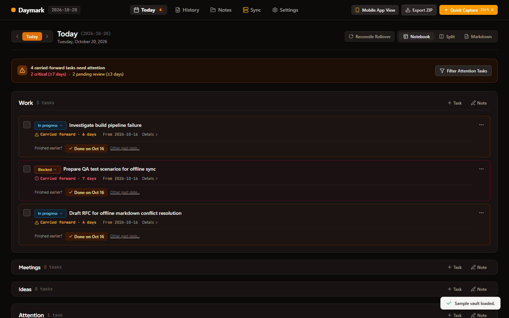 |
| Desktop: Notes | 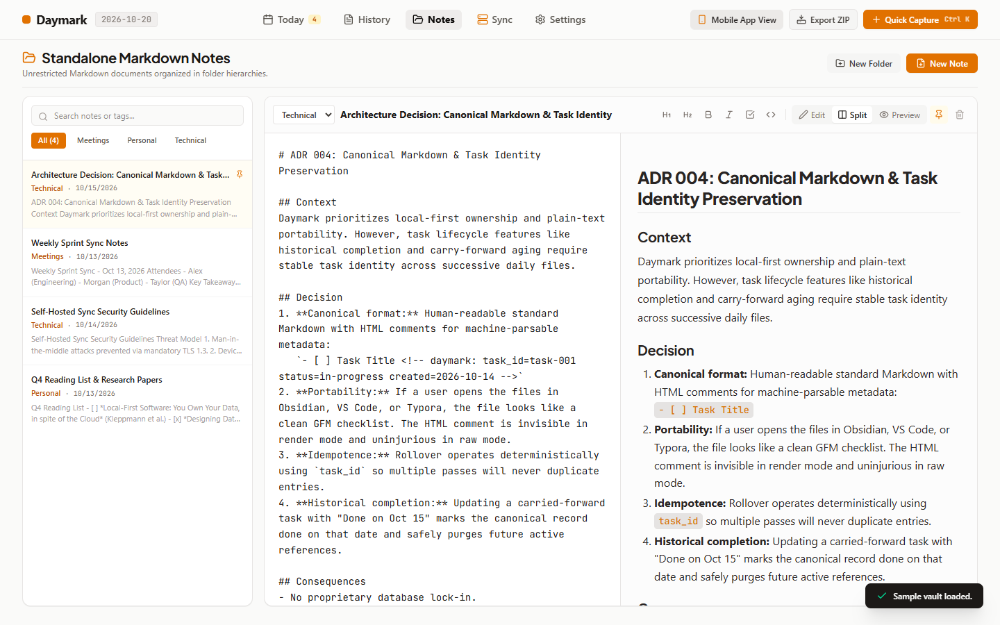 |
| Desktop: History opens on the latest note | 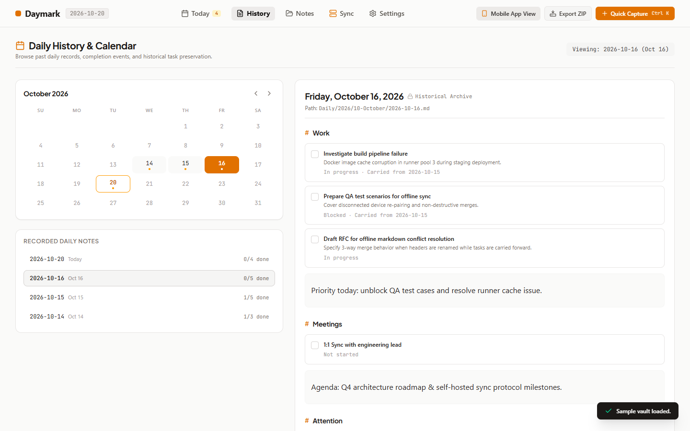 |
| Desktop: Settings (dark) | 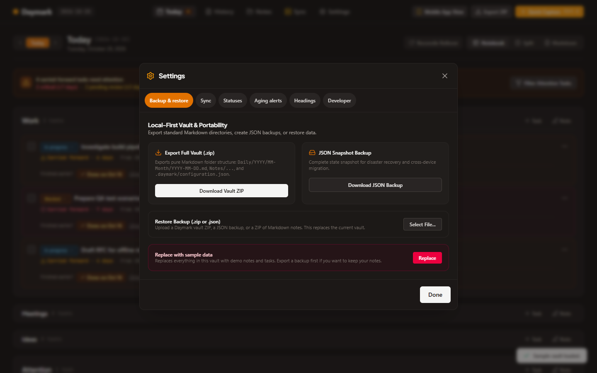 |

## How it was verified
- `npm run lint`, `npm test` (59 tests plus one Linux-only file-permission test), `npm run build`, `npm run validate:ai`: pass.
- `npm run test:e2e`: PWA on an emulated phone, including the new offline ZIP export. `npm run test:sync`: 7 two-device checks. Both pass.
- `node scripts/e2e-android-native.mjs`: 20 checks on the Android 16 emulator (app, widget, sync, and the three new Back-button checks).
- Docker image rebuilt and run; data files checked for owner-only modes inside the Linux container.

## Known gaps
- Not re-tested on your physical phone after these changes. Please reinstall the new APK; it upgrades in place and keeps your data.
- iOS is PWA-only and was not tested on an iPhone; the native iOS widget is not built.
- The Android build is a debug APK (no Play Store signing or auto-update).
- Remaining larger refactors (splitting `TodayView`, `SettingsModal` and `MobileAppShell` into smaller components) were not done; they do not affect users.
- Accessibility: touch targets, labels and dialog roles improved, but no full screen-reader pass.
- The CI workflow has never run on GitHub (nothing pushed yet).

## Usage vs. estimate
| | Estimated | Actual |
| :--- | :--- | :--- |
| Claude sessions | 2-3 | 1 (continued session) |
| Tokens (approx.) | 4-7M | not measured here; check `/usage` |
| Pro 5-hour windows | 1.5-2 | about 1, with Opus 5.5 |

## Next
All roadmap cycles are done. Suggested follow-ups are listed at the end of [`docs/ROADMAP.md`](../../ROADMAP.md).
