# Cycle 6: your look, Calendar and roomier screens

Date: 2026-10-23

Daymark now has more room for the day, space to write, and a look you can make your own. The [design](../../superpowers/specs/2026-10-22-uxui-cycle-6-design.md) covers the changes below.

## What shipped

**Appearance**
- Choose Light or Dark in Settings. New installs start in Light; existing notebooks keep the system theme once when upgrading, then remember your choice.
- Save up to five background photos on each device. A sixth asks which photo to replace. Dim and blur keep the background calm.
- Set header, text and accent colours separately for Light and Dark, plus header opacity and S/M/L text size. Automatic text stays readable; a custom colour warns when contrast is low.
- Theme, colours, dim, blur and text size sync. Photos and the selected photo stay on this device.

**Calendar**
- Calendar replaces History on desktop and phones, with month and week views, task counts and a dot for day notes.
- Plan future days and open any day in the daily editor. Looking at an empty future day creates nothing until you add something.
- Drag a task onto today or a future day on desktop, or use its menu to move it.

**Today**
- List and Markdown views use the available desktop width. Collapse sections and keep that choice on this device.
- Move a task to tomorrow or another day, with Undo.
- The sidebar adds a seven-day progress strip and a link to the next planned day.
- **Fixed:** deleted tasks no longer come back the next morning. Moved tasks stay off their source day.

**Notes**
- The editor fills the screen; long writing scrolls inside it. The note list scrolls separately.
- New note and Folder sit below search. Focus mode hides the list, and the footer shows save state, word count and when you last edited.
- Start from Blank, Meeting, Daily review or Decision record.

**Settings**
- The window keeps the same size between tabs, with a side list on desktop and full-screen tabs on phones.
- Preferences save as you change them. Text and numbers save on leaving the field or pressing Enter; invalid values show an explanation and keep the last valid value.

**Android widgets**
- Style each widget separately or match the app. Choose colours, opacity, font, size, corners, spacing and which details to show.
- Preview changes in Settings, set defaults for new widgets, or customize a placed widget from the home screen.

**Search, shortcuts and phones**
- Search across tasks on every day and all notes. A result opens the task details or note directly.
- Ctrl/⌘ Shift F or / opens search; Ctrl/⌘ K still opens New task. Press ? for the full shortcut list.
- Theme, photos, text size and header colours also apply on phones. The Android status bar follows the header where supported.

## Screenshots

Captured with `node scripts/capture-screenshots.mjs cycle-6`.

| Screen | Image |
| :--- | :--- |
| Appearance | 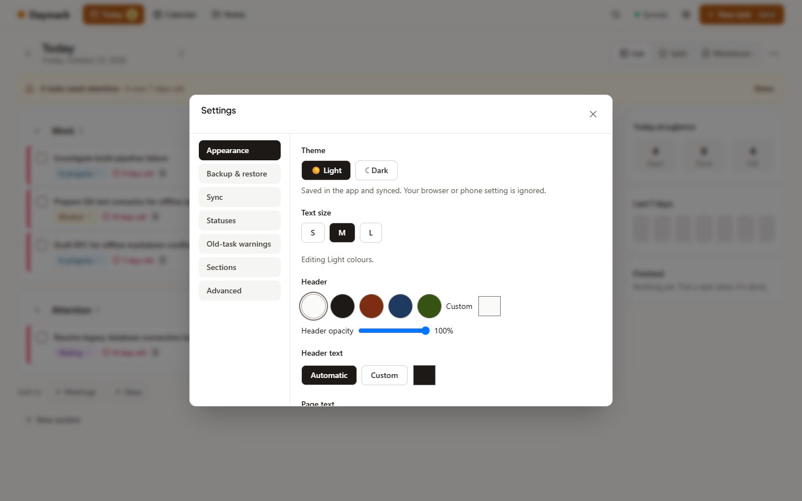 |
| Photo across Today, Light | 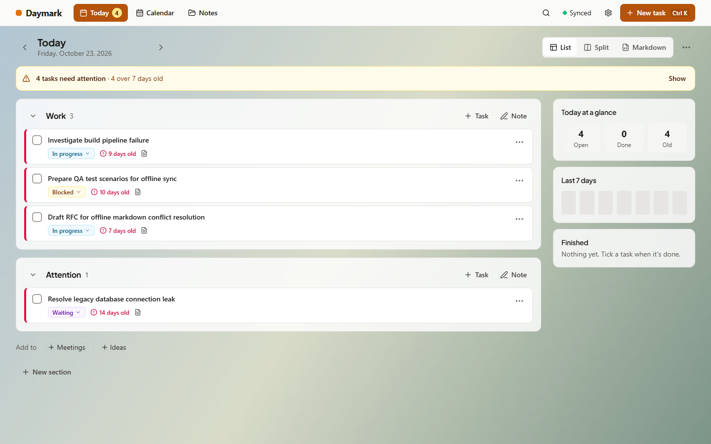 |
| Photo across Today, Dark | 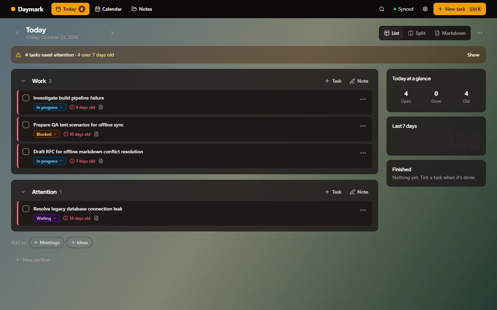 |
| Today at 1920 px | 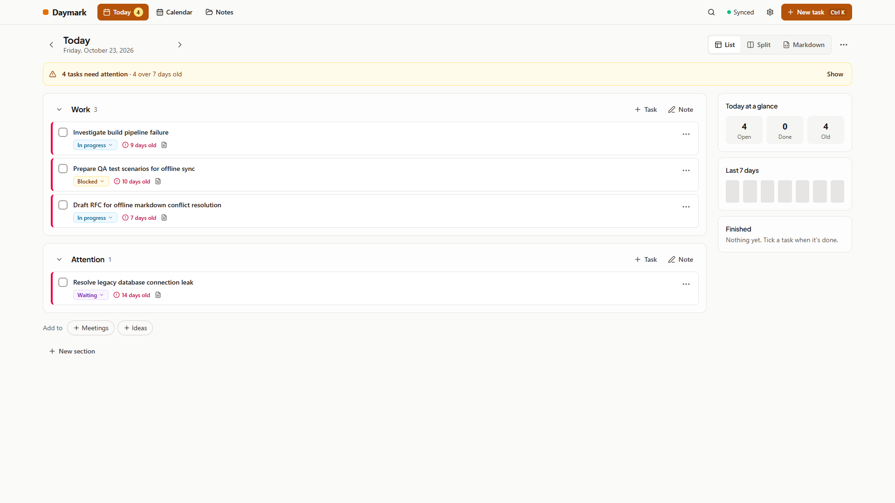 |
| Notes focus mode | 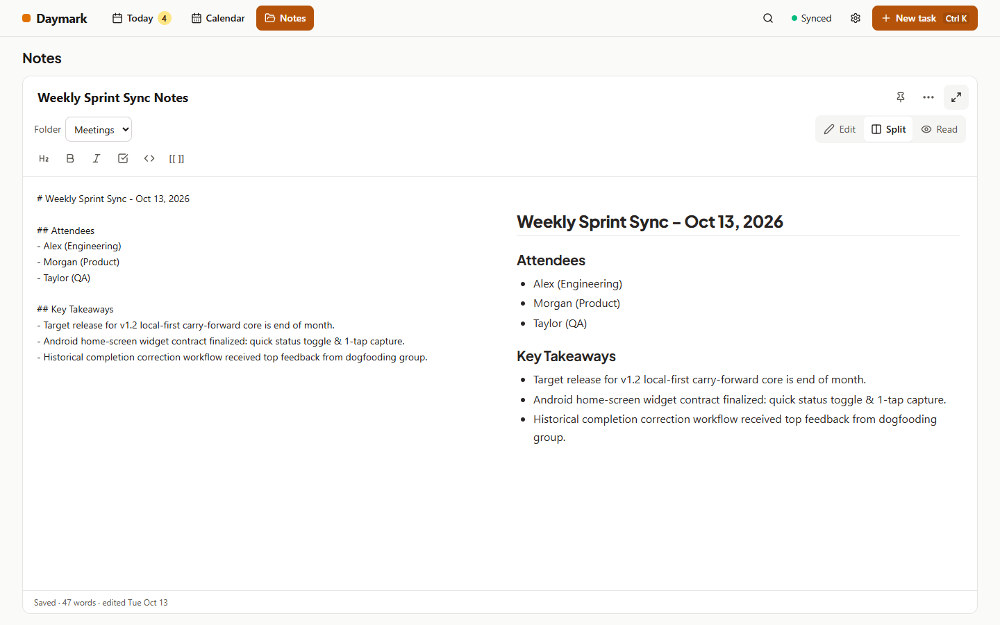 |
| Calendar month | 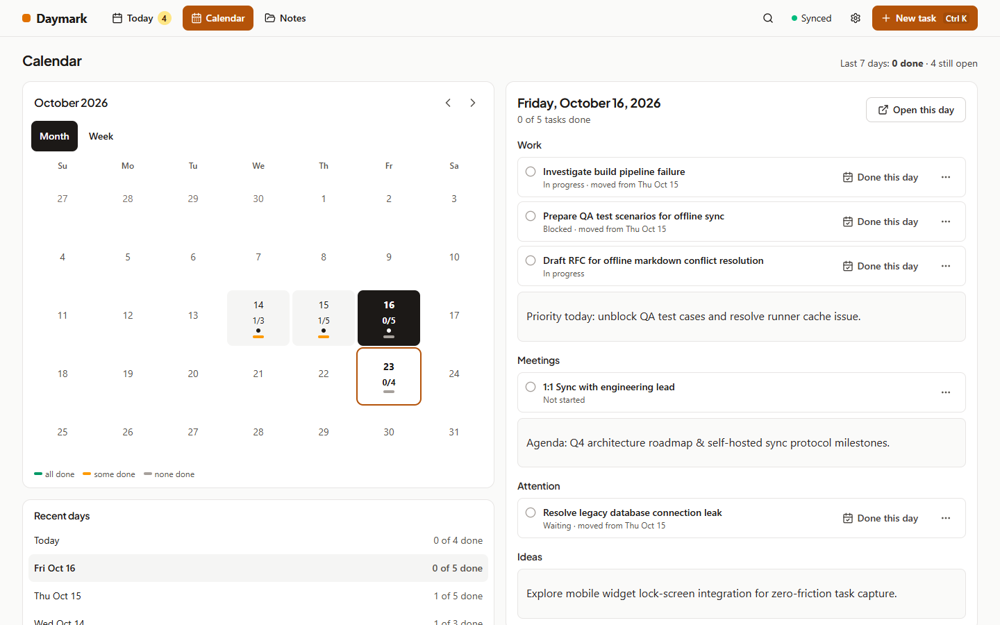 |
| Calendar week | 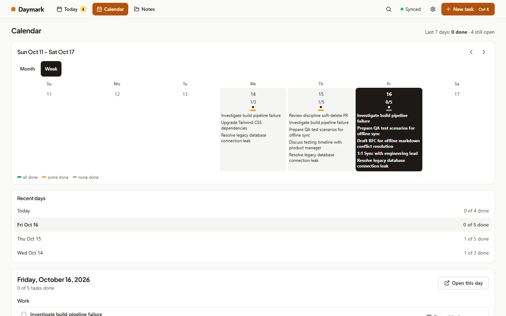 |
| Search | 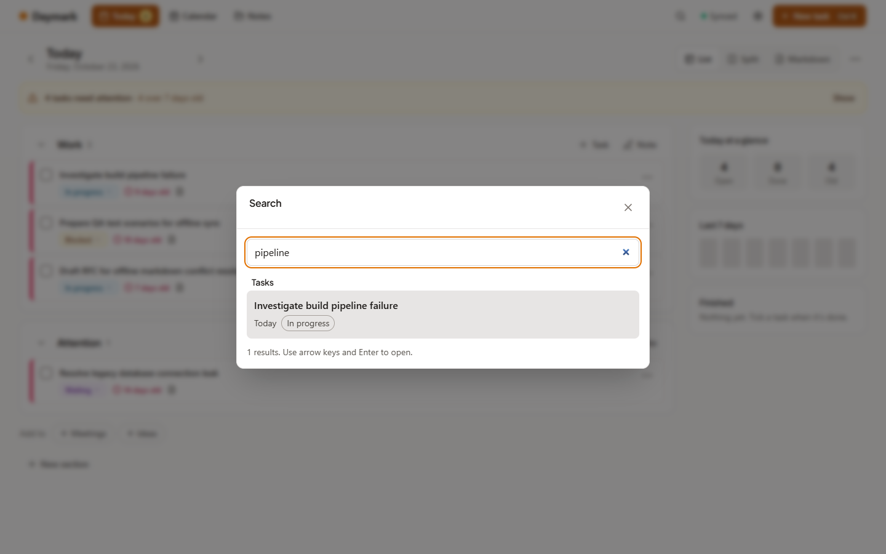 |
| Settings keeps its size | 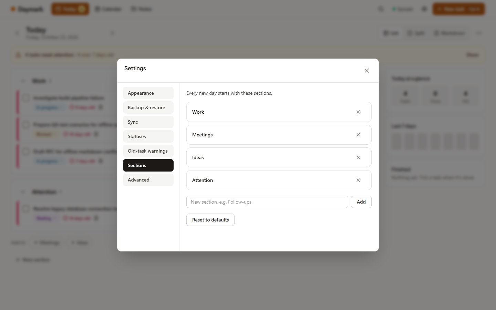 |
| Phone Today with header colour | 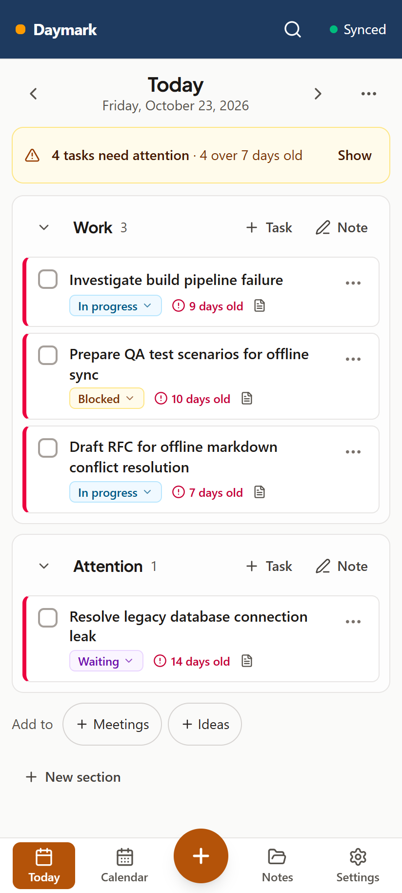 |
| Phone Today with header colour, Dark | 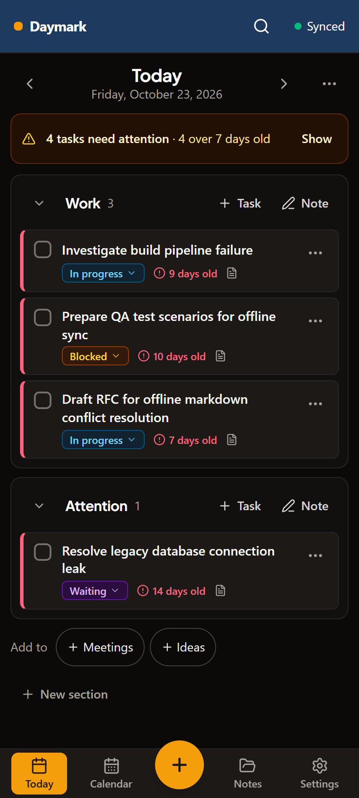 |

## How it was verified

- QA browser checks: 81/81 checks (57 existing + 24 new for cycle 6).
- UX/UI checks: 83/83 (80 existing + 3 new layout checks).
- Offline and installable web app checks: pass.
- Two-device sync and restart checks: pass.
- Unit and server tests: 472 passed, 1 skipped.
- Android: debug APK builds; Kotlin JVM tests 21/21 (WidgetStyleTest 9, WidgetModelTest 11, example 1).

The controller supplied the browser, screenshot and Android results. The UX total includes the deep-link setup fix; the controller will confirm it on the next run. Type checking, the production build and AI configuration validation are recorded in the task report.

## Known limits

- Android widgets cannot blur what is behind them; they support opacity instead.
- Photos are not synced or backed up. Keep the original files if you want them on another device.
- Android 15 and newer may ignore the status-bar colour.
- Widget styles and collapsed sections stay on the device. Note templates are built in; custom templates are not available yet.
