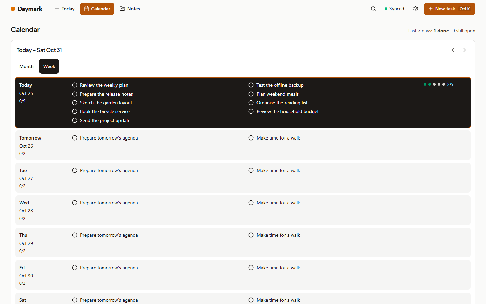
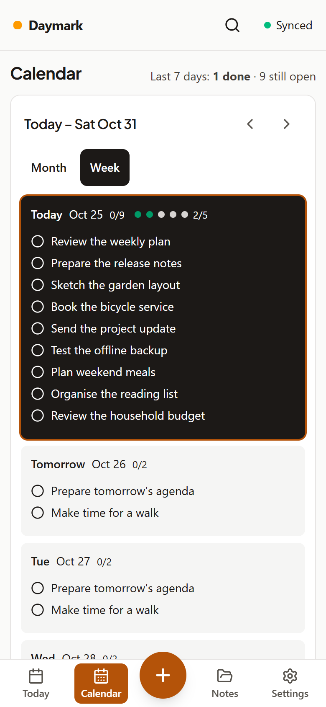
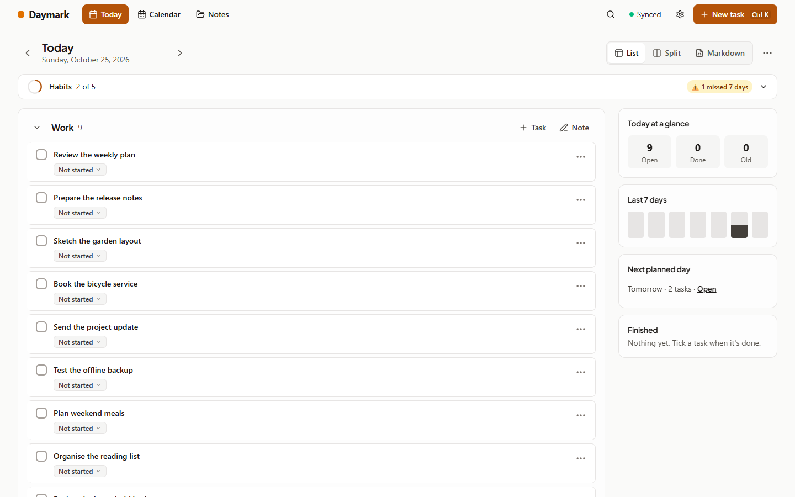
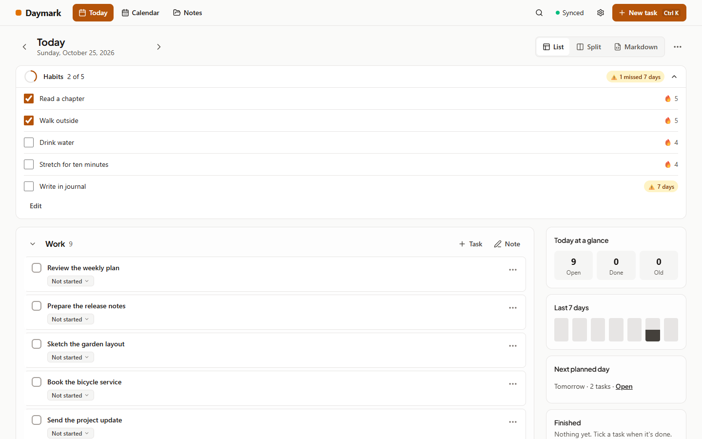
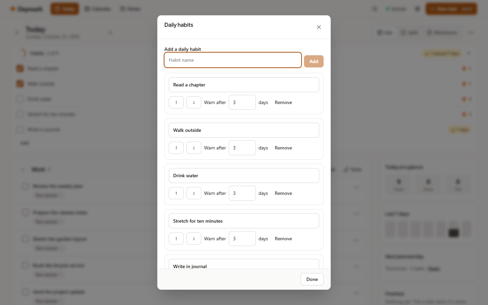
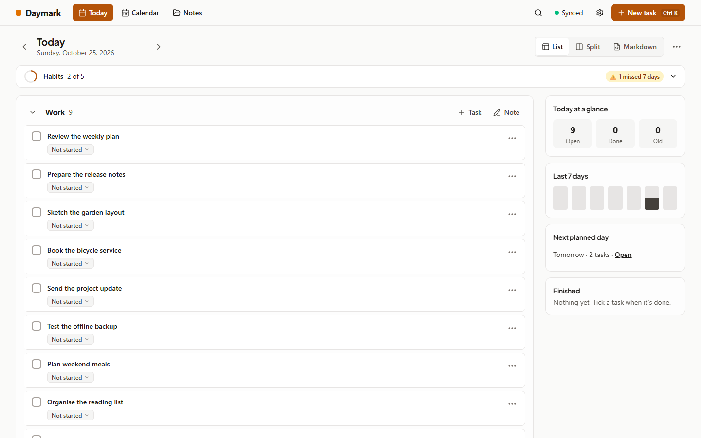
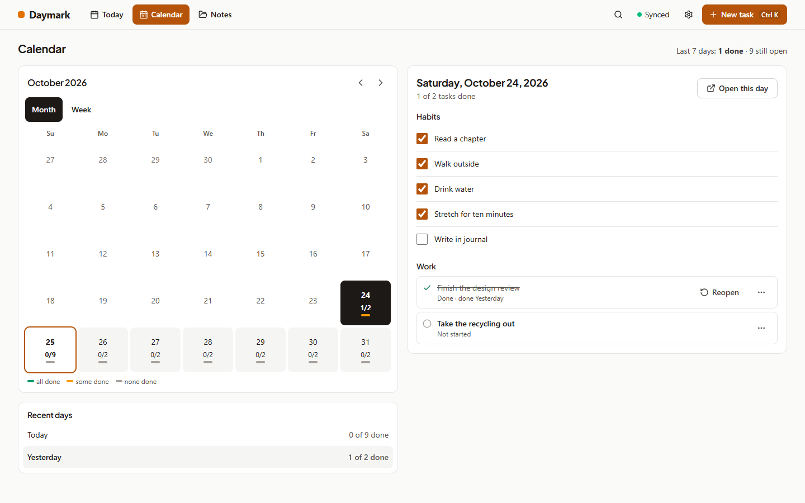

# Cycle 7: readable weeks and daily habits

Date: 2026-10-25

Read the whole week without squeezing tasks into narrow columns, and keep a daily habit list that starts fresh each morning.

## What shipped

**Calendar week**
- Seven full-width day rows, Sunday first, show every task. Long titles wrap and busy days grow to fit.
- Tasks use two columns on desktop and one on phones. Today is highlighted; select a row to see the day’s tasks, notes and habits.
- Move between weeks, open a day to write, or drag a task onto today or a future day on desktop.
- Habit dots show what you ticked on past days and today. Habits do not affect task counts or “Last 7 days”.

**Daily habits**
- Open the Habits bar above Today’s tasks to see your checklist. It starts closed and remembers your choice on this device.
- Add, rename, reorder or remove habits with Edit. Names can be 1–80 characters; duplicate names are allowed. Renaming keeps the history.
- Each day starts unticked. An unticked today keeps yesterday’s streak until the day ends.
- Missed-day warnings start after **3** consecutive missed days before today. Set each habit’s warning from **1 to 365** days. Ticking today clears its warning immediately.
- Tick or untick past days in Calendar’s day details or by opening that day. Future days cannot be ticked.
- Removing a habit stops it appearing from today onward and keeps its past ticks. Adding the same name again starts a new habit.
- Habits are included in ZIP and JSON backups, separate from daily Markdown. They do not roll over, age, appear in search or contribute to task progress.

**Sync and upgrading**
- Habits sync only between devices on **1.4.0 or later**. Older apps do not see them and cannot change them; their existing notes and tasks are unaffected.
- **Update the sync server together with the apps.** An older server cannot sync habits.
- Ticks for different habits or days merge. For the same habit and day, the latest change wins. Removing a habit wins over a concurrent edit.

**Android home-screen widget**
- Add **Daymark Habits** from the launcher’s widget list, alongside the existing task widget.
- See today’s habits, progress, streaks and warnings. Tick today directly on the widget; the change appears there immediately and reaches the notebook when Daymark next opens or resumes.
- Tapping the header opens Today with Habits expanded. With no habits, the widget invites you to add them in Daymark.
- Customize each widget’s appearance or match the app. A Show streaks option controls streak visibility.
- After midnight, yesterday’s ticks are cleared from the display. Pending ticks keep the date they were made on.

## Screenshots

| Screen | Image |
| :--- | :--- |
| Calendar week, desktop |  |
| Calendar week, phone |  |
| Habits closed |  |
| Habits open |  |
| Edit habits |  |
| Missed-day warning |  |
| Calendar day habits |  |

## How it was verified

- Unit and server tests: 607 passed, 1 skipped.
- Screenshot and server-session helper tests: 11 passed, including every weekday and a year boundary.
- Type checking and documentation/configuration validation: pass.
- Production builds, browser checks, Android builds and refreshed week screenshots still need release verification.

## Known limits

- The habits widget is Android-only and needs the app to open or resume before its queued changes sync to other devices.
- The widget displays up to 30 habits, with as many visible as its size allows. “+N more” opens the app.
- Every habit is daily and either done or not done. Schedules, reminders and count targets are not available.
