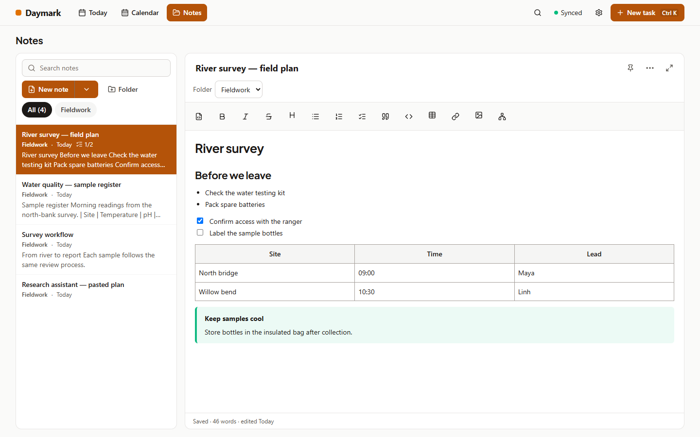
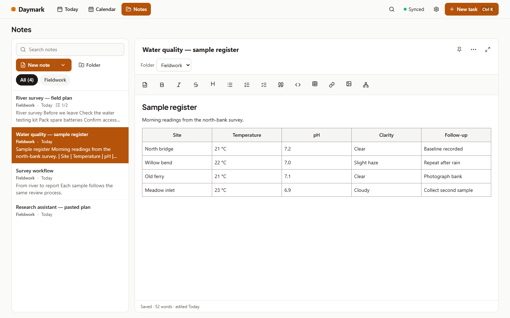
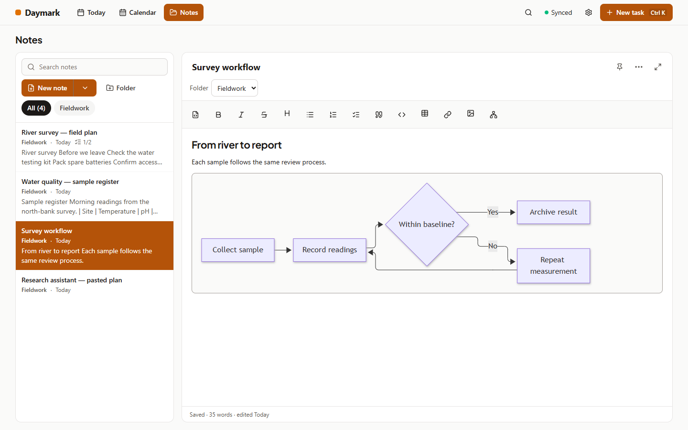
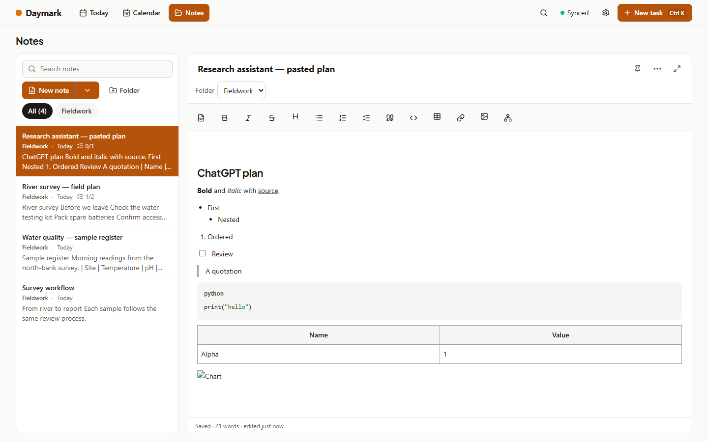
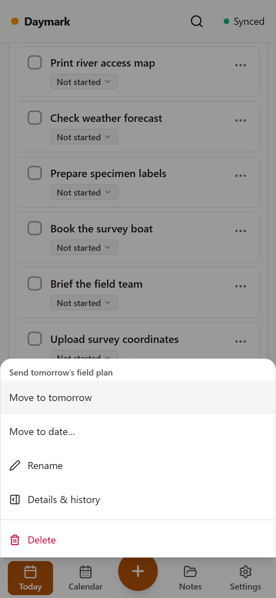
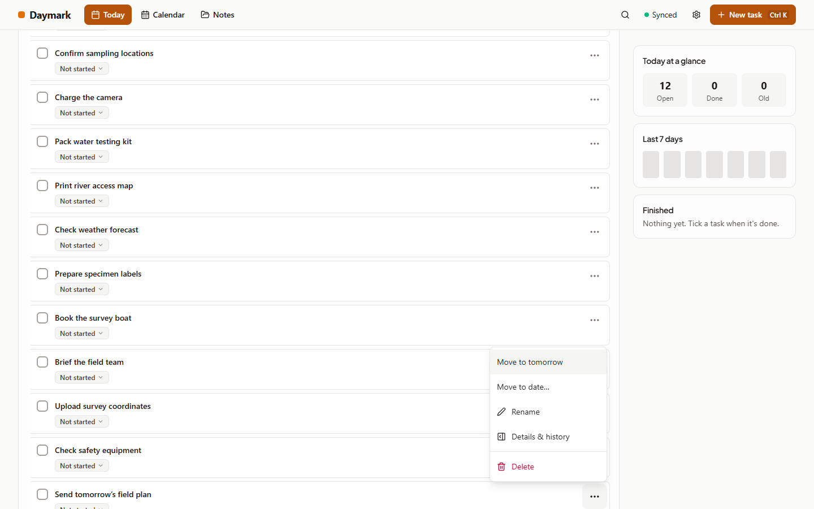

# Cycle 9: menus that fit and richer Notes

Date: 2026-10-25

Write with pictures, tables and diagrams while keeping your notes in Markdown. Open menus anywhere on the screen and reach every action.

## What's new

- **A rich editor for Notes:** headings, bold, italic, lists, checkboxes, quotes, callouts and code with syntax colouring. Insert tables and add or remove rows and columns. Focus mode, templates and word count are still here. Today's section notes stay as they are.
- **Pictures that travel with your notes:** paste a screenshot, drop a file or pick a picture. Saved pictures work offline and sync to your other devices. A picture that has not arrived yet shows “Picture not synced yet” until it downloads.
- **Small pictures:** the longest side is at most **1600 px**, saved as WebP at quality **0.8**, with JPEG as a fallback when WebP encoding is unavailable. Daymark aims for **400 KB** or less and retries at lower quality when needed; the hard limit is **1.5 MB**. Animated GIFs become still pictures. Online `https://` images stay links.
- **Mermaid diagrams:** a Mermaid code block displays as a diagram. Open it to edit the code; errors show the code and an explanation.
- **Paste from AI chats and web pages:** keep headings, lists, tables, links, quotes and code while leaving fonts, colours and page layout behind. Markdown from a copy button works too. Use Ctrl/⌘+Shift+V for plain text. Copying out offers both formatted text and Markdown.
- **`[[links]]` with autocomplete:** type `[[` to find a note, choose with the arrow keys and Enter or Tab, or tap it. You can create a note when there is no match.
- **Markdown whenever you need it:** use the Markdown button to edit the source. Opening a note without editing leaves its Markdown byte-for-byte unchanged. Unsupported content stays in a raw Markdown block; editing may normalise formatting in supported blocks.
- **Backups include saved pictures:** ZIP exports place them in `Notes/_assets/` and rewrite note links to relative paths, ready to open in another Markdown app. JSON backups include pictures too.

| Screen | Image |
| :--- | :--- |
| Rich Notes |  |
| Tables |  |
| Mermaid diagrams |  |
| Pasted content |  |

## Fixed

- On screens below **768 px** wide, menus open as a bottom sheet above the bottom tabs, with large touch targets and room to scroll. Close with Escape, a tap outside, or Android Back.
- From **768 px** wide, menus flip above their button when needed, shift inside the window and scroll if space is tight. Cards and sticky bars no longer cover them. Keyboard navigation and focus return still work.

| Screen | Image |
| :--- | :--- |
| Phone menu |  |
| Desktop menu |  |

## Upgrading

- **Update the sync server first**, then update your apps. Devices on **1.6.0 or later** sync pictures through the updated server.
- Older apps keep syncing notes text and show picture links as text. Update all devices to see saved pictures everywhere.
- Your notes remain Markdown. Back up before upgrading, and include the server's entire data directory, including its `assets/` folder, in server backups.

## Known limits

- There is **no automatic picture cleanup**. Settings shows picture storage usage; use **Remove unused pictures** to remove pictures no note uses. With sync enabled, cleanup checks the synced notes first.
- Online images may stop showing if their link expires. They are not downloaded into your backups.
- The 400 KB picture size is a target, not a guarantee; some pictures remain larger after compression.
- This release is **untested on a real phone**.
