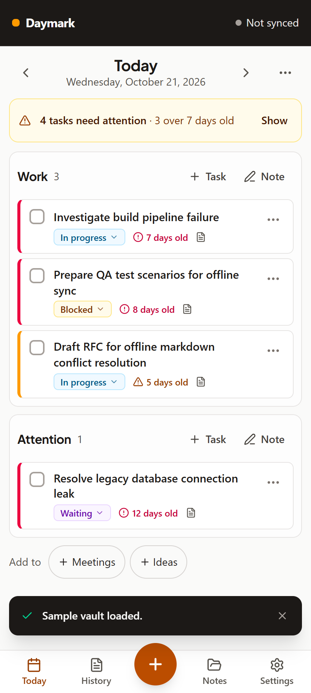
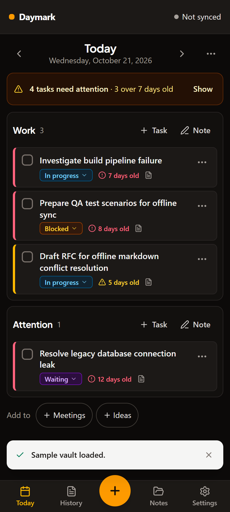
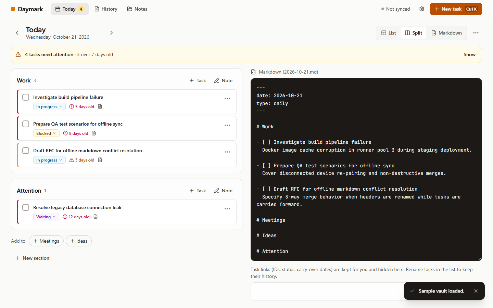
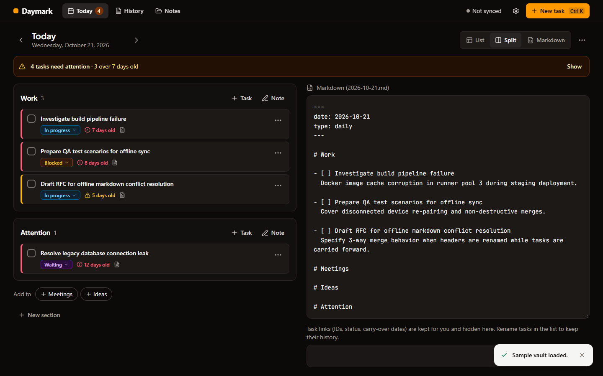

# QA fixes handoff — 2026-10-21

Branch: `qa-fixes-2026-10-21`, based on `cycle-5-ux-redesign`. This is a verified branch handoff; the package remains version 1.1.0. No release tag or deployment was made.

## What changed

All 17 reported bugs now have fixes and regression coverage. See the [QA report](../../reports/qa-e2e/2026-10-21-qa-report.md) for the commit for each bug and the [implementation plan](../../superpowers/plans/2026-10-21-qa-bug-fixes.md) for scope.

Claude completed Tasks 1–10 and 14. This continuation verified the final review fix for Tasks 10/14, completed Tasks 11–13, and performed Task 15:

- Markdown saves preserve section notes, nested headings, checklist notes, and description paragraphs.
- UI and widget checkbox toggles restore the task's prior status and record history. Legacy tasks without history remain usable.
- New Task names the viewed day. Empty legacy section settings recover defaults, and Settings keeps at least one section.
- Pull-only sync omits damaged legacy records while preserving their stored originals for repair. A subsequent valid push repairs them.
- Browser checks wait for offline IndexedDB hydration. The screenshot audit uses current controls and fails when navigation fails.

## Verification

Executed on Windows with Node 22 using `npm.cmd` because PowerShell blocks `npm.ps1`.

| Command | Result |
|---|---|
| `npm run lint` | Exit 0 |
| `npm test` | 133 passed, 1 skipped across 13 files |
| `npm run build` | Exit 0 |
| `npm run validate:ai` | Passed; rerun after this handoff document |
| `npm run test:e2e` | 16/16 passed, including offline reload and capture |
| `npm run test:sync` | 7/7 passed, including two devices and server restart |
| `npm run test:qa` | 42/42 passed, exit 0 |
| `node scripts/ux-audit.mjs qa-fixes` | Exit 0; 34 captures, light/dark, phone/desktop |

The skipped unit test checks Unix owner-only file modes and is intentionally skipped on Windows. Vite reports an existing warning about `__dirname` with its future native config loader. Sandbox runs could not start `tsx` servers (`uv_os_get_passwd`), and restricted network access caused browser console errors; the successful integration and audit runs used approved execution outside the sandbox.

An independent final review found two Important compatibility defects; three tests reproduced them before fixes and pass afterward. No additional review round was performed. Mixed-version clients and native Android hardware were not exercised.

## Screenshots

Every audit capture was inspected in contact sheets; core Today and Markdown screens were also opened individually. The [audit directory](./audit/) includes History, Notes, task details, Settings, and capture screens.

## Data compatibility and remaining work

The task metadata comment format is unchanged. `DailyDocument.removedTaskIds` and `TaskItem.statusBeforeDone` are optional; existing vaults still load. Full-fidelity JSON/ZIP snapshots retain these fields. Markdown-only interchange cannot retain every optional field.

On a newly connected device, server settings win over local defaults. Restoring a backup while synced also keeps server settings on the next sync; this is intentional. Damaged server records are kept on disk but are invisible to clients until a valid copy repairs them.

The original backlog BL-1 through BL-4 remains: domain-level historical-date validation, unused relative-date helper's Tomorrow case, replacement of a previous toast's Undo, and intentional server-settings precedence after backup restore. Simultaneous cross-tab writes can still race. See [review decisions](./review-decisions.md) for the complete inherited rulings and deferred findings.

Merge, push, release tagging, Android builds/device tests, and deployment remain follow-up actions. No model token or usage-window measurements were available for this continuation.
