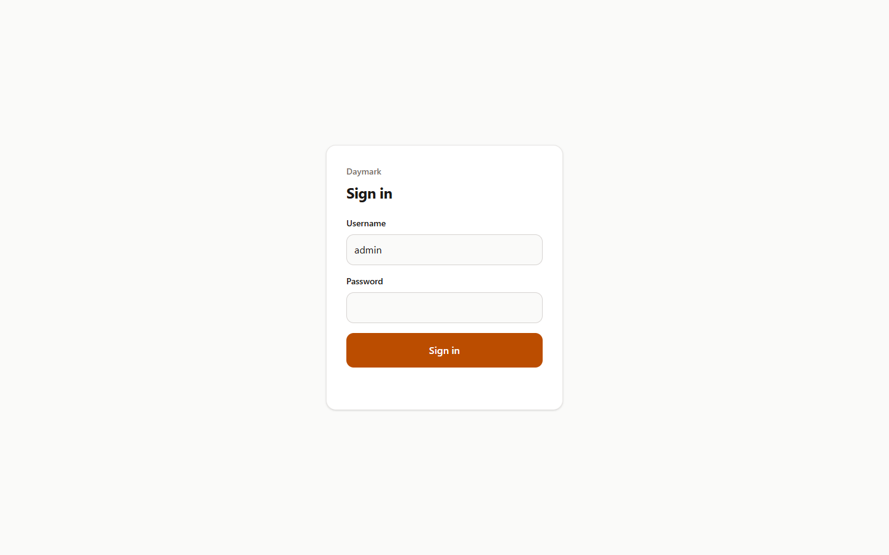
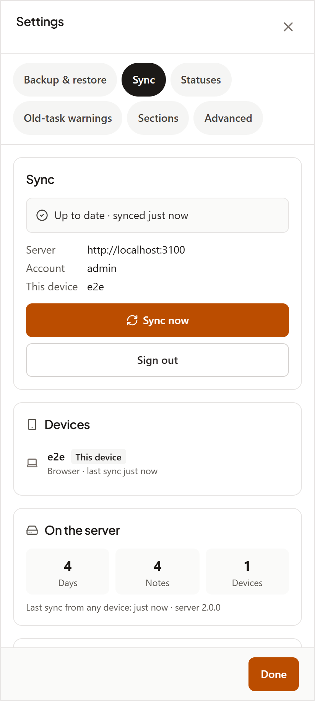
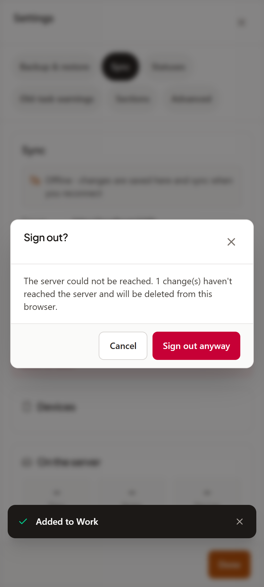

# Server sign-in

Date: 2026-10-22 · Branch: `feat/server-sign-in` · Tag: none

## What shipped

- **Sign in before opening your notebook.** Visit your Daymark server and enter your username and password. The site needs sign-in in development and production. App code files stay public but contain no user data; reading or changing notes needs an access token.
- **Stay signed in on each device.** Access tokens last **15 minutes**. Refresh tokens last **30 days**, renewed on every refresh, so there is no idle lock while you keep using the device. Each refresh replaces the old token. Reusing a retired refresh token signs that device out; a refresh response lost on a bad connection can also mean signing in again. Other devices stay signed in.
- **Sign out clears the browser.** In **Settings → Sync**, the account view shows Server, Account, This device, **Sync now** and **Sign out**. Sign-out tries to sync first, then removes the local vault, sync state and cached app files. If the server cannot be reached or changes are still unsent, **Sign out?** shows how many changes would be lost. **Cancel** keeps your notes here; **Sign out anyway** discards the browser copy.
- **Control signed-in devices.** Changing the password signs out every device, including the one making the change. Remote sign-out also ends that device's session. When a browser next learns its session has ended, its local copy is wiped without an unsent-change confirmation. Android keeps its local notes.
- **Android still works without an account.** The first-run screen, **Welcome to Daymark**, offers **Sign in to sync** alongside **Start fresh** for local use, sample data and restoring a backup. Sign-in opens **Settings → Sync** for the server address, username, password and device name, then **Connect and sync**. You can also connect later; existing local notes merge on first sync. **Disconnect this device** stops syncing and keeps the phone's local copy.
- **Web sync uses its own server.** The server-hosted browser app always syncs with that server, with no local-only choice or server-address field. A signed-in PWA can still edit offline and sync when back online. A web build hosted on another origin is local-only; use **Backup & restore** to move notes.

## Upgrade and self-hosting

### Upgrading

Data already in a browser is kept and merged into the server on first sign-in. Phones need to sign in once more; their local data is kept. To reset the account, stop the server and delete `DATA_DIR/auth.json`, then restart with `DAYMARK_PASSWORD`; recreating the account revokes every existing device session while preserving the server vault.

After upgrading, **every device signs in once more**. The old 90-day tokens no longer work. Replace `DAYMARK_TOKEN_TTL_DAYS` with `DAYMARK_REFRESH_TTL_DAYS` (default **30**). The access-token lifetime stays at **15 minutes**.

Use a positive, finite refresh lifetime or leave it unset. Invalid or ≤ 0 values fall back to 30 days.

**Plain HTTP is for LAN only:** its refresh cookie is not `Secure`. Use HTTPS (e.g. Caddy) on a public address. The server keeps the refresh token in an `HttpOnly`, `SameSite=Strict` cookie; data routes still require a Bearer access token. The account remains the single self-hosted account created on first start from `DAYMARK_USER` (default `admin`) and `DAYMARK_PASSWORD`.

See the [self-hosting instructions](../../../README.md#self-hosting-the-sync-server) and [configuration/API reference](../../../.ai-configs/project/api-and-sync.md).

Behind a reverse proxy in Docker, set e.g. `DAYMARK_TRUST_PROXY=uniquelocal` (default `loopback`) for Secure cookies over forwarded HTTPS and per-client login limits. Trust only your proxy network and bind the upstream port to loopback. For Caddy on the host, replace the default Compose port mapping and proxy to `127.0.0.1:3000`:

```yaml
services:
  daymark:
    ports:
      - "127.0.0.1:3000:3000"
    environment:
      DAYMARK_TRUST_PROXY: uniquelocal
```

## Screenshots

The controller captured these three views with `node scripts/capture-screenshots.mjs server-sign-in` and visually checked all three images.

| Screen | Image |
| :--- | :--- |
| Desktop 1440×900: signed-out sign-in page |  |
| Phone 412×915: Settings → Sync account and Sign out (server web mode) |  |
| Phone 412×915: Sign out? after adding a change while the API is unreachable |  |

The Android first-run screen is described above. It requires the native app and cannot be captured by the browser screenshot script; the phone screenshots show the server web app at an Android viewport size.

## How it was verified

Documentation was checked against the design and the implemented configuration, API, gate, sync hook and account panel. Controller verification completed:

- `npm run test:qa`: 0 failed across 55 checks, including A1–A5.
- `npm run test:e2e` and `npm run test:sync`: passed.
- UX suite: 80/80 passed.
- Android debug build: succeeded.
- Unit tests, `npm run lint` and `npm run validate:ai`: passed.
- All three release screenshots above: captured and visually checked.

`node --check scripts/capture-screenshots.mjs` also passed during the documentation task.

## Known gaps

- Native Android first-run behaviour is described from the current UI code, without a new device capture.
