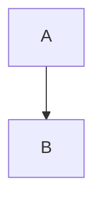

# Heading one
## Heading two
### Heading three
#### Heading four
##### Heading five
###### Heading six

**Bold**, *italic*, ~~strike~~ and `inline code` with [[Another Note]] and #tag.

- First
  - Nested
    1. Numbered

- [ ] Todo
  - [x] Nested done

| Left | Center | Right |
| :--- | :---: | ---: |
| a | b | c |

```typescript
const answer = 42;
```



> Quoted text

> [!NOTE]
> A callout remains readable.

---

[Example](https://example.com)


